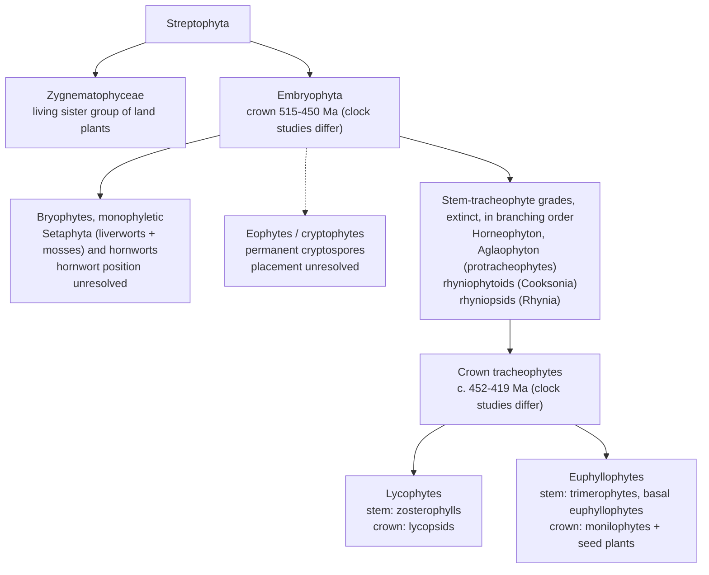

# Primer: early land plants, Late Ordovician to Early Devonian (c. 458–393 Ma)

Shared background for the taxon cards (`taxa/`) and later models. Drafted 2026-10-26 by Claude Sonnet 5.5 (`claude-sonnet-5-5`); not yet reviewed by a human or a second agent. Each substantive claim traces to a source read for this document; "Source access" says which were read in full. Ages are Ma on ICS v2024/12 (`data/timescale.csv`) unless a source's own scale is stated. Tags: (O) observation, (I) interpretation, (S) speculation.

## 1. Timescale

### 1.1 Stage bases

`data/timescale.csv` matches the ICS v2024/12 chart for all 20 stages (checked row by row). The last two columns give the GTS2012-based values printed on ICS charts v2013/01 to v2023/09, which most of the literature uses.

| Stage (series) | Base, Ma (± as printed) | Duration, Myr | Older base, Ma | Shift, Myr |
|---|---|---|---|---|
| Darriwilian (Middle Ordovician) | 469.4 ± 0.9 | 11.2 | 467.3 | +2.1 |
| Sandbian | 458.2 ± 0.7 | 5.4 | 458.4 | −0.2 |
| Katian | 452.8 ± 0.7 | 7.6 | 453.0 | −0.2 |
| Hirnantian | 445.2 ± 0.9 | 2.1 | 445.2 | 0.0 |
| Rhuddanian (Llandovery) | 443.1 ± 0.9 | 2.6 | 443.8 | −0.7 |
| Aeronian | 440.5 ± 1.0 | 1.9 | 440.8 | −0.3 |
| Telychian | 438.6 ± 1.0 | 5.7 | 438.5 | +0.1 |
| Sheinwoodian (Wenlock) | 432.9 ± 1.2 | 2.3 | 433.4 | −0.5 |
| Homerian | 430.6 ± 1.3 | 3.9 | 430.5 | +0.1 |
| Gorstian (Ludlow) | 426.7 ± 1.5 | 1.7 | 427.4 | −0.7 |
| Ludfordian | 425.0 ± 1.5 | 2.3 | 425.6 | −0.6 |
| Pridoli | 422.7 ± 1.6 | 3.1 | 423.0 | −0.3 |
| Lochkovian (Lower Devonian) | 419.62 ± 1.36 | 6.6 | 419.2 | +0.4 |
| Pragian | 413.02 ± 1.91 | 2.4 | 410.8 | +2.2 |
| Emsian | 410.62 ± 1.95 | 17.2 | 407.6 | +3.0 |
| Eifelian (Middle Devonian) | 393.47 ± 0.99 | 5.5 | 393.3 | +0.2 |

Duration is the base minus the next younger base (Eifelian uses the Givetian, 387.95 Ma). The charts state no confidence level for "±". The older values are identical in the v2013/01, v2020/03, v2022/02 and v2023/09 PDFs, except that the Rhuddanian is 443.4 in v2013/01.

### 1.2 Three scales, and a correction to the project brief

Papers before 2024 mostly use Lochkovian 419.2 ± 3.2, Pragian 410.8 ± 2.8, Emsian 407.6 ± 2.6 and Eifelian 393.3 ± 1.2 Ma (GTS2012, printed on ICS charts through v2023/09). The v2024/12 chart replaced them, taking most ages from GTS2020; 63% of Palaeozoic stage ages changed (Cohen et al. 2025).

The v2024/12 Devonian ages are not GTS2020 ages. For the Devonian and Carboniferous bases the chart adopted the Bayesian age–depth model of Harrigan et al. (2022) instead (Cohen et al. 2025). The GTS2020 wall chart (Gradstein et al. 2020; PDF text layer, mapping by printed order, chapter tables not seen) prints different Devonian bases. The Ordovician and Silurian values in `timescale.csv` equal the 15 printed on that chart, so `docs/decisions.md` ("GTS2020 ages") holds for those periods only.

| Base of | GTS2012 / ICS ≤ v2023/09 | GTS2020 chart | ICS v2024/12 (Harrigan et al. 2022) |
|---|---|---|---|
| Lochkovian | 419.2 ± 3.2 | 419.0 | 419.62 ± 1.36 |
| Pragian | 410.8 ± 2.8 | 412.4 | 413.02 ± 1.91 |
| Emsian | 407.6 ± 2.6 | 410.5 | 410.62 ± 1.95 |
| Eifelian | 393.3 ± 1.2 | 394.3 | 393.47 ± 0.99 |

- The Pragian and Emsian bases moved 1.6–2.2 and 2.9–3.0 Myr older. The Emsian lengthens from 14.3 to 17.2 Myr, the Pragian shortens from 3.2 to 2.4 and the Lochkovian from 8.4 to 6.6, so per-stage rates change. The Hirnantian lengthens from 1.4 to 2.1 Myr because the Silurian base moved 0.7 Myr younger (Harper 2023 quotes 1.4).
- Rhynie shows dates and stages decoupling. Parry et al. (2011) dated an andesite at 411.5 ± 1.3 Ma (U–Pb) and, with spores (early but not earliest Pragian to possibly earliest Emsian), argued the Lochkovian–Pragian boundary must be older than 411.5 Ma, older than the 410.8 Ma charted; on v2024/12 the date is Pragian. Edwards et al. (2018) quote 407 Ma, the 40Ar/39Ar age of hydrothermal K-feldspar (407.6 ± 2.2 Ma; Mark et al. 2011). Scotese et al. (2021) date a Pragian Cool Event at 411–406 Ma on ICS v2020/01 ages.

Recommended rules for cards and models: record stage names as the primary datum and convert through `timescale.csv`; note the original age and scale when a paper gives only Ma; keep radiometric ages as measured and re-assign stages on v2024/12; treat Early Devonian stage boundaries as uncertain by about ±2 Myr.

## 2. Palaeogeography

### 2.1 Configuration

- **Ordovician to Silurian (O).** The Iapetus Ocean was over 4,000 km wide at 487 Ma and about 1,200 km (eastern Avalonia–Laurentia) or 500 km (Ganderia–Laurentia) by 444 Ma. Avalonia rifted from Gondwana at about 490 Ma, opening the Rheic Ocean (over 3,500 km wide between South America and Laurentia by 444 Ma, about 7,000 km by the Early Silurian); Avalonia and Baltica merged obliquely near 444 Ma (Cocks & Torsvik 2021). From the mid-Silurian they collided with Laurentia (Caledonian orogeny, 430–420 Ma; Cocks & Torsvik 2011), forming Laurussia.
- **Latitudes.** Laurentia was equatorial throughout (Cocks & Torsvik 2011). Baltica moved from a high southern latitude to near the equator, and the Ordovician South Pole lay beneath northern Africa (Cocks & Torsvik 2021). Hirnantian ice covered about 50% of Gondwana to about 35° S (Scotese et al. 2021); small ice caps persisted in Brazil into the early Llandovery (Cocks & Torsvik 2021).
- **Asia and land area.** Siberia drifted north; the Kazakh terranes lay near the sector of Gondwana that stretched north over the equator; the positions of South China, North China, Tarim and Annamia are disputed. The fraction of land in the tropics (I, model-dependent) was 45–46% at 460–440 Ma and about 30% by the Early Devonian (all Cocks & Torsvik 2021).
- No reliable global full-plate model exists before 410 Ma (Cocks & Torsvik 2021); carry Ordovician and Silurian palaeolatitudes as ranges.

### 2.2 Where the records come from

| Region | Spore records | Reference |
|---|---|---|
| Gondwana, east (Argentina) | Dapingian cryptospores | Rubinstein et al. (2010) |
| Gondwana, west (Saudi Arabia, Czech Republic, Oman) | Late Darriwilian cryptospores (Saudi Arabia, Czech Republic); Katian trilete and hilate spores (Saudi Arabia); Ordovician spore-filled sporangial fragments (Oman) | Rubinstein et al. (2010); Steemans et al. (2009); Wellman et al. (2003) |
| Baltica (Sweden) | Darriwilian cryptospores; Sandbian trilete spores, the oldest known | Rubinstein & Vajda (2019) |

Megafossil floras are in §6.2: peri-Gondwana (Barrandian), Laurussia (Welsh Borderland, Tipperary, Bathurst Island, Gaspé, Rhynie, at about 28° S; Edwards et al. 2018), eastern Gondwana (Victoria) and South China (low latitude, isolated; Xue et al. 2018).

Interpretations conflict. Steemans et al. (2009, 2010) place the origin of the vascular lineage in Gondwana, with colonisation of Avalonia, then Laurentia and Baltica when the plates were close (Ashgill to Llandovery), and of South America only after the Gondwanan ice sheet collapsed. Rubinstein & Vajda (2019) propose Baltica as a possible centre of radiation. Lochkovian floras of Laurussia and western Gondwana are dominated by isotomously branched plants with terminal sporangia, whereas South China is zosterophyll-dominated, read by Xue (2012) as phytogeographic isolation. An Aeronian–Telychian transgression is argued to have destroyed the biotopes of the earliest vegetation (Steemans et al. 2010).

## 3. Climate and atmosphere

### 3.1 Temperature and ice

- **Hirnantian.** Clumped isotopes give tropical sea-surface temperatures of 32–37 °C through the Late Ordovician to Early Silurian, with about 5 °C of cooling in the Hirnantian and ice volume at or above the Pleistocene maximum (Finnegan et al. 2011). Conodont δ18O gives tropical cooling to 28 ± 2 °C between 454 and 446 Ma (Cocks & Torsvik 2021). A coupled model puts ice-sheet onset as early as the Darriwilian (Pohl et al. 2016). Ghienne et al. (2014) find three glacial cycles. New radioisotope dates limit the glacial maximum to about 0.2 Myr (Harper 2023).
- **Absolute temperatures disagree (O vs I).** Grossman & Joachimski (2022) compile 22,332 carbonate and 4,615 phosphate δ18O analyses: low-latitude shallow-water means fall from 42.0 ± 3.1 °C (Early–Middle Ordovician) to 35.6 ± 2.4 °C (Late Ordovician–Devonian). Scotese et al. (2021) combine isotopes with lithological indicators, reject the extreme early Palaeozoic isotopic values, and model tropical temperatures mostly at 25–32 °C: roughly 4–10 °C lower for the Late Ordovician to Devonian (my comparison; "tropical" is defined differently).
- **Silurian.** Conodont δ18O shows warming to the early–mid Telychian, cooling from the late Llandovery into the early Wenlock and again in the late Wenlock (each about +2‰ over about 1.5 Myr), and sharp swings in the mid-Ludlow around the Lau event (Trotter et al. 2016). Scotese et al. (2021) describe a warm interval from the early Ludlow to the early Lochkovian.
- **Early Devonian.** About 30 °C in the Lochkovian, cooling from the Pragian, 23–25 °C in the Middle Devonian (Joachimski et al. 2009). Scotese et al. (2021) describe a Pragian Cool Event with a sea-level fall of about 100 m ending the Tippecanoe sequence, and an Early–Middle Devonian cool interval at a global mean of 18.7 °C.

### 3.2 CO2

| Source and method | Interval | CO2 |
|---|---|---|
| Foster et al. (2017), 1,241 estimates, five proxies | last 420 Myr | maximum about 2,000 ppm in the Devonian; few observations and proxy types early |
| Franks et al. (2014), leaf gas exchange | Devonian to present | below 1,000 ppm for most of it; argues against 2,000–3,000 ppm swings after the Devonian |
| Witkowski et al. (2018), phytane δ13C | Late Ordovician; Devonian | about 450 rising to 700 µatm (460–440 Ma); about 1,400 µatm in the Devonian |
| Nardin et al. (2011), GEOCLIM model | Furongian to Early Devonian | about 5,600 to 2,800 ppmv (Llandovery), rising again in the Early Devonian |
| Lenton et al. (2016), COPSE variant | 445 Ma | 8 × present level (about 2,200 ppm if PAL = 278 ppm; my conversion) |

The Silurian is data-scarce for CO2 proxies (Witkowski et al. 2018) and the compilation of Foster et al. (2017) starts at 420 Ma. A prior of 1,000–3,000 ppm for the Silurian–Early Devonian is a judgement (S), not a result.

### 3.3 O2

- Early Palaeozoic O2 is unresolved. GEOCARBSULF predicts near-present levels against redox proxies implying less than half present; the rebuilt GEOCARBSULFOR gives 2–11% of the atmosphere from the Cambrian to mid-Ordovician, near-modern levels in the Devonian, and a nadir of about 14.5% across the Emsian–Eifelian boundary (Krause et al. 2018).
- Charcoal first appears in the basal Pridoli of the Welsh Borders (Glasspool et al. 2004) and constrains O2 to a 13–35% "fire window", with scarcity in the Middle–Late Devonian (Scott & Glasspool 2006). Lenton et al. (2016) read the 420–400 Ma charcoal as O2 above 15–17%; Krause et al. (2018) cite about 15% for smouldering and 19% for probable combustion.
- Molybdenum isotopes and I/Ca ratios indicate oxygenation about 400 Ma (Dahl et al. 2010; Lu et al. 2018); Lu et al. find the upper ocean not resiliently oxygenated until about 200 Ma.

### 3.4 Sea level

Eustatic sea level reached a Late Ordovician zenith, fell in the Hirnantian (about 100 m; Harper 2023), was high in the mid-Silurian and low in the Early Devonian; events range from tens of metres to about 125 m, with amplitude the least certain quantity (Haq & Schutter 2008). Early Silurian melting drove transgressions to the end of the Llandovery (Cocks & Torsvik 2021). Sea level sets both the land available to plants and the non-marine rock that preserves them (Kenrick et al. 2012).

## 4. Events, and the hypotheses linking them to plants

### 4.1 Events

| Event | Interval | Observations (O) | Proposed drivers (I, S) |
|---|---|---|---|
| Late Ordovician mass extinction | Hirnantian, 445.2–443.1 Ma | two pulses, at the base and middle of the Hirnantian; about 75% (Harper 2023) to 85% (Bond & Grasby 2020) of marine species lost; sea level −100 m; cooling ≥ 5 °C | glaciation then deglaciation, warming and anoxia (Harper 2023); volcanic warming and anoxia for both pulses (Bond & Grasby 2020); first extinction tied to early melting (Ghienne et al. 2014) |
| Ireviken | earliest Wenlock, about 431–432 Ma | δ13Ccarb excursion of about 4.5‰ (Rose et al. 2019); conodont and other turnover (Jeppsson et al. 1995) | oceanic primo–secundo cycles (Jeppsson et al. 1995); cooling (Trotter et al. 2016); Rose et al. argue the Gotland pattern is partly local deposition and diagenesis |
| Mulde | late Wenlock (Homerian) | separates two secundo episodes (Jeppsson et al. 1995) | as above |
| Lau | Ludfordian | δ13C up to about 8‰ in the Prague Basin, with gaps linked to sea-level fall (Lehnert et al. 2007); a Ludlow oceanic event (Jeppsson & Aldridge 2000) | as above |

Plants (O): land plants appear largely unaffected by the end-Ordovician extinction (Servais et al. 2019), and cryptospore producers survived the Hirnantian glaciation (Steemans et al. 2010). In the Prague Basin trilete-spore producers expanded almost exponentially from the Wenlock but lost species during glacial cooling, while cryptospore producers stagnated (Pšenička et al. 2021); among the sources read, this is the only test of plant turnover against the Silurian events. Euphyllophytes are unequivocal from the Pragian and trees over 8 m appear by the Givetian (Kenrick et al. 2012); sampling-corrected richness rises in the Pragian and Givetian (Capel et al. 2022).

### 4.2 Hypotheses

| Hypothesis | Claim | Support | Critique and alternatives |
|---|---|---|---|
| Lenton et al. (2012), "First plants cooled the Ordovician" | spreading non-vascular plants accelerated silicate weathering and drew down CO2 enough to start ice-sheet growth | Porada et al. (2016): potential weathering flux of 2.8 km³ rock yr⁻¹, about three times the modern chemical flux, strongly CO2-sensitive (model) | Quirk et al. (2015): liverworts with mycorrhizal fungi raise Ca weathering 3–7× and phosphate 9–13× in experiments, but shallow rooting (0.1 m) makes the total effect at least 10× smaller than trees. Edwards et al. (2015): limited weathering depth, minor CO2 drawdown. Tectonic alternatives: Taconic tropical weathering (Swanson-Hysell & Macdonald 2017); fresh volcanic rock and motion through the intertropical convergence zone (Nardin et al. 2011); a 35% fall in arc activity from 480 Ma (Cocks & Torsvik 2021). Ice onset may predate the cooling (Pohl et al. 2016). If crown embryophytes date from 457–450 Ma (Hooper et al. 2026, untested), models starting non-vascular diversification at 470 Ma need revisiting, though stem-lineage plants could be older |
| Lenton et al. (2016), "Earliest land plants created modern levels of atmospheric oxygen" | cryptogamic cover reached about 30% of modern productivity by about 445 Ma; high C:P (about 2,000 against about 100 for marine biomass) and selective P weathering raised O2 to present levels by 420–400 Ma | charcoal; Mo and I/Ca proxies; Krause et al. (2018) independently find a stepwise Palaeozoic oxygenation coincident with vascular plants | selective P weathering rests on experiments with living mosses and liverworts (about 24-fold amplification, range 15–43) extrapolated to the Palaeozoic, and depends on unmeasured biomass P; C:P is 800–4,300 in living bryophytes; the model misses the Late Ordovician sulphur-isotope rise (all Lenton et al. 2016). Covers that bury little organic carbon add little O2 (Edwards et al. 2015); earlier productivity estimates were about 5% and 7% of modern (Lenton et al. 2016) |

Algeo & Scheckler (1998) extend the argument to the Devonian: trees and seeds intensified weathering, causing eutrophication, anoxia and CO2 drawdown. This lies outside the window but depends on rooting, which arose piecemeal and independently in several clades through the Devonian (Kenrick & Strullu-Derrien 2014); the Rhynie lycopsid *Asteroxylon* had rooting axes without root caps (Hetherington & Dolan 2018). Dahl & Arens (2020) review these links and conclude that the effect of each ecological stage is still debated.

## 5. Phylogenetic backbone

### 5.1 Living plants

- **Sister group (O).** Zygnematophyceae are sister to land plants in phylotranscriptomic analyses (Wickett et al. 2014; One Thousand Plant Transcriptomes Initiative 2019; Puttick et al. 2018), although internal branches among streptophyte algae are short, a true radiation cannot be rejected, and a Coleochaetales–Zygnematophyceae clade has similar quartet support (One Thousand Plant Transcriptomes Initiative 2019).
- **Bryophytes.** Monophyly is the best-supported hypothesis (Puttick et al. 2018; Harris et al. 2020; One Thousand Plant Transcriptomes Initiative 2019; Su et al. 2021). Puttick et al. reject all but three rooted hypotheses, which differ only in the position of hornworts; Setaphyta (liverworts plus mosses) as sister to the rest is favoured, with weak support for hornworts. Harris et al. (2022) place the root between bryophytes and tracheophytes by three independent methods.
- **Consequence (I).** The last common ancestor of living land plants was more complex than liverwort-first trees implied, and bryophytes lost genes for vasculature and stomata (Puttick et al. 2018; Harris et al. 2020, 2022; Donoghue et al. 2021). Fossils read as "bryophyte-like" need re-evaluation.
- **Tracheophytes.** Lycophytes are sister to euphyllophytes (One Thousand Plant Transcriptomes Initiative 2019).

### 5.2 Fossil grades

| Grade | Observations | Examples | First record | Placement and dispute |
|---|---|---|---|---|
| Cryptospore plants (cryptophytes, eophytes) | millimetre-scale; forking striated axes, rare stomata; valvate sporangia with permanent dyads or tetrads; conducting cells like bryophyte leptoids; probably poikilohydric | *Partitatheca*, *Lenticulatheca* | spores Dapingian (Rubinstein et al. 2010); parent plants Pridoli–Lochkovian; Ordovician Oman fragments with liverwort-like spore walls | stem-embryophyte, stem-tracheophyte or bryophyte-like, unresolved (Edwards et al. 2014); Eophytidae (Edwards et al. 2022); stem-tracheophytes in Clark et al. (2023); Hooper et al. (2026) run both placements |
| Rhyniophytoids | naked dichotomous axes, terminal sporangia, trilete spores; conducting tissue rarely preserved | *Cooksonia* | Sheinwoodian, about 432 Ma (Libertín et al. 2018) | *C. pertoni* held among the earliest eutracheophytes (Gonez & Gerrienne 2010); some *Cooksonia* produce monads from dyads (Edwards et al. 2014); a grade, not a clade |
| Protracheophytes | Rhynie axes with terminal sporangia; *Aglaophyton* strand without wall thickenings, like moss hydroids and leptoids (Edwards 1986); arbuscular endophytes (Remy et al. 1994; Strullu-Derrien et al. 2014) | *Aglaophyton*, *Horneophyton* | Pragian–Emsian (Rhynie) | conventionally between bryophytes and tracheophytes; Cascales-Miñana et al. (2019) find annular or spiral thickenings in *Horneophyton* tracheids and place horneophytes as sister to eutracheophytes |
| Rhyniopsids | terete xylem strand with tracheid thickenings | *Rhynia*, *Eddianna* (Gaspé; Pfeiler & Tomescu 2018) | Pragian–Emsian | stem-tracheophytes |
| Zosterophylls | lateral stalked sporangia; K-branching in some (Xue 2012) | *Zosterophyllum*, *Ramoferis* (Hao & Xue 2011) | Ludfordian, Arctic Canada (Kotyk et al. 2002); Lochkovian, Yunnan | stem-lycophytes (Clark et al. 2023). *Z. shengfengense* has the oldest known rooting system: a rhizome with root-like axes about 20 mm long, root : shoot 0.028 (Hao et al. 2010) |
| Lycopsids | *Asteroxylon* rooting axes lack root caps (Hetherington & Dolan 2018) | *Baragwanathia*, *Asteroxylon* | Gorstian on graptolites (Rickards 2000), contested: brachiopods place the Yea beds mostly in the Early Devonian (Earp 2024); Pridoli in Bohemia (*B. brevifolioides*) | crown lycophytes at 431–411 Ma (Harris et al. 2022) |
| Trimerophytes, basal euphyllophytes | *Wilhowia*: helical branching, paired fusiform sporangia with trilete spores, three-ribbed actinostele (Gensel 2022); secondary xylem in two plants of 407–397 Ma (Gerrienne et al. 2011) | *Wilhowia* (Gaspé, basal Emsian) | Pragian (Kenrick et al. 2012) | crown euphyllophytes at 432–414 Ma (Harris et al. 2022); the wood may precede lignophytes (Gerrienne et al. 2011) |

The cladistic framework of Kenrick & Crane (1997), which still holds when fossils are added (Wellman 2014), underlies this arrangement. Most Silurian and Early Devonian fossils are stem tracheophytes (Puttick et al. 2018), and Silurian assemblages hold primitive vascular plants but no clear bryophytes (Wellman 2014).

Dotted line: eophyte placement is contested (stem-embryophyte, stem-tracheophyte or near bryophytes). Cascales-Miñana et al. (2019) would move *Horneophyton* from the stem grades to the line next to the crown.

### 5.3 Molecular clocks against the record

| Source | Crown Embryophyta | Crown Tracheophyta | Notes |
|---|---|---|---|
| Morris et al. (2018) | 515.2–473.5 Ma (95% HPD across seven topologies); 583.1–470.0 across all dating strategies | 450.8–419.3 Ma across topologies; means near 444 Ma with uniform priors | 37 calibrations; soft maximum 515.5 Ma from Cambrian cryptospores; fossil minimum for crown tracheophytes 420.7 Ma |
| Harris et al. (2022) | 515–493 Ma | 452–447 Ma | 68 calibrations plus a horizontal-gene-transfer constraint; relaxing all maxima gives Ediacaran (597–540 Ma), not Neoproterozoic, ages |
| Hooper et al. (2026), published 22 Oct 2026, not yet tested by others | 457–450 Ma | 432–428 Ma (crown bryophytes 445–429 Ma) | same molecular dataset as Harris et al., recalibrated fossils (below) |
| Su et al. (2021) | 980–682 Ma | | maxima relaxed; older ages partly reflect different fossil assignments (Harris et al. 2022) |
| Fossils | cryptospores: Cambrian (affinity unclear; Morris et al. 2018), Tremadocian about 480 Ma (Strother & Foster 2021), Dapingian (Rubinstein et al. 2010) | trilete spores: Sandbian (Rubinstein & Vajda 2019), Katian (Steemans et al. 2009); megafossils from the Sheinwoodian; *Baragwanathia* Gorstian (contested; Earp 2024) | |

The lag is about 40 Myr from the oldest cryptospores accepted as embryophytic (Dapingian) to the oldest megafossil (Sheinwoodian). Clock estimates for crown embryophytes of 515–470 Ma (Morris et al. 2018; Harris et al. 2022) precede that fossil by 40–80 Myr. Three readings compete.

1. (I) The clocks are right and the record is truncated by facies: continental rocks are scarce before the late Silurian, spores are less facies-dependent but carry no bodies, and bryophytes preserve poorly (Kenrick et al. 2012; Morris et al. 2018; Donoghue et al. 2021).
2. (I/S) The embryophyte body plan was assembled gradually from the Ediacaran–Cambrian to the mid-Silurian, so clock ages date a developmental toolkit rather than plants that would leave spores (Strother & Foster 2021).
3. (I; new, untested) The calibrations are wrong. Hooper et al. (2026) reconstruct 27 spore characters across 27 living and 11 fossil genera (four methods, three timetrees, eophytes as stem-embryophytes or stem-tracheophytes). The ancestral embryophyte made unenveloped trilete monads from tetrahedral tetrads, with a three-layered sporoderm and monoplastidic meiosis. Trilete spores therefore mark total-group embryophytes, not vascular plants, and cryptospores cannot calibrate the crown. Their constraints: crown-Embryophyta at most 459.1 Ma (oldest possible trilete spores, Dalby Limestone, central Sweden) and at least 426.9 Ma (*Cooksonia* cf. *pertoni*); crown-Tracheophyta 431.2–420.7 Ma (to a Ludlow *Zosterophyllum*, Bathurst Island). The crown-embryophyte mean is 55 Myr younger than in Harris et al. (2022), and the gap to the oldest unequivocal land-plant fossils shrinks to as little as 19 Myr.

Morris et al. (2018) set the maximum from Cambrian cryptospores (515.5 Ma); Hooper et al. set it from the first trilete spores (459.1 Ma). Both are fossil-absence arguments, the kind Hedges et al. (2018) and Su et al. (2021) reject (my inference). The trilete result holds across all models and timetrees, but Hooper et al. note that eophyte position has not been tested cladistically, that the all-rates-different model (apparently driven by *Partitatheca*, with enveloped dyads) reconstructs an enveloped ancestral spore, and that no accuracy ranking of ancestral-state methods is agreed. Until others test it, treat 457–450 Ma as one end of a range (515–450 Ma), not a replacement. Stem-lineage plants could be older, and many crown traits arose along stems.

## 6. The nature of the record

### 6.1 Spores, mesofossils and megafossils

- **Dispersed spores (O).** Cryptospore assemblages are near-identical from the Middle Ordovician to the Early Silurian, a stasis of about 30 Myr (Steemans et al. 2009), 35–45 Myr (Rubinstein et al. 2010), about 40 Myr (Wellman & Gray 2000) or 60 Myr (Edwards et al. 2022), depending on records and scale. Cryptospores decline and trilete spores become abundant in the late Llandovery (Wellman & Gray 2000) or from the Wenlock (Pšenička et al. 2021). Parent plants are known mainly from minute Pridoli–Lochkovian fossils (Morris et al. 2018; Edwards et al. 2014).
- **How spore types are read (I).** The traditional reading treats cryptospores as products of bryophyte-grade plants and trilete spores as a mark of the vascular lineage, so the Early Silurian turnover records the rise of tracheophytes (Steemans et al. 2009; Wellman & Gray 2000). Hooper et al. (2026) reverse the second step: trilete spores were already produced by the ancestral embryophyte, so their first appearance bounds the embryophyte crown and cryptospore plants are not crown calibrations. The turnover would then be a change among descendants of a trilete-producing ancestor (my inference). This is one untested reconstruction, and it does not show which plants made the Ordovician cryptospores.
- **Mesofossils.** The Welsh Borderland and South Wales yield Gorstian–Pragian assemblages whose Pridoli–Lochkovian coalified fragments, interpreted as wildfire products, preserve anatomy and in situ spores (Edwards & Richardson 2004; Glasspool et al. 2004). The plants are allochthonous, in fluvial sediments, so habitats are uncertain; interfluves with calcretes are proposed as refuges for cryptospore producers (hypothesis; Edwards & Richardson 2004).
- **Megafossils.** About a dozen pre-Devonian assemblages (Wellman & Gray 2000), or 24 Silurian localities worldwide (Wellman 2014).

### 6.2 Principal deposits

| Deposit | Age | Content and use | Limits |
|---|---|---|---|
| Rhynie chert, Scotland (Laurussia) | U–Pb 411.5 ± 1.3 Ma (Parry et al. 2011); 40Ar/39Ar 407.6 ± 2.2 Ma; spores middle Pragian to early Emsian (Edwards et al. 2018) | in situ permineralisation in hot-spring sinter at about 28° S; *Rhynia*, *Aglaophyton*, *Horneophyton*, *Nothia*, *Asteroxylon*; fungi, arthropods, microbes (Strullu-Derrien et al. 2019) | one site and habitat; radiometric ages differ by about 4 Myr |
| Xitun and Posongchong formations, Yunnan (South China) | Lochkovian; Pragian | zosterophyll floras, including *Ramoferis* (Hao & Xue 2011) and the oldest rooting system (Xue 2012; Hao et al. 2010) | isolated region (Xue et al. 2018) |
| *Baragwanathia* flora, Victoria (eastern Gondwana) | Gorstian on graptolites (Rickards 2000); Pridoli–Lochkovian, mostly Early Devonian, on brachiopods and revised mapping (Earp 2024) | among the oldest club mosses | the Silurian age is disputed; see `taxa/baragwanathia-longifolia.md` |
| Bathurst Island, Arctic Canada (Laurussia) | Ludfordian | seven taxa, zosterophyll-dominated, larger and more complex than most contemporaries (Kotyk et al. 2002) | ten fertile plants |
| Barrandian, Czech Republic (peri-Gondwana) | Sheinwoodian (about 432 Ma); Pridoli | oldest unequivocal megafossil, with in situ spores (Libertín et al. 2018) | preserved in marine sediments |
| Tipperary, Ireland, and Welsh Borderland (Laurussia) | late Wenlock; Gorstian–Pragian | *Cooksonia* compressions (Edwards et al. 1983); Pridoli–Lochkovian coalified mesofossils (§6.1) | no anatomy at Tipperary; fluvial allochthonous assemblages |
| Gaspé, Quebec (Laurussia) | Emsian | most diverse Early Devonian flora of North America (Pfeiler & Tomescu 2018; Gensel 2022) | allochthonous (Lalica & Tomescu 2021) |

### 6.3 Biases, and what diversity curves can support

- **Facies.** Western Europe has very few terrestrial deposits before the latest Silurian; body fossils track facies, spores much less (Kenrick et al. 2012).
- **Taphonomy, geography, dating.** Bryophytes lack lignin and preserve poorly (Morris et al. 2018); mesofossils need charcoalification and HF maceration (Edwards et al. 2022); detailed records come from a few regions that may not show where innovations arose (Edwards & Richardson 2004); stage ages shift with the scale (§1).

Supported: observed Silurian–Devonian genus richness correlates strongly with locality counts; after correction only the Pragian and Givetian increases remain, and the stepwise turnover is partly biological (Capel et al. 2022). In South China origination peaked in the Ludlow–Pragian and Givetian, extinction in the Pragian–Emsian and Givetian, and diversity was anticorrelated with marine faunas through eustasy (Xiong et al. 2013). Disparity of the plant kingdom rises episodically, matching successive evolutionary floras (Clark et al. 2023).

Not supported: absolute richness before the Pragian; origination or extinction times before the first fossil (ghost lineages of tens of millions of years); bryophyte diversity; per-stage rates that ignore scale uncertainty.

## 7. Open questions, framed for modellers

1. **How much did early vegetation weather and bury?** Estimates of Late Ordovician cryptogamic productivity span about 5% to 30% of modern, and of weathering amplification from 3× (Porada et al. 2016) to far less than trees (Quirk et al. 2015). A Monte Carlo over cover, C:P, P release, rooting depth and CO2 would show which parameter dominates (Lenton et al. 2016; Edwards et al. 2015). Tractable.
2. **Is the 19–80 Myr lag between clocks and fossils preservation, late trait acquisition or miscalibration?** The three readings (§5.3) predict different joint distributions of clade ages, first occurrences and spore types. A birth–death model with facies-dependent preservation and sea-level-driven rock availability can ask which clock range (515–470 or 457–450 Ma) fits the first appearances of cryptospores, trilete spores and megafossils. Tractable.
3. **Are the Pragian and Givetian richness increases real?** Simulating sampling from locality counts (Capel et al. 2022) tests which estimators recover a known history. Tractable.
4. **What replaced cryptospore plants with trilete-spore plants, and was it a lineage turnover?** Competition, climate filtering and the Aeronian–Telychian transgression (Steemans et al. 2010; Pšenička et al. 2021) predict different spatial signatures; if trilete spores were ancestral (Hooper et al. 2026), the turnover may be a shift in dominance among lineages. A spatial model on Laurussia and Gondwana can compare them. Partly tractable; palaeolatitudes are uncertain.
5. **Did vegetation respond to the Hirnantian glaciation, and did it matter to climate?** Couple an ice-sheet and weathering model to a vegetation model (Pohl et al. 2016; Porada et al. 2016). Partly tractable.
6. **Which O2 threshold governs the charcoal record?** Fuel load from small plants against thresholds of 13%, 15–17% or 19% (§3.3) predicts different charcoal onsets. Tractable.
7. **Which traits did the ancestral embryophyte have?** The answer depends on the hornwort position and on where eophytes and protracheophytes fall (Puttick et al. 2018; Cascales-Miñana et al. 2019; Clark et al. 2023; Hooper et al. 2026). Ancestral-state analyses on alternative trees, with and without contested fossils, show what is robust. Tractable once the trait matrix exists.
8. **How much does scale uncertainty change every coincidence?** Pragian cooling against Rhynie, or the Hirnantian duration, shifts by 1–3 Myr between the three scales (§1.2). Resampling stage boundaries within their uncertainty tests any claimed coincidence. Tractable and cheap.
9. **Does the Hooper et al. (2026) recalibration survive testing?** Re-running the clock under alternative maxima (Cambrian cryptospores, Sandbian trilete spores, none) and eophyte placements shows how much of the 55 Myr shift each choice contributes; Harris et al. (2022) already report sensitivity to maxima. Tractable for anyone holding the alignment and calibration tables, which were not seen here.

## Source access

Read in full or at length: the ICS charts v2013/01, v2020/03, v2022/02, v2023/09 and v2024/12 and the GTS2020 chart (PDF text); Cohen et al. (2025) (GTS2020 and Devonian passages); Steemans et al. (2009); Morris et al. (2018); Harris et al. (2022); Hooper et al. (2026) (open-access article text; supplementary tables not seen); Clark et al. (2023); One Thousand Plant Transcriptomes Initiative (2019); Foster et al. (2017); Witkowski et al. (2018); Krause et al. (2018); Cocks & Torsvik (2021); Scotese et al. (2021); Harper (2023); Rose et al. (2019) (abstract and introduction); Edwards et al. (2018), Kenrick et al. (2012) and Lenton et al. (2016) via PMC page summaries. Everything else rests on abstracts, because publishers blocked full text. Kenrick & Crane (1997) is cited only through Wellman (2014); Lenton et al. (2012) was read as a two-sentence abstract and as described by Harper (2023); the GTS2020 numbers come from the chart PDF, not the chapters.

## References

- Algeo TJ, Scheckler SE (1998). Terrestrial-marine teleconnections in the Devonian: links between the evolution of land plants, weathering processes, and marine anoxic events. Philosophical Transactions of the Royal Society of London. Series B: Biological Sciences 353(1365): 113-130. https://doi.org/10.1098/rstb.1998.0195
- Bond DPG, Grasby SE (2020). Late Ordovician mass extinction caused by volcanism, warming, and anoxia, not cooling and glaciation. Geology 48(8): 777-781. https://doi.org/10.1130/G47377.1
- Capel E, Cleal CJ, Xue J, et al. (2022). The Silurian–Devonian terrestrial revolution: Diversity patterns and sampling bias of the vascular plant macrofossil record. Earth-Science Reviews 231: 104085. https://doi.org/10.1016/j.earscirev.2022.104085
- Cascales-Miñana B, Steemans P, Servais T, et al. (2019). An alternative model for the earliest evolution of vascular plants. Lethaia 52(4): 445-453. https://doi.org/10.1111/let.12323
- Clark JW, Hetherington AJ, Morris JL, et al. (2023). Evolution of phenotypic disparity in the plant kingdom. Nature Plants 9(10): 1618-1626. https://doi.org/10.1038/s41477-023-01513-x
- Cocks LRM, Torsvik TH (2011). The Palaeozoic geography of Laurentia and western Laurussia: A stable craton with mobile margins. Earth-Science Reviews 106(1-2): 1-51. https://doi.org/10.1016/j.earscirev.2011.01.007
- Cocks LRM, Torsvik TH (2021). Ordovician palaeogeography and climate change. Gondwana Research 100: 53-72. https://doi.org/10.1016/j.gr.2020.09.008
- Cohen K, Harper D, Gibbard P, et al. (2025). The ICS international chronostratigraphic chart this decade. Episodes 48(1): 105-115. https://doi.org/10.18814/epiiugs/2025/025001
- Dahl TW, Hammarlund EU, Anbar AD, et al. (2010). Devonian rise in atmospheric oxygen correlated to the radiations of terrestrial plants and large predatory fish. Proceedings of the National Academy of Sciences 107(42): 17911-17915. https://doi.org/10.1073/pnas.1011287107
- Dahl TW, Arens SKM (2020). The impacts of land plant evolution on Earth's climate and oxygenation state – An interdisciplinary review. Chemical Geology 547: 119665. https://doi.org/10.1016/j.chemgeo.2020.119665
- Donoghue PCJ, Harrison CJ, Paps J, et al. (2021). The evolutionary emergence of land plants. Current Biology 31(19): R1281-R1298. https://doi.org/10.1016/j.cub.2021.07.038
- Earp C (2024). Notanopliid brachiopods and associated fossils from the Yea area, central Victoria: a key to resolving age and correlation problems in a complex geological setting. Proceedings of the Royal Society of Victoria 136(1). https://doi.org/10.1071/rs23021
- Edwards DS (1986). Aglaophyton major, a non-vascular land-plant from the Devonian Rhynie Chert. Botanical Journal of the Linnean Society 93(2): 173-204. https://doi.org/10.1111/j.1095-8339.1986.tb01020.x
- Edwards D, Richardson JB (2004). Silurian and Lower Devonian plant assemblages from the Anglo‐Welsh Basin: a palaeobotanical and palynological synthesis. Geological Journal 39(3-4): 375-402. https://doi.org/10.1002/gj.997
- Edwards D, Feehan J, Smith DG (1983). A late Wenlock flora from Co. Tipperary, Ireland. Botanical Journal of the Linnean Society 86(1-2): 19-36. https://doi.org/10.1111/j.1095-8339.1983.tb00715.x
- Edwards D, Cherns L, Raven JA (2015). Could land‐based early photosynthesizing ecosystems have bioengineered the planet in mid‐Palaeozoic times?. Palaeontology 58(5): 803-837. https://doi.org/10.1111/pala.12187
- Edwards D, Kenrick P, Dolan L (2018). History and contemporary significance of the Rhynie cherts—our earliest preserved terrestrial ecosystem. Philosophical Transactions of the Royal Society B: Biological Sciences 373(1739): 20160489. https://doi.org/10.1098/rstb.2016.0489
- Edwards D, Morris JL, Richardson JB, et al. (2014). Cryptospores and cryptophytes reveal hidden diversity in early land floras. New Phytologist 202(1): 50-78. https://doi.org/10.1111/nph.12645
- Edwards D, Morris JL, Axe L, et al. (2022). Piecing together the eophytes – a new group of ancient plants containing cryptospores. New Phytologist 233(3): 1440-1455. https://doi.org/10.1111/nph.17703
- Finnegan S, Bergmann K, Eiler JM, et al. (2011). The Magnitude and Duration of Late Ordovician–Early Silurian Glaciation. Science 331(6019): 903-906. https://doi.org/10.1126/science.1200803
- Foster GL, Royer DL, Lunt DJ (2017). Future climate forcing potentially without precedent in the last 420 million years. Nature Communications 8(1): 14845. https://doi.org/10.1038/ncomms14845
- Franks PJ, Royer DL, Beerling DJ, et al. (2014). New constraints on atmospheric CO2 concentration for the Phanerozoic. Geophysical Research Letters 41(13): 4685-4694. https://doi.org/10.1002/2014gl060457
- Gensel PG (2022). Partially Permineralized Adpressions of Wilhowia phocarum Gensel gen. et sp. nov., a New Basal Euphyllophyte from the Lower Devonian Battery Point Formation, North Shore of Gaspé Bay, Quebec, Canada. International Journal of Plant Sciences 183(7): 604-629. https://doi.org/10.1086/721263
- Gerrienne P, Gensel PG, Strullu-Derrien C, et al. (2011). A Simple Type of Wood in Two Early Devonian Plants. Science 333(6044): 837-837. https://doi.org/10.1126/science.1208882
- Ghienne JF, Desrochers A, Vandenbroucke TRA, et al. (2014). A Cenozoic-style scenario for the end-Ordovician glaciation. Nature Communications 5(1): 4485. https://doi.org/10.1038/ncomms5485
- Glasspool IJ, Edwards D, Axe L (2004). Charcoal in the Silurian as evidence for the earliest wildfire. Geology 32(5): 381. https://doi.org/10.1130/g20363.1
- Gonez P, Gerrienne P (2010). A New Definition and a Lectotypification of the Genus Cooksonia Lang 1937. International Journal of Plant Sciences 171(2): 199-215. https://doi.org/10.1086/648988
- Gradstein FM, Ogg JG, Schmitz MD, Ogg GM (eds) (2020). Geologic Time Scale 2020. Elsevier. https://doi.org/10.1016/C2020-1-02369-3
- Grossman EL, Joachimski MM (2022). Ocean temperatures through the Phanerozoic reassessed. Scientific Reports 12(1): 8938. https://doi.org/10.1038/s41598-022-11493-1
- Hao S, Xue J (2011). A New Zosterophyll Plant, Ramoferis gen. nov., from the Posongchong Formation of Lower Devonian (Pragian) of Southeastern Yunnan, China. Acta Geologica Sinica - English Edition 85(4): 765-776. https://doi.org/10.1111/j.1755-6724.2011.00482.x
- Hao S, Xue J, Guo D, et al. (2010). Earliest rooting system and root : shoot ratio from a new Zosterophyllum plant. New Phytologist 185(1): 217-225. https://doi.org/10.1111/j.1469-8137.2009.03056.x
- Haq BU, Schutter SR (2008). A Chronology of Paleozoic Sea-Level Changes. Science 322(5898): 64-68. https://doi.org/10.1126/science.1161648
- Harper DAT (2023). Late Ordovician Mass Extinction: Earth, fire and ice. National Science Review 11(1): nwad319. https://doi.org/10.1093/nsr/nwad319
- Harrigan CO, Schmitz MD, Over DJ, et al. (2022). Recalibrating the Devonian time scale: A new method for integrating radioisotopic and astrochronologic ages in a Bayesian framework. GSA Bulletin 134(7-8): 1931-1948. https://doi.org/10.1130/B36128.1
- Harris BJ, Harrison CJ, Hetherington AM, et al. (2020). Phylogenomic Evidence for the Monophyly of Bryophytes and the Reductive Evolution of Stomata. Current Biology 30(11): 2001-2012.e2. https://doi.org/10.1016/j.cub.2020.03.048
- Harris BJ, Clark JW, Schrempf D, et al. (2022). Divergent evolutionary trajectories of bryophytes and tracheophytes from a complex common ancestor of land plants. Nature Ecology & Evolution 6(11): 1634-1643. https://doi.org/10.1038/s41559-022-01885-x
- Hedges SB, Tao Q, Walker M, et al. (2018). Accurate timetrees require accurate calibrations. Proceedings of the National Academy of Sciences 115(41). https://doi.org/10.1073/pnas.1812558115
- Hetherington AJ, Dolan L (2018). Stepwise and independent origins of roots among land plants. Nature 561(7722): 235-238. https://doi.org/10.1038/s41586-018-0445-z
- Hooper J, Worth AM, Wellman CH, et al. (2026). Reconstructing spore evolution recalibrates the timescale of land plant diversification. Nature Plants. https://doi.org/10.1038/s41477-026-02432-3
- Jeppsson L, Aldridge RJ (2000). Ludlow (late Silurian) oceanic episodes and events. Journal of the Geological Society 157(6): 1137-1148. https://doi.org/10.1144/jgs.157.6.1137
- Jeppsson L, Aldridge RJ, Dorning KJ (1995). Wenlock (Silurian) oceanic episodes and events. Journal of the Geological Society 152(3): 487-498. https://doi.org/10.1144/gsjgs.152.3.0487
- Joachimski MM, Breisig S, Buggisch W, et al. (2009). Devonian climate and reef evolution: Insights from oxygen isotopes in apatite. Earth and Planetary Science Letters 284(3-4): 599-609. https://doi.org/10.1016/j.epsl.2009.05.028
- Kenrick P, Crane PR (1997). The origin and early evolution of plants on land. Nature 389(6646): 33-39. https://doi.org/10.1038/37918
- Kenrick P, Strullu-Derrien C (2014). The Origin and Early Evolution of Roots. PLANT PHYSIOLOGY 166(2): 570-580. https://doi.org/10.1104/pp.114.244517
- Kenrick P, Wellman CH, Schneider H, et al. (2012). A timeline for terrestrialization: consequences for the carbon cycle in the Palaeozoic. Philosophical Transactions of the Royal Society B: Biological Sciences 367(1588): 519-536. https://doi.org/10.1098/rstb.2011.0271
- Kotyk ME, Basinger JF, Gensel PG, et al. (2002). Morphologically complex plant macrofossils from the Late Silurian of Arctic Canada. American Journal of Botany 89(6): 1004-1013. https://doi.org/10.3732/ajb.89.6.1004
- Krause AJ, Mills BJW, Zhang S, et al. (2018). Stepwise oxygenation of the Paleozoic atmosphere. Nature Communications 9(1): 4081. https://doi.org/10.1038/s41467-018-06383-y
- Lalica MAK, Tomescu AMF (2021). Diversity of Microfossils, including Fungal Material, Associated with Early Tracheophytes in the Lower Devonian (Emsian) Battery Point Formation (Gaspé Bay, Quebec, Canada). International Journal of Plant Sciences 182(4): 309-324. https://doi.org/10.1086/713441
- Lehnert O, Frýda J, Buggisch W, et al. (2007). δ13C records across the late Silurian Lau event: New data from middle palaeo-latitudes of northern peri-Gondwana (Prague Basin, Czech Republic). Palaeogeography, Palaeoclimatology, Palaeoecology 245(1-2): 227-244. https://doi.org/10.1016/j.palaeo.2006.02.022
- Lenton TM, Crouch M, Johnson M, et al. (2012). First plants cooled the Ordovician. Nature Geoscience 5(2): 86-89. https://doi.org/10.1038/ngeo1390
- Lenton TM, Dahl TW, Daines SJ, et al. (2016). Earliest land plants created modern levels of atmospheric oxygen. Proceedings of the National Academy of Sciences 113(35): 9704-9709. https://doi.org/10.1073/pnas.1604787113
- Libertín M, Kvaček J, Bek J, et al. (2023). The early land plant Cooksonia bohemica from the Pridoli, late Silurian, Barrandian area, the Czech Republic, Central Europe. Historical Biology 35(12): 2504-2514. https://doi.org/10.1080/08912963.2022.2144286
- Libertín M, Kvaček J, Bek J, et al. (2018). Sporophytes of polysporangiate land plants from the early Silurian period may have been photosynthetically autonomous. Nature Plants 4(5): 269-271. https://doi.org/10.1038/s41477-018-0140-y
- Lu W, Ridgwell A, Thomas E, et al. (2018). Late inception of a resiliently oxygenated upper ocean. Science 361(6398): 174-177. https://doi.org/10.1126/science.aar5372
- Mark DF, Rice CM, Fallick AE, et al. (2011). 40Ar/39Ar dating of hydrothermal activity, biota and gold mineralization in the Rhynie hot-spring system, Aberdeenshire, Scotland. Geochimica et Cosmochimica Acta 75(2): 555-569. https://doi.org/10.1016/j.gca.2010.10.014
- Morris JL, Puttick MN, Clark JW, et al. (2018). The timescale of early land plant evolution. Proceedings of the National Academy of Sciences 115(10). https://doi.org/10.1073/pnas.1719588115
- Nardin E, Godderis Y, Donnadieu Y, et al. (2011). Modeling the early Paleozoic long-term climatic trend. Geological Society of America Bulletin 123(5-6): 1181-1192. https://doi.org/10.1130/b30364.1
- One Thousand Plant Transcriptomes Initiative (2019). One thousand plant transcriptomes and the phylogenomics of green plants. Nature 574(7780): 679-685. https://doi.org/10.1038/s41586-019-1693-2
- Parry SF, Noble SR, Crowley QG, et al. (2011). A high-precision U–Pb age constraint on the Rhynie Chert Konservat-Lagerstätte: time scale and other implications. Journal of the Geological Society 168(4): 863-872. https://doi.org/10.1144/0016-76492010-043
- Pfeiler KC, Tomescu AMF (2018). An Early Devonian permineralized rhyniopsid from the Battery Point Formation of Gaspé (Canada). Botanical Journal of the Linnean Society 187(2): 292-302. https://doi.org/10.1093/botlinnean/boy011
- Pohl A, Donnadieu Y, Le Hir G, et al. (2016). Glacial onset predated Late Ordovician climate cooling. Paleoceanography 31(6): 800-821. https://doi.org/10.1002/2016pa002928
- Porada P, Lenton TM, Pohl A, et al. (2016). High potential for weathering and climate effects of non-vascular vegetation in the Late Ordovician. Nature Communications 7(1): 12113. https://doi.org/10.1038/ncomms12113
- Pšenička J, Bek J, Frýda J, et al. (2021). Dynamics of Silurian Plants as Response to Climate Changes. Life 11(9): 906. https://doi.org/10.3390/life11090906
- Puttick MN, Morris JL, Williams TA, et al. (2018). The Interrelationships of Land Plants and the Nature of the Ancestral Embryophyte. Current Biology 28(5): 733-745.e2. https://doi.org/10.1016/j.cub.2018.01.063
- Quirk J, Leake JR, Johnson DA, et al. (2015). Constraining the role of early land plants in Palaeozoic weathering and global cooling. Proceedings of the Royal Society B: Biological Sciences 282(1813): 20151115. https://doi.org/10.1098/rspb.2015.1115
- Remy W, Taylor TN, Hass H, et al. (1994). Four hundred-million-year-old vesicular arbuscular mycorrhizae. Proceedings of the National Academy of Sciences 91(25): 11841-11843. https://doi.org/10.1073/pnas.91.25.11841
- Rickards RB (2000). The age of the earliest club mosses: the Silurian Baragwanathia flora in Victoria, Australia. Geological Magazine 137(2): 207-209. https://doi.org/10.1017/s0016756800003800
- Rose CV, Fischer WW, Finnegan S, et al. (2019). Records of carbon and sulfur cycling during the Silurian Ireviken Event in Gotland, Sweden. Geochimica et Cosmochimica Acta 246: 299-316. https://doi.org/10.1016/j.gca.2018.11.030
- Rubinstein CV, Vajda V (2019). Baltica cradle of early land plants? Oldest record of trilete spores and diverse cryptospore assemblages; evidence from Ordovician successions of Sweden. GFF 141(3): 181-190. https://doi.org/10.1080/11035897.2019.1636860
- Rubinstein CV, Gerrienne P, de la Puente GS, et al. (2010). Early Middle Ordovician evidence for land plants in Argentina (eastern Gondwana). New Phytologist 188(2): 365-369. https://doi.org/10.1111/j.1469-8137.2010.03433.x
- Scotese CR, Song H, Mills BJW, et al. (2021). Phanerozoic paleotemperatures: The earth’s changing climate during the last 540 million years. Earth-Science Reviews 215: 103503. https://doi.org/10.1016/j.earscirev.2021.103503
- Scott AC, Glasspool IJ (2006). The diversification of Paleozoic fire systems and fluctuations in atmospheric oxygen concentration. Proceedings of the National Academy of Sciences 103(29): 10861-10865. https://doi.org/10.1073/pnas.0604090103
- Servais T, Cascales-Miñana B, Cleal CJ, et al. (2019). Revisiting the Great Ordovician Diversification of land plants: Recent data and perspectives. Palaeogeography, Palaeoclimatology, Palaeoecology 534: 109280. https://doi.org/10.1016/j.palaeo.2019.109280
- Steemans P, Wellman CH, Gerrienne P (2010). Palaeogeographic and palaeoclimatic considerations based on Ordovician to Lochkovian vegetation. Geological Society, London, Special Publications 339(1): 49-58. https://doi.org/10.1144/sp339.5
- Steemans P, Hérissé AL, Melvin J, et al. (2009). Origin and Radiation of the Earliest Vascular Land Plants. Science 324(5925): 353-353. https://doi.org/10.1126/science.1169659
- Strother PK, Foster C (2021). A fossil record of land plant origins from charophyte algae. Science 373(6556): 792-796. https://doi.org/10.1126/science.abj2927
- Strullu-Derrien C, Kenrick P, Knoll AH (2019). The Rhynie chert. Current Biology 29(23): R1218-R1223. https://doi.org/10.1016/j.cub.2019.10.030
- Strullu‐Derrien C, Kenrick P, Pressel S, et al. (2014). Fungal associations in Horneophyton ligneri from the Rhynie Chert (c. 407 million year old) closely resemble those in extant lower land plants: novel insights into ancestral plant–fungus symbioses. New Phytologist 203(3): 964-979. https://doi.org/10.1111/nph.12805
- Su D, Yang L, Shi X, et al. (2021). Large-Scale Phylogenomic Analyses Reveal the Monophyly of Bryophytes and Neoproterozoic Origin of Land Plants. Molecular Biology and Evolution 38(8): 3332-3344. https://doi.org/10.1093/molbev/msab106
- Swanson-Hysell NL, Macdonald FA (2017). Tropical weathering of the Taconic orogeny as a driver for Ordovician cooling. Geology G38985.1. https://doi.org/10.1130/g38985.1
- Trotter JA, Williams IS, Barnes CR, et al. (2016). New conodont δ18O records of Silurian climate change: Implications for environmental and biological events. Palaeogeography, Palaeoclimatology, Palaeoecology 443: 34-48. https://doi.org/10.1016/j.palaeo.2015.11.011
- Wellman CH (2014). The nature and evolutionary relationships of the earliest land plants. New Phytologist 202(1): 1-3. https://doi.org/10.1111/nph.12670
- Wellman CH, Gray J (2000). The microfossil record of early land plants. Philosophical Transactions of the Royal Society of London. Series B: Biological Sciences 355(1398): 717-732. https://doi.org/10.1098/rstb.2000.0612
- Wellman CH, Osterloff PL, Mohiuddin U (2003). Fragments of the earliest land plants. Nature 425(6955): 282-285. https://doi.org/10.1038/nature01884
- Wickett NJ, Mirarab S, Nguyen N, et al. (2014). Phylotranscriptomic analysis of the origin and early diversification of land plants. Proceedings of the National Academy of Sciences 111(45). https://doi.org/10.1073/pnas.1323926111
- Witkowski CR, Weijers JWH, Blais B, et al. (2018). Molecular fossils from phytoplankton reveal secular P co 2 trend over the Phanerozoic. Science Advances 4(11): eaat4556. https://doi.org/10.1126/sciadv.aat4556
- Xiong C, Wang D, Wang Q, et al. (2013). Diversity Dynamics of Silurian–Early Carboniferous Land Plants in South China. PLoS ONE 8(9): e75706. https://doi.org/10.1371/journal.pone.0075706
- Xue J (2012). Lochkovian plants from the Xitun Formation of Yunnan, China, and their palaeophytogeographical significance. Geological Magazine 149(2): 333-344. https://doi.org/10.1017/s001675681100077x
- Xue J, Huang P, Wang D, et al. (2018). Silurian-Devonian terrestrial revolution in South China: Taxonomy, diversity, and character evolution of vascular plants in a paleogeographically isolated, low-latitude region. Earth-Science Reviews 180: 92-125. https://doi.org/10.1016/j.earscirev.2018.03.004
