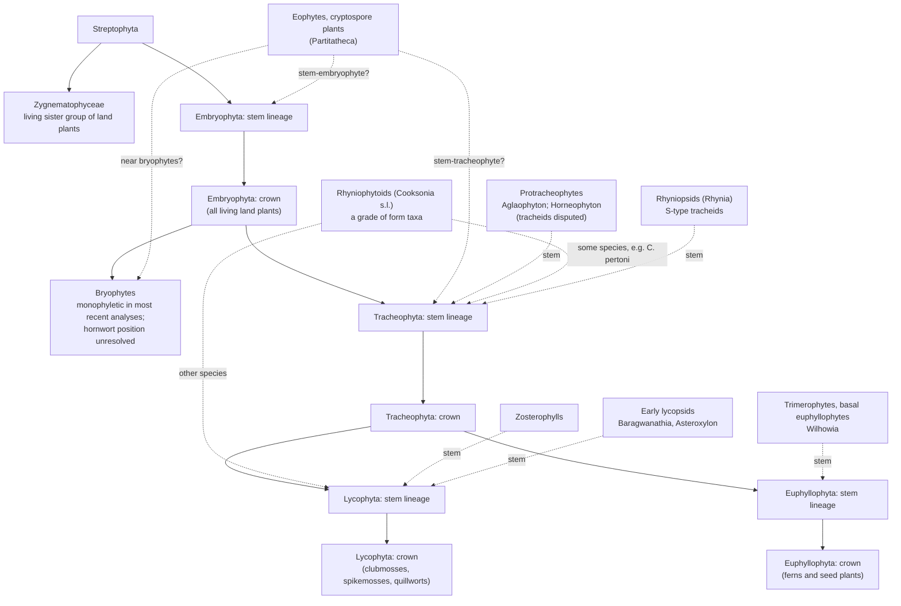

# Primer: early land plants, Late Ordovician to Early Devonian (c. 458–393 Ma)

Shared background for the taxon cards (`taxa/`) and later models. Drafted 2026-10-26 by Claude Sonnet 5.5 (`claude-sonnet-5-5`). Revised 2026-10-28 by Claude Opus 5.5 after Barry Brook's review; see "Revision of 2026-10-28" at the end. Each substantive claim traces to a source read for this document; "Source access" says which were read in full. Ages are Ma on ICS v2024/12 (`data/timescale.csv`) unless a source's own scale is stated.

Tags: (O) observation, an occurrence or measurement as reported; (I) interpretation, including every reconstruction that needs a model to get from measurement to quantity (palaeogeography, phylogenies, proxy-derived temperatures and CO2); (S) speculation. In the climate tables, "status" separates proxy reconstructions, model outputs and values a model assumes as input.

## 1. Timescale

### 1.1 Stage bases

`data/timescale.csv` matches the ICS v2024/12 chart for all 20 stages (checked row by row). The last two columns give the GTS2012-based values printed on ICS charts v2013/01 to v2023/09, which most of the literature uses.

| Stage (series) | Base, Ma (± as printed) | Duration, Myr | Older base, Ma | Shift, Myr |
|---|---|---|---|---|
| Darriwilian (Middle Ordovician) | 469.4 ± 0.9 | 11.2 | 467.3 | +2.1 |
| Sandbian | 458.2 ± 0.7 | 5.4 | 458.4 | −0.2 |
| Katian | 452.8 ± 0.7 | 7.6 | 453.0 | −0.2 |
| Hirnantian | 445.2 ± 0.9 | 2.1 | 445.2 | 0.0 |
| Rhuddanian (Llandovery) | 443.1 ± 0.9 | 2.6 | 443.8 | −0.7 |
| Aeronian | 440.5 ± 1.0 | 1.9 | 440.8 | −0.3 |
| Telychian | 438.6 ± 1.0 | 5.7 | 438.5 | +0.1 |
| Sheinwoodian (Wenlock) | 432.9 ± 1.2 | 2.3 | 433.4 | −0.5 |
| Homerian | 430.6 ± 1.3 | 3.9 | 430.5 | +0.1 |
| Gorstian (Ludlow) | 426.7 ± 1.5 | 1.7 | 427.4 | −0.7 |
| Ludfordian | 425.0 ± 1.5 | 2.3 | 425.6 | −0.6 |
| Pridoli | 422.7 ± 1.6 | 3.1 | 423.0 | −0.3 |
| Lochkovian (Lower Devonian) | 419.62 ± 1.36 | 6.6 | 419.2 | +0.4 |
| Pragian | 413.02 ± 1.91 | 2.4 | 410.8 | +2.2 |
| Emsian | 410.62 ± 1.95 | 17.2 | 407.6 | +3.0 |
| Eifelian (Middle Devonian) | 393.47 ± 0.99 | 5.5 | 393.3 | +0.2 |

Duration is the base minus the next younger base (Eifelian uses the Givetian, 387.95 Ma). The charts state no confidence level for "±". The older values are identical in the v2013/01, v2020/03, v2022/02 and v2023/09 PDFs, except that the Rhuddanian is 443.4 in v2013/01.

The Devonian "±" values hide asymmetric intervals. The chart's Devonian bases are the posterior medians of Harrigan et al. (2022; their Table 6, Becker et al. 2020 conodont scale), reported with 95% highest-density intervals: Lochkovian 419.62 +1.36/−1.14, Pragian 413.02 +1.75/−1.91, Emsian 410.62 +1.66/−1.95, Eifelian 393.47 +0.72/−0.99 Ma. The chart prints the wider side as a symmetric "±". The intervals come from one Bayesian age–depth model (modifiedBChron) that exploits stratigraphic superposition, so the boundary ages are not independent of each other. Durations computed from the printed "±" values as if they were independent misstate the uncertainty, and can even come out negative: the Pragian base, 413.02 ± 1.91, against the Emsian base, 410.62 ± 1.95.

### 1.2 Three scales, and a correction to the project brief

Papers before 2024 mostly use Lochkovian 419.2 ± 3.2, Pragian 410.8 ± 2.8, Emsian 407.6 ± 2.6 and Eifelian 393.3 ± 1.2 Ma (GTS2012, printed on ICS charts through v2023/09). The v2024/12 chart replaced them, taking most ages from GTS2020; 63% of Palaeozoic stage ages changed (Cohen et al. 2025).

The v2024/12 Devonian ages are not GTS2020 ages. For the Devonian and Carboniferous bases the chart adopted the Bayesian age–depth model of Harrigan et al. (2022) instead (Cohen et al. 2025). The GTS2020 wall chart (Gradstein et al. 2020; PDF text layer, mapping by printed order, chapter tables not seen) prints different Devonian bases. The Ordovician and Silurian values in `timescale.csv` equal the 15 printed on that chart, so `docs/decisions.md` ("GTS2020 ages") holds for those periods only.

| Base of | GTS2012 / ICS ≤ v2023/09 | GTS2020 chart | ICS v2024/12 (Harrigan et al. 2022) |
|---|---|---|---|
| Lochkovian | 419.2 ± 3.2 | 419.0 | 419.62 ± 1.36 |
| Pragian | 410.8 ± 2.8 | 412.4 | 413.02 ± 1.91 |
| Emsian | 407.6 ± 2.6 | 410.5 | 410.62 ± 1.95 |
| Eifelian | 393.3 ± 1.2 | 394.3 | 393.47 ± 0.99 |

- The Pragian and Emsian bases moved 1.6–2.2 and 2.9–3.0 Myr older. The Emsian lengthens from 14.3 to 17.2 Myr, the Pragian shortens from 3.2 to 2.4 and the Lochkovian from 8.4 to 6.6, so per-stage rates change. The Hirnantian lengthens from 1.4 to 2.1 Myr because the Silurian base moved 0.7 Myr younger (Harper 2023 quotes 1.4).
- Rhynie shows dates and stages decoupling. Parry et al. (2011) dated an andesite at 411.5 ± 1.3 Ma (U–Pb) and, with spores (early but not earliest Pragian to possibly earliest Emsian), argued the Lochkovian–Pragian boundary must be older than 411.5 Ma, older than the 410.8 Ma charted; on v2024/12 the date is Pragian. Edwards et al. (2018) quote 407 Ma, the 40Ar/39Ar age of hydrothermal K-feldspar (407.6 ± 2.2 Ma; Mark et al. 2011). Scotese et al. (2021) date a Pragian Cool Event at 411–406 Ma on ICS v2020/01 ages.

Stages are defined by their boundary stratotypes, not by numbers. In the chart's words, "Numerical ages are subject to ongoing revision and do not define units in the Phanerozoic and the Ediacaran; only GSSPs do" (ICS v2024/12). A revised chart changes the age attached to a stage, not the stage a fossil belongs to. Rules for cards and models:

- Record the stratigraphic assignment (stage, or biozone where given) and its basis as the primary datum, and convert to Ma through `timescale.csv`.
- Record independent numerical evidence alongside, as measured, with method and uncertainty: radiometric dates, and detrital-zircon maximum depositional ages, which bound age from one side only. Do not relabel a stage from a date.
- When a date falls outside its assigned stage on the current chart, record both and investigate. The cause may be the date, a maximum age read as a depositional age, the correlation, or the boundary uncertainty. Rhynie is the example above: a Pragian U–Pb date, with spores that allow the earliest Emsian.
- When a paper gives only Ma, note the age and the scale it used, and assign a stage only where the stratigraphic basis is stated.
- Early Devonian boundary ages are uncertain by about 2 Myr, asymmetrically (§1.1). Propagate that uncertainty by sampling a joint, ordered age model, never by perturbing each boundary independently (§8, question 8).

## 2. Palaeogeography

### 2.1 Configuration

- **Ordovician to Silurian (I; reconstructions from palaeomagnetic, faunal and geological data).** The Iapetus Ocean was over 4,000 km wide at 487 Ma and about 1,200 km (eastern Avalonia–Laurentia) or 500 km (Ganderia–Laurentia) by 444 Ma. Avalonia rifted from Gondwana at about 490 Ma, opening the Rheic Ocean (over 3,500 km wide between South America and Laurentia by 444 Ma, about 7,000 km by the Early Silurian); Avalonia and Baltica merged obliquely near 444 Ma (Cocks & Torsvik 2021). From the mid-Silurian they collided with Laurentia (Caledonian orogeny, 430–420 Ma; Cocks & Torsvik 2011), forming Laurussia.
- **Latitudes.** Laurentia was equatorial throughout (Cocks & Torsvik 2011). Baltica moved from a high southern latitude to near the equator, and the Ordovician South Pole lay beneath northern Africa (Cocks & Torsvik 2021). Hirnantian ice covered about 50% of Gondwana to about 35° S (Scotese et al. 2021); small ice caps persisted in Brazil into the early Llandovery (Cocks & Torsvik 2021).
- **Asia and land area.** Siberia drifted north; the Kazakh terranes lay near the sector of Gondwana that stretched north over the equator; the positions of South China, North China, Tarim and Annamia are disputed. The fraction of land in the tropics (I, model-dependent) was 45–46% at 460–440 Ma and about 30% by the Early Devonian (all Cocks & Torsvik 2021).
- No reliable global full-plate model exists before 410 Ma (Cocks & Torsvik 2021); carry Ordovician and Silurian palaeolatitudes as ranges.

### 2.2 Where the records come from

| Region | Spore records | Reference |
|---|---|---|
| Gondwana, east (Argentina) | Dapingian cryptospores | Rubinstein et al. (2010) |
| Gondwana, west (Saudi Arabia, Czech Republic, Oman) | Late Darriwilian cryptospores (Saudi Arabia, Czech Republic); Katian trilete and hilate spores (Saudi Arabia); Ordovician spore-filled sporangial fragments (Oman) | Rubinstein et al. (2010); Steemans et al. (2009); Wellman et al. (2003) |
| Baltica (Sweden) | Darriwilian cryptospores; Sandbian trilete spores, the oldest known | Rubinstein & Vajda (2019) |

Megafossil floras are in §7.2: peri-Gondwana (Barrandian), Laurussia (Welsh Borderland, Tipperary, Bathurst Island, Gaspé, Rhynie, at about 28° S; Edwards et al. 2018), eastern Gondwana (Victoria) and South China (low latitude, isolated; Xue et al. 2018).

Interpretations conflict. Steemans et al. (2009, 2010) place the origin of the vascular lineage in Gondwana, with colonisation of Avalonia, then Laurentia and Baltica when the plates were close (Ashgill to Llandovery), and of South America only after the Gondwanan ice sheet collapsed. Rubinstein & Vajda (2019) propose Baltica as a possible centre of radiation. Lochkovian floras of Laurussia and western Gondwana are dominated by isotomously branched plants with terminal sporangia, whereas South China is zosterophyll-dominated, read by Xue (2012) as phytogeographic isolation. An Aeronian–Telychian transgression is argued to have destroyed the biotopes of the earliest vegetation (Steemans et al. 2010).

## 3. Climate and atmosphere

### 3.1 Temperature and ice

Each entry estimates a different quantity. None is the temperature of the land where plants grew.

| Target variable | Coverage in the window | Method | Status | Value | Source |
|---|---|---|---|---|---|
| Tropical sea-surface temperature | Late Ordovician to Early Silurian | clumped isotopes in carbonate fossils | proxy (I) | 32–37 °C, with about 5 °C of Hirnantian cooling | Finnegan et al. (2011) |
| Tropical seawater temperature | 454–446 Ma | conodont apatite δ18O | proxy (I), reported second-hand | cooling to 28 ± 2 °C | Cocks & Torsvik (2021) |
| Low-latitude shallow seawater temperature, means by interval | Early–Middle Ordovician; Late Ordovician to Devonian | compilation of 22,332 carbonate and 4,615 phosphate δ18O analyses, of which 11,893 and 4,427 passed preservation screening; low latitude is 30° S–30° N | proxy (I) | 42.0 ± 3.1 falling to 35.6 ± 2.4 °C | Grossman & Joachimski (2022) |
| Conodont apatite δ18O, which records temperature and seawater composition together | Silurian | measured δ18O | measurement (O); climate reading (I) | warming to the early–mid Telychian; cooling in the late Llandovery–early Wenlock and late Wenlock (each about +2‰ over about 1.5 Myr); sharp swings around the mid-Ludlow Lau event | Trotter et al. (2016) |
| Low-latitude seawater temperature | Lochkovian; Middle Devonian | conodont apatite δ18O | proxy (I) | about 30 °C; 23–25 °C | Joachimski et al. (2009) |
| Tropical surface temperature, and global mean surface temperature | Ordovician to Devonian | isotopes combined with lithological climate indicators; extreme early Palaeozoic isotope values rejected | reconstruction (I) | tropics mostly 25–32 °C; a warm interval from the early Ludlow to the early Lochkovian; a Pragian Cool Event with sea level about 100 m lower; global mean 18.7 °C in the Early–Middle Devonian cool interval | Scotese et al. (2021) |
| Ice-sheet onset | Darriwilian onwards | coupled climate–ice-sheet model | model output (I) | onset possibly as early as the Darriwilian | Pohl et al. (2016) |
| Glacial cycles, duration and ice volume | cycles late Katian to earliest Silurian; maximum in the Hirnantian | sedimentology; radioisotope dates; clumped isotopes | stratigraphic interpretation (I); duration depends on interpolation between dates (I) | three glacial cycles (Ghienne et al. 2014); glacial maximum about 0.2 Myr (Harper 2023); ice volume at or above the Pleistocene maximum (Finnegan et al. 2011) | as given |

- **Absolute values disagree (I).** For the Late Ordovician to Devonian, Grossman & Joachimski's isotopic means are roughly 4–10 °C above Scotese et al.'s tropical reconstruction (my comparison; the two define "tropical" differently).
- **From these to plant temperatures (I).** Seawater temperatures at low latitude and a global mean cannot be used as plant temperatures. A model needs land-surface temperature by latitude and season, which only a climate model supplies, such as the HadCM3L `scotese_02` suite in `data/external/climate/`. That suite's temperatures are model outputs, driven by a prescribed CO2 series (§3.2).

### 3.2 CO2

| Source | Target variable | Coverage in the window | Method | Status | Value |
|---|---|---|---|---|---|
| Foster et al. (2017) | atmospheric CO2 | from 420 Ma only (latest Silurian and Devonian); few observations and proxy types at the old end | compilation of 1,241 estimates from five proxies | proxy compilation (I) | the long-term reconstructed level reaches about 2,000 ppm in the Devonian; not a bound on individual estimates |
| Witkowski et al. (2018) | atmospheric CO2 | 460–440 Ma; the Devonian data lie at about 380–355 Ma, after the window | phytane δ13C, converted with assumed seawater temperatures (about 10 °C for the Ordovician) | proxy (I); depends on the temperature assumed | about 450 rising to 700 µatm, mostly because of the low assumed Ordovician temperatures; about 1,400 µatm at the start of a Devonian–Early Carboniferous decline |
| Franks et al. (2014) | atmospheric CO2 | Devonian onwards (earliest points not checked) | gas-exchange model applied to fossil leaves | proxy (I) | below 1,000 ppm for most of the record; argues against swings of 2,000–3,000 ppm after the Devonian |
| Nardin et al. (2011) | atmospheric CO2 | Furongian to Early Devonian | GEOCLIM weathering–climate model | model output (I) | about 5,600 falling to 2,800 ppmv by the Llandovery, rising again in the Early Devonian |
| Lenton et al. (2016) | none: CO2 is an input | 445 Ma | productivity model of cryptogamic cover | assumed input | 8 × present atmospheric level, "a widely quoted value" (about 2,200 ppm if PAL = 278 ppm; my conversion) |
| HadCM3L `scotese_02` (Valdes et al. 2021) | none: CO2 is an input | whole window | prescribed from Foster et al. (2017), extended before 420 Ma | assumed input | about 1,300–2,100 ppm in the slices from 455.7 to 395 Ma (`data/external/climate/hadcm3l_experiment_info.csv`) |

No CO2 proxy covers most of the Silurian: Witkowski et al. (2018) call it data-scarce, and Foster et al. (2017) start at 420 Ma. The range 1,000–3,000 ppm for the Silurian–Early Devonian is a judgement (S). Use it as a sensitivity scenario, not as a prior, until it has been shown to suit particular intervals.

Lenton et al. (2016) headline that cryptogamic cover could reach about 30% of modern terrestrial productivity by about 445 Ma. That is their ice-free case at 8 PAL CO2, 18.7 GtC yr⁻¹. The same ice-free model gives 7.8 GtC yr⁻¹ at 4 PAL and 27.1 at 16 PAL (O2 0.6 PAL; their Table S2). An extensive ice-sheet mask at 8 PAL gives 10.5 GtC yr⁻¹, about 17% of modern by my scaling. The paper also starts from an assumed O2 of 0.6 PAL (about 14 vol.%) at 445 Ma. The estimate depends strongly on both the assumed CO2 and the ice scenario.

### 3.3 O2

- Early Palaeozoic O2 is unresolved. GEOCARBSULF predicts near-present levels against redox proxies implying less than half present; the rebuilt GEOCARBSULFOR gives 2–11% of the atmosphere from the Cambrian to mid-Ordovician, near-modern levels in the Devonian, and a nadir of about 14.5% across the Emsian–Eifelian boundary (Krause et al. 2018).
- **Charcoal (O).** The oldest reported charcoal is from the Pen-y-lan Mudstone at Rumney, Cardiff, and the late Silurian Winnica Formation, Poland. Both assemblages are dominated by nematophytes, not embryophytes (Glasspool & Gastaldo 2022, abstract; full text behind a bot check). The Pen-y-lan Mudstone is Wenlock, late Wenlock (Homerian) on the British Geological Survey's account (Howells 2007). It therefore predates the basal Pridoli charcoal of the Welsh Borders (Glasspool et al. 2004), which earlier sources treat as the first.
- **Charcoal to O2 (I).**
  - Scott & Glasspool (2006) set a 13–35% "fire window" and read Middle–Late Devonian charcoal scarcity as low O2.
  - Lenton et al. (2016) read the 420–400 Ma charcoal as O2 above 15–17%. Krause et al. (2018) cite about 15% for smouldering and 19% for probable combustion.
  - Glasspool & Gastaldo (2022) take 16% (about 0.75 PAL) as the minimum for sustained burning, from modern charring experiments. They argue it was first met in the mid-Silurian and repeatedly thereafter, against the trends of COPSE-revisited and GEOCARBSULFOR.
  - Glasspool & Gastaldo (2024; abstract read) reassess the Devonian "charcoal gap" using Emsian–Eifelian charcoal from Maine and the dispersed microscopic record. They conclude that fire was substantially uninterrupted and that O2 stayed above 16% from the Silurian onwards.
- **What charcoal can and cannot show (I).** Charcoal shows that fuel burned, which bounds O2 from below once a threshold is accepted. Its scarcity also depends on fuel load and moisture, preservation and sampling, so scarcity alone is weak evidence of low O2. The earliest fuel was largely nematophyte, not plant.
- Molybdenum isotopes and I/Ca ratios indicate oxygenation about 400 Ma (Dahl et al. 2010; Lu et al. 2018); Lu et al. find the upper ocean not resiliently oxygenated until about 200 Ma.

### 3.4 Sea level

Eustatic sea level reached a Late Ordovician zenith, fell in the Hirnantian (about 100 m; Harper 2023), was high in the mid-Silurian and low in the Early Devonian; events range from tens of metres to about 125 m, with amplitude the least certain quantity (Haq & Schutter 2008). Early Silurian melting drove transgressions to the end of the Llandovery (Cocks & Torsvik 2021). Sea level sets both the land available to plants and the non-marine rock that preserves them (Kenrick et al. 2012).

## 4. Events, and the hypotheses linking them to plants

### 4.1 Events

| Event | Interval | Evidence (O; temperatures and extinction percentages are proxy- or compilation-based, I) | Proposed drivers (I, S) |
|---|---|---|---|
| Late Ordovician mass extinction | Hirnantian, 445.2–443.1 Ma | two pulses, at the base and middle of the Hirnantian; about 75% (Harper 2023) to 85% (Bond & Grasby 2020) of marine species lost; sea level −100 m; cooling ≥ 5 °C | glaciation then deglaciation, warming and anoxia (Harper 2023); volcanic warming and anoxia for both pulses (Bond & Grasby 2020); first extinction tied to early melting (Ghienne et al. 2014) |
| Ireviken | earliest Wenlock, about 431–432 Ma | δ13Ccarb excursion of about 4.5‰ (Rose et al. 2019); conodont and other turnover (Jeppsson et al. 1995) | oceanic primo–secundo cycles (Jeppsson et al. 1995); cooling (Trotter et al. 2016); Rose et al. argue the Gotland pattern is partly local deposition and diagenesis |
| Mulde | late Wenlock (Homerian) | separates two secundo episodes (Jeppsson et al. 1995) | as above |
| Lau | Ludfordian | δ13C up to about 8‰ in the Prague Basin, with gaps linked to sea-level fall (Lehnert et al. 2007); a Ludlow oceanic event (Jeppsson & Aldridge 2000) | as above |

Plants (I, read from the spore record): land plants appear largely unaffected by the end-Ordovician extinction (Servais et al. 2019), and cryptospore producers survived the Hirnantian glaciation (Steemans et al. 2010). In the Prague Basin trilete-spore producers expanded almost exponentially from the Wenlock but lost species during glacial cooling, while cryptospore producers stagnated (Pšenička et al. 2021); among the sources read, this is the only test of plant turnover against the Silurian events. Euphyllophytes are unequivocal from the Pragian and trees over 8 m appear by the Givetian (Kenrick et al. 2012); sampling-corrected richness rises in the Pragian and Givetian (Capel et al. 2022).

### 4.2 Hypotheses

| Hypothesis | Claim | Support | Critique and alternatives |
|---|---|---|---|
| Lenton et al. (2012), "First plants cooled the Ordovician" | spreading non-vascular plants accelerated silicate weathering and drew down CO2 enough to start ice-sheet growth | Porada et al. (2016): potential weathering flux of 2.8 km³ rock yr⁻¹, about three times the modern chemical flux, strongly CO2-sensitive (model) | Quirk et al. (2015): liverworts with mycorrhizal fungi raise Ca weathering 3–7× and phosphate 9–13× in experiments, but shallow rooting (0.1 m) makes the total effect at least 10× smaller than trees. Edwards et al. (2015): limited weathering depth, minor CO2 drawdown. Tectonic alternatives: Taconic tropical weathering (Swanson-Hysell & Macdonald 2017); fresh volcanic rock and motion through the intertropical convergence zone (Nardin et al. 2011); a 35% fall in arc activity from 480 Ma (Cocks & Torsvik 2021). Ice onset may predate the cooling (Pohl et al. 2016). If crown embryophytes date from 457–450 Ma (Hooper et al. 2026, untested), models starting non-vascular diversification at 470 Ma need revisiting, though stem-lineage plants could be older |
| Lenton et al. (2016), "Earliest land plants created modern levels of atmospheric oxygen" | cryptogamic cover reached about 30% of modern productivity by about 445 Ma (ice-free case, with CO2 assumed at 8 PAL; about 17% with an extensive ice sheet, §3.2); high C:P (about 2,000 against about 100 for marine biomass) and selective P weathering raised O2 to present levels by 420–400 Ma | charcoal; Mo and I/Ca proxies; Krause et al. (2018) independently find a stepwise Palaeozoic oxygenation coincident with vascular plants | selective P weathering rests on experiments extrapolated to the Palaeozoic: a moss (*Physcomitrella patens*) on granite amplified P weathering about 24-fold (range 15–43), a liverwort (*Marchantia paleacea*) on basalt 9–13-fold; and depends on unmeasured biomass P; C:P is 800–4,300 in living bryophytes; the model misses the Late Ordovician sulphur-isotope rise (all Lenton et al. 2016). Covers that bury little organic carbon add little O2 (Edwards et al. 2015); earlier productivity estimates were about 5% and 7% of modern (Lenton et al. 2016) |

Algeo & Scheckler (1998) extend the argument to the Devonian: trees and seeds intensified weathering, causing eutrophication, anoxia and CO2 drawdown. This lies outside the window but depends on rooting, which arose piecemeal and independently in several clades through the Devonian (Kenrick & Strullu-Derrien 2014); the Rhynie lycopsid *Asteroxylon* had rooting axes without root caps (Hetherington & Dolan 2018). Dahl & Arens (2020) review these links and conclude that the effect of each ecological stage is still debated.

## 5. Phylogenetic backbone

### 5.1 Living plants

- **Sister group (I, from sequence data).** Zygnematophyceae are sister to land plants in phylotranscriptomic analyses (Wickett et al. 2014; One Thousand Plant Transcriptomes Initiative 2019; Puttick et al. 2018), although internal branches among streptophyte algae are short, a true radiation cannot be rejected, and a Coleochaetales–Zygnematophyceae clade has similar quartet support (One Thousand Plant Transcriptomes Initiative 2019).
- **Bryophytes.** Monophyly is the best-supported hypothesis (Puttick et al. 2018; Harris et al. 2020; One Thousand Plant Transcriptomes Initiative 2019; Su et al. 2021). Puttick et al. reject all but three rooted hypotheses, which differ only in the position of hornworts; Setaphyta (liverworts plus mosses) as sister to the rest is favoured, with weak support for hornworts. Harris et al. (2022) place the root between bryophytes and tracheophytes by three independent methods.
- **Consequence (I).** The last common ancestor of living land plants was more complex than liverwort-first trees implied, and bryophytes lost genes for vasculature and stomata (Puttick et al. 2018; Harris et al. 2020, 2022; Donoghue et al. 2021). Fossils read as "bryophyte-like" need re-evaluation.
- **Tracheophytes.** Lycophytes are sister to euphyllophytes (One Thousand Plant Transcriptomes Initiative 2019).

### 5.2 Fossil grades

| Grade | Observations | Examples | First record | Placement and dispute |
|---|---|---|---|---|
| Cryptospore plants (cryptophytes, eophytes) | millimetre-scale; forking striated axes, rare stomata; valvate sporangia with permanent dyads or tetrads; conducting cells like bryophyte leptoids; probably poikilohydric | *Partitatheca*, *Lenticulatheca* | spores Dapingian (Rubinstein et al. 2010); parent plants Pridoli–Lochkovian; Ordovician Oman fragments with liverwort-like spore walls | stem-embryophyte, stem-tracheophyte or bryophyte-like, unresolved (Edwards et al. 2014); Eophytidae (Edwards et al. 2022a); stem-tracheophytes in Clark et al. (2023); Hooper et al. (2026) run both placements |
| Rhyniophytoids | naked dichotomous axes, terminal sporangia, trilete spores; conducting tissue rarely preserved | *Cooksonia* | Sheinwoodian, about 432 Ma (Libertín et al. 2018) | *C. pertoni* held among the earliest eutracheophytes (Gonez & Gerrienne 2010); some *Cooksonia* produce monads from dyads (Edwards et al. 2014); a grade, not a clade |
| Protracheophytes | Rhynie axes with terminal sporangia; *Aglaophyton* strand without wall thickenings, like moss hydroids and leptoids (Edwards 1986); arbuscular endophytes (Remy et al. 1994; Strullu-Derrien et al. 2014) | *Aglaophyton*, *Horneophyton* | Pragian–Emsian (Rhynie) | conventionally between bryophytes and tracheophytes. *Horneophyton* conducting cells are disputed. Cascales-Miñana et al. (2019) find annular or spiral thickenings, read them as tracheids, and place horneophytes as sister to eutracheophytes. Kenrick & Long (2026) image the same tissue by confocal microscopy and 3D reconstruction, find transfer-cell-like wall ingrowths and no tracheids, and conclude that *Horneophyton* is not a tracheophyte. The dispute decides whether a Rhynie sporophyte of this size moved water through tracheids |
| Rhyniopsids | terete xylem strand with tracheid thickenings | *Rhynia*, *Eddianna* (Gaspé; Pfeiler & Tomescu 2018) | Pragian–Emsian | stem-tracheophytes |
| Zosterophylls | lateral stalked sporangia; K-branching in some (Xue 2012) | *Zosterophyllum*, *Ramoferis* (Hao & Xue 2011) | Ludfordian, Arctic Canada (Kotyk et al. 2002); Lochkovian, Yunnan | stem-lycophytes (Clark et al. 2023). *Z. shengfengense* has the oldest known rooting system: a rhizome with root-like axes about 20 mm long, root : shoot 0.028, a volume estimate from one specimen (Hao et al. 2010) |
| Early lycopsids (leafy lycophytes outside the crown; *Asteroxylon* leaves have no vein, their traces ending below the leaf base, Kerp 2017) | *Asteroxylon* rooting axes lack root caps (Hetherington & Dolan 2018) | *Baragwanathia*, *Asteroxylon* | Gorstian on graptolites (Rickards 2000), contested: brachiopods place the Yea beds mostly in the Early Devonian (Earp 2024); Pridoli in Bohemia (*B. brevifolioides*) | stem-group lycopsids, so stem lycophytes, not members of the crown (drepanophycalean grade; see the [Asteroxylon](../taxa/asteroxylon-mackiei.md) and [Baragwanathia](../taxa/baragwanathia-longifolia.md) cards). They cannot calibrate the lycophyte crown. Clock estimate for that crown: 431–411 Ma (Harris et al. 2022) |
| Trimerophytes, basal euphyllophytes | *Wilhowia*: helical branching, paired fusiform sporangia with trilete spores, three-ribbed actinostele (Gensel 2022); secondary xylem in two plants of 407–397 Ma (Gerrienne et al. 2011) | *Wilhowia* (Gaspé, basal Emsian) | Pragian (Kenrick et al. 2012) | crown euphyllophytes at 432–414 Ma (Harris et al. 2022); the wood may precede lignophytes (Gerrienne et al. 2011) |

The cladistic framework of Kenrick & Crane (1997), which still holds when fossils are added (Wellman 2014), underlies this arrangement. Most Silurian and Early Devonian fossils are stem tracheophytes (Puttick et al. 2018), and Silurian assemblages hold primitive vascular plants but no clear bryophytes (Wellman 2014).

The diagram separates what is secure from what is not. Solid lines are the living backbone, which sequence data resolve, apart from the root of the bryophytes. Dotted lines attach extinct groups to the lineage they are thought to belong to: on the stem leading to a crown group, or within it. A dotted line to a stem asserts membership, not position along it; the order of extinct grades along a stem is not resolved. Divergence ages are left off the diagram because they depend on calibration choices; see §5.3.

Placements follow the cards and the sources in §5.2. Eophyte placement is unresolved. Clark et al. (2023) recover them as stem-tracheophytes in a Bayesian morphological analysis. Hooper et al. (2026) state that their position has not been tested cladistically, and run both stem placements. The Horneophyton dispute is about anatomy (§5.2): if its conducting cells are not tracheids, the protracheophyte grade holds two plants without tracheids on the tracheophyte stem.

### 5.3 Molecular clocks against the record

| Source | Crown Embryophyta | Crown Tracheophyta | Notes |
|---|---|---|---|
| Morris et al. (2018) | 515.2–473.5 Ma (95% HPD across seven topologies); 583.1–470.0 across all dating strategies | 450.8–419.3 Ma across topologies; means near 444 Ma with uniform priors | 37 calibrations; soft maximum 515.5 Ma from Cambrian cryptospores; fossil minimum for crown tracheophytes 420.7 Ma |
| Harris et al. (2022) | 515–493 Ma | 452–447 Ma | 68 calibrations plus a horizontal-gene-transfer constraint; relaxing all maxima extends the possible origin to the Ediacaran (597–540 Ma), still much younger than Su et al. (2021) |
| Hooper et al. (2026), published 22 Oct 2026, not yet tested by others | 457–450 Ma | 432–428 Ma (crown bryophytes 445–429 Ma) | same molecular dataset as Harris et al., recalibrated fossils (below) |
| Su et al. (2021) | 518–500 Ma (strategy 1, soft maxima as in Morris et al.); 980–682 Ma (strategy 2, a 1,042 Ma maximum, favoured); 919–639 Ma (strategy 3, truncated-Cauchy calibrations) | | older ages partly reflect different fossil assignments (Harris et al. 2022) |
| Fossils | cryptospores: Cambrian (affinity unclear; Morris et al. 2018), Tremadocian about 480 Ma (Strother & Foster 2021), Dapingian (Rubinstein et al. 2010) | trilete spores: Sandbian (Rubinstein & Vajda 2019), Katian (Steemans et al. 2009); megafossils from the Sheinwoodian; *Baragwanathia* Gorstian (contested; Earp 2024) | |

The lag is about 40 Myr from the oldest cryptospores accepted as embryophytic (Dapingian) to the oldest megafossil (Sheinwoodian). Clock estimates for crown embryophytes of 515–470 Ma (Morris et al. 2018; Harris et al. 2022) precede that fossil by 40–80 Myr. Three readings compete.

1. (I) The clocks are right and the record is truncated by facies: continental rocks are scarce before the late Silurian, spores are less facies-dependent but carry no bodies, and bryophytes preserve poorly (Kenrick et al. 2012; Morris et al. 2018; Donoghue et al. 2021).
2. (I/S) The lineages diverged when the clocks say, but the characters that make land plants recognisable as fossils were acquired later. Strother & Foster (2021) argue that the embryophyte body plan was assembled gradually from the Ediacaran–Cambrian to the mid-Silurian. The clocks still estimate lineage divergences. What this reading adds is a claim about trait evolution: the preservable characters (resistant spores, then bodies) followed the divergences by tens of millions of years. That needs its own evidence, and it is a different claim from saying the clocks date a "developmental toolkit".
3. (I; new, untested) The calibrations are wrong. Hooper et al. (2026) reconstruct 27 spore characters across 27 living and 11 fossil genera (four methods, three timetrees, eophytes as stem-embryophytes or stem-tracheophytes). In most of their models, the ancestral embryophyte made unenveloped trilete monads from tetrahedral tetrads, with a three-layered sporoderm and monoplastidic meiosis. They conclude that trilete spores mark total-group embryophytes rather than vascular plants, and they stop using cryptospores as crown calibrations. Their constraints on crown-Embryophyta are soft bounds, each with a 2.5% probability of being exceeded: a maximum of 459.1 Ma and a minimum of 426.9 Ma (*Cooksonia* cf. *pertoni*). The maximum is the oldest possible trilete spores (Dalby Limestone, central Sweden). They would not use the same spores as a minimum, because the trilete marks may be compression artefacts. For crown-Tracheophyta: 431.2–420.7 Ma, the minimum from a Ludlow *Zosterophyllum* on Bathurst Island. The crown-embryophyte mean is 55 Myr younger than in Harris et al. (2022), and the gap to the oldest unequivocal land-plant fossils shrinks to as little as 19 Myr.

Morris et al. (2018) set the maximum from Cambrian cryptospores (515.5 Ma); Hooper et al. set it from the first trilete spores (459.1 Ma). Both are fossil-absence arguments, the kind Hedges et al. (2018) and Su et al. (2021) reject (my inference). Hooper et al.'s own caveats:

- The trilete result holds across all their models and timetrees.
- Eophyte position has not been tested cladistically.
- The all-rates-different model, apparently driven by *Partitatheca* with its enveloped dyads, reconstructs an enveloped ancestral spore.
- No accuracy ranking of ancestral-state methods is agreed.

Three steps in the argument need assumptions that the paper does not test (I).

1. **Secondary cryptospory.** An ancestral trilete monad does not exclude cryptospore production arising secondarily within the crown. Cryptospores are then not diagnostic of crown membership, but they are not excluded from it either.
2. **First occurrence as a maximum.** A total-group character arises at or before the crown node, so the crown can be no older than the character's origin. That origin is unobserved. The first fossil occurrence bounds the crown from above only if the character would have been preserved and sampled soon after it arose. A soft maximum expresses that assumption as a probability; it does not remove it.
3. **Spore type and producer.** The bound rests on attributing the Dalby spores to embryophytes and on reading their trilete marks correctly, which Hooper et al. themselves doubt.

Carry the clock results as separate scenarios, each conditional on its calibrations, not as one pooled interval: Morris et al. (2018), 515.2–473.5 Ma for the embryophyte crown across topologies; Harris et al. (2022), 515–493 Ma; Hooper et al. (2026), 457–450 Ma; Su et al. (2021), 518–500 Ma or 980–682 Ma depending on the maximum constraint. The span 515–450 Ma is a list of disagreeing results, not an uncertainty interval. Stem-lineage plants could be older than any crown, and many crown traits arose along the stems.

## 6. Biological transitions

The framings (`docs/framings.md`) rest on a set of biological transitions that §§1–5 do not set out. They are separate characters. Each is scored from different fossils, deposits and preservation modes, and measured on different living plants (table). The record already shows them dissociated (O):

- conducting cells in axes a tenth of a millimetre wide;
- stomata and cuticle on plants whose conducting cells lack tracheid thickenings;
- complex free-living gametophytes beside larger sporophytes;
- fungal hosts without roots;
- a living moss whose capsule bears stomata although its sporophyte is reported to depend on the gametophyte for carbon.

"Vascularisation", "independence" and "increasing size" are therefore at least three variables. A model that moves them together assumes a correlation the evidence does not contain (I). The table was drafted by a Claude Sonnet 5.5 agent from the taxon cards; each entry carries the card's sourcing.

| Transition and what changes | Fossil observations that constrain it | Living comparators that measure it | What remains inference |
|---|---|---|---|
| **Gametophyte–sporophyte relationship.** Size, complexity, independence and attachment of the two generations; zygote retention and provisioning | Rhynie (Pragian–earliest Emsian): free-living gametophytes with cuticle, stomata and a conducting strand, about a tenth the linear size of the sporophytes (derived), paired by tissue and co-occurrence, not attachment, although *Remyophyton* bears two outgrowths read as possible sporophyte junctions ([gametophytes](../taxa/rhynie-chert-gametophytes.md); Taylor et al. 2005). Early Devonian [*Sciadophyton*](../taxa/sciadophyton.md): axes to about 10 cm with conducting cells, interpreted as a gametophyte; sporophyte unknown. Lochkovian thalloid transfer-cell fossils, possibly [eophyte](../taxa/eophytes.md) gametophytes, unattached (Edwards et al. 2022b). Attachment claimed for one *Cooksonia paranensis* specimen (Gerrienne et al. 2006); for *Elandia itshoba* (Baviaanskloof Formation, South Africa, probably Lochkovian), with up to six axes arising from a basal structure read as gametophyte remains (Gess & Prestianni 2021); and for [*Sporogonites*](../taxa/sporogonites.md) in three discordant versions, the newest a 2026 conference abstract. No Silurian gametophyte is known (Pšenička et al. 2021) | [*Coleochaete*](../taxa/coleochaete.md): zygote retained; provisioning inferred from wall ingrowths and zygote growth (Haig 2015). [*Marchantia*](../taxa/marchantia-polymorpha.md), [*Anthoceros*](../taxa/anthoceros.md), [*Polytrichum*](../taxa/polytrichum-commune.md): dominant gametophyte, nourished sporophyte. Embryo support described as months in [*Lycopodiella*](../taxa/lycopodiella-inundata.md), 3–6 weeks to emergence in [*Selaginella*](../taxa/selaginella.md). [*Psilotum*](../taxa/psilotum-nudum.md): fungus-fed, vascularised gametophyte | Ancestral life cycle (F1); dependence of any fossil sporophyte; post-fertilisation development unobserved |
| **Sporophyte nutritional independence.** Carbon, water and nutrient supply separate from the gametophyte; the three can change separately | Indirect only. [*Cooksonia*](../taxa/cooksonia.md) axes span 0.2 mm (Irish Wenlock) to 1.5 mm (*C. barrandei*, Sheinwoodian). Boyce (2008) argued from tissue-volume requirements that the narrowest axes could not feed themselves while wider ones might; Libertín et al. (2018) applied this to 1–1.5 mm axes. Neither has anatomy of the axes in question. Stomata in Lochkovian *C. pertoni* (argued sparse) and, rare with collapsed guard cells, in eophytes; cuticle and stomata on the five Rhynie sporophytes (about 15–30 cm reconstructed). No fossil preserves how a sporophyte was supplied | *Anthoceros*: photosynthetic, stomatal, gametophyte-nourished sporophyte. *Polytrichum formosum*: carbon-dependent sporophyte, stomatal capsule in the genus. *Lycopodiella*: detached juveniles with leaves are hypothesised to be partly fungus-fed (Hoysted et al. 2021). Dependence untimed in *Selaginella* and [*Ceratopteris*](../taxa/ceratopteris-richardii.md) | When independence arose in any lineage; whether axis width marks it |
| **Branching and sporangium number.** One sporangium on an unbranched axis; isotomous dichotomy with a sporangium per tip; lateral sporangia, K-branching, overtopping | *C. barrandei* (Sheinwoodian), the oldest generally accepted land-plant megafossil: isotomous, terminal sporangia. *Steganotheca* (Ludfordian–Pridoli): at least ten terminal sporangia ([rhyniophytoids](../taxa/rhyniophytoids.md)). [Bathurst Island](../taxa/bathurst-island-flora.md) (late Ludlow): cf. *Bathurstia* spikes to 45 × 11 mm on a 5 mm axis; a *Zosterophyllum* with at least 27 sporangia on a 1.0 mm axis. Eophytes: one terminal sporangium. *Sporogonites*: unbranched, one capsule per preserved axis. [*Pertica*](../taxa/pertica.md) (Emsian–Eifelian): helical laterals, 32–128 sporangia per cluster in *P. dalhousii* | Bryophyte sporophytes: unbranched, one sporangium (*Polytrichum*, *Anthoceros*, [*Haplomitrium*](../taxa/haplomitrium-gibbsiae.md)) | Whether branching raised spore output or release height |
| **Water transport and gas exchange.** Conducting cells (none; hydroid-like; tracheids with annular, G-, S- or P-type walls), and the cuticle and stomata that regulate loss and CO2 uptake | Annular tracheids in late Ludlow naked axes, attachment to *Cooksonia* unresolved (Edwards & Davies 1976); Lochkovian *C. pertoni* (Edwards et al. 1992) and [*Tortilicaulis offaeus*](../taxa/tortilicaulis-offaeus.md) (Morris et al. 2024). Rhynie: *Rhynia* S-type, *Asteroxylon* G-type, *Aglaophyton* and *Nothia* without tracheid thickenings, *Horneophyton* disputed (§5.2); stomata on all (Kerp 2017). *Psilophyton dawsonii* (Emsian): P-type pits (Hartman & Banks 1980). Tracheid diameter rises through the Late Silurian–Early Devonian (Niklas 1985). Eophytes: rare stomata, no water-conducting cells | *Polytrichum*: hydroids, P50 about −1.8 MPa, stomata on the capsule only. *Haplomitrium*: perforate conducting cells (Ligrone et al. 2012), no stomata (Harris et al. 2020). *Anthoceros*: stomata not actively regulated (Pressel et al. 2018). *Psilotum*: stem assimilation about 10% and hydraulic conductance about 8% of wheat values (Franks 2006) | Lignification of any non-tracheid strand; conductance of any fossil strand; function of eophyte stomata |
| **Height and spore-release height.** Stature and the height from which spores leave, set by support, conduction and carbon gain | Heights are fragment lengths or reconstructions. *Cooksonia* 1–6 cm; Rhynie plants 15–30 cm; *Psilophyton* 30–60 cm; *Pertica* about 1–3 m, anatomy unknown. Wood in *Franhueberia* (Emsian), none in *Wilhowia* axes 1 cm wide (Gensel 2022). [*Sengelia*](../taxa/sengelia-radicans.md) stems to 34 mm wide but creeping | The haploid stalk raises the capsule in *Marchantia*; *Polytrichum* seta 5–9 cm | Dispersal benefit of height; whole-plant stature (complete plants are rare even where, as at Rhynie, plants are preserved in growth position) |
| **Rooting.** Rhizoids; rhizoid-bearing axes, corms and rhizomes; rooting axes without root caps; roots with caps | Rhynie sporophytes: rhizoid-bearing axes, a corm or rhizomes, no roots (Hetherington & Dolan 2017); *Asteroxylon* rooting axes without caps or rhizoids (Hetherington & Dolan 2018). Lochkovian *Zosterophyllum shengfengense*: root-like axes, root : shoot 0.028, a volume estimate from one specimen (Hao et al. 2010). Late Lochkovian–early Pragian *Sengelia*: root-bearing axes at least 12 cm deep (Matsunaga & Tomescu 2016, 2017). Euphyllophyte roots unequivocal only from the Frasnian; Doran & Tomescu (2025) propose a rooting role for emergences on Early Devonian *Psilophyton* | *Haplomitrium*: no rhizoids. *Polytrichum*: rhizoids, no roots. *Lycopodiella*: roots in adults, rhizoids in juveniles | Uptake function of rooting axes and emergences; rooting depth and soil effects |
| **Fungal nutrition.** Presence, identity and function of symbionts; carbon paid for phosphorus and nitrogen | Rhynie (Pragian–earliest Emsian): *Aglaophyton* arbuscules (Remy et al. 1994); *Horneophyton* with Glomeromycotina-like and Mucoromycotina-like fungi in different tissues (Strullu-Derrien et al. 2014); *Nothia* with three endophytes and host wall responses (Krings et al. 2007); *Asteroxylon* rooting system with a probably parasitic fungus (Strullu-Derrien et al. 2015). Ordovician *Palaeoglomus grayi*: no host, possible contamination ([fungi](../taxa/early-glomeromycotan-fungi.md)) | *Haplomitrium*: Mucoromycotina deliver 33P and 15N at 440 and 1500 ppm CO2 for under 2% of fixed carbon in core mycelium (Field et al. 2015, 2019). *Lycopodiella*: exchange varies with stage (Hoysted et al. 2021). *Marchantia polymorpha*: derived loss of mycorrhiza | Nutrient transfer and net benefit in every fossil; whether symbiosis preceded rooting |
| **Reproductive strategy.** Dispersal unit (dyad, tetrad, trilete monad), spore size against number, size dimorphism | Dispersed cryptospores 23–62 µm in the assemblages on the cards; permanent dyads and tetrads in Lochkovian eophyte sporangia; *Cooksonia* trilete spores 10–38 µm in the species on its card; Rhynie plants homosporous (*Horneophyton* 39–49 µm, *Aglaophyton* about 65 µm). [*Omniastrobus*](../taxa/omniastrobus-dawsonii.md) (Emsian): mean spore size grades among sporangia from about 70–150 µm to over 200 µm, some bimodal (abstract only; Bonacorsi et al. 2021) | *Marchantia*: up to 3 × 10^5 spores of about 10 µm per capsule. *Selaginella*: megaspores 150–1500 µm, microspores 15–50 µm (genus-wide; Zhou & Zhang 2023) | Function and sex of *Omniastrobus* size classes; spores per sporangium; mating system, which spores do not fix: Rhynie gametophytes are unisexual although the sporophytes are homosporous (Taylor et al. 2005), and homosporous *Ceratopteris* sets sex by pheromone |

Dispersed spores bear directly only on the last row (on others only indirectly, through phylogenetic placement and calibration), so F3 and F4 see one transition directly; on Hooper et al.'s (2026) reading, trilete spores mark total-group embryophytes, not tracheophytes (§5.3). Body fossils constrain the other rows. The rows map onto the framings as follows (I): F1 uses rows 1–3, 5 and 8; F2 rows 3–6; F5 rows 4, 6 and 7; F6 rows 1 and 4; F7 all of them.

**Conducting cells without size or independence (O, I).**
- *Tortilicaulis offaeus* (Lochkovian, Brown Clee Hill) has stems 0.06–0.17 mm wide containing elongate cells with regularly spaced thickenings. Morris et al. (2024) read them as simple annular tracheids. The thickenings are clear in one of five scanned specimens, weaker or confined to one cell in two, and not clearly shown in two; wall class and lignification are not shown (O).
- On Boyce's (2008) argument, axes of about 0.2 mm are too thin to feed themselves, and these are thinner. If the argument holds, a plant with tracheid-like cells was still gametophyte-nourished (I).
- Living plants separate the same traits. *Polytrichum* has hydroids, a conducting strand in the seta in the Polytrichaceae examined, and up to 250 capsule stomata (genus-level count). Yet the *P. formosum* sporophyte is reported to depend on the gametophyte for carbon (Brodribb et al. 2020; Renzaglia et al. 2020; Renault et al. 1992, abstract only).
- Hornwort sporophytes are photosynthetic and stomatal and remain gametophyte-nourished (Frangedakis et al. 2021).

A conducting strand and stomata therefore coexist with nourishment by the gametophyte, and neither marks full independence (O).

**Rhynie (O, I).** Plants of similar size at one site differ in conducting tissue (Kerp 2017):
- *Rhynia* has S-type tracheids and *Asteroxylon* G-type;
- the *Aglaophyton* strand has no helical or annular thickenings, and *Nothia* rhizomes have uniformly thickened conducting cells;
- *Horneophyton* is disputed (§5.2).

All of them carry stomata, so stomata are not tied to tracheid thickenings (I). The gametophytes *Lyonophyton* and *Remyophyton* are free-living, roughly a tenth the linear size of their sporophytes, and have stomata and a conducting strand; *Lyonophyton* also has arbuscules. The pairings with sporophytes rest on tissue similarity and co-occurrence, not attachment, and the card takes the strand wall type from the matched sporophyte (Taylor et al. 2005; Kerp 2017). Stomata and a conducting strand therefore also occurred in the haploid generation of stem-group plants (I). Living *Psilotum* has a non-green, fungus-fed, vascularised gametophyte (Duckett & Ligrone 2005), so conducting cells in a gametophyte do not imply autotrophy. Whether that applies to the Rhynie gametophytes is speculation (S).

**Size is several variables (O, I).** "Increasing size" separates into axis width, height, fertile output and support. *Cooksonia* axes span about 0.2–1.5 mm across the morphogenus, and the independence argument is a contest between two inferences from size and tissue requirements, with no anatomy of the axes concerned. Width does not predict stature. *Sengelia* stems reach 34 mm but are interpreted as creeping (Matsunaga & Tomescu 2017). The late Ludlow Bathurst Island plants have vegetative axes of 0.7–2.4 mm, overlapping *Cooksonia*, while cf. *Bathurstia* carries spikes up to 45 × 11 mm on a 5 mm axis (Kotyk et al. 2002). Secondary growth is decoupled from axis width, although whether it was needed for height is not established:
- no secondary xylem is reported for *Psilophyton*, at 30–60 cm in compilations;
- *Wilhowia* axes 1 cm wide lack it (Gensel 2022);
- secondary xylem occurs in narrower coeval euphyllophyte fragments (Gerrienne et al. 2011).

*Aglaophyton* axes bent over and re-rooted when too tall for their strand to support them (Kerp 2017), so support, not conduction alone, limited height there (I). Heterospory is not tied to size. Tall *Archaeopteris* trees were heterosporous (the megaspore–sporangium link is inferred), living *Selaginella* is herbaceous and heterosporous, and *Omniastrobus* shows graded spore sizes in an Emsian plant of unknown size.

**Roots and fungi (O, I, S).** Roots arose piecemeal and independently in several clades (Kenrick & Strullu-Derrien 2014; Hetherington & Dolan 2018), and unequivocal euphyllophyte roots appear only in the Frasnian, although Doran & Tomescu (2025) propose a rooting role for emergences on Early Devonian *Psilophyton*. Fungal association did not wait for roots: the Rhynie hosts are rootless, and living *Haplomitrium gibbsiae* has no rhizoids. Nor was every association mutualistic: the fungus in the rooting system of *Asteroxylon* was probably parasitic, and nutrient transfer is inferred in every fossil (I). No fossil test yet shows whether symbiosis substituted for roots, preceded them or followed them (S).

**Observations that would tell a package from independent transitions.** A package model drives the transitions through one latent axis, either together or in a fixed order. An independent model gives each transition its own costs and benefits, habitat dependence and timing by lineage. Each prediction below can be tested in a model of the F1–F2 kind against the card matrix (`data/traits.csv`, in which many cells are unknown).

1. **Trait combinations.** The strong package predicts that states co-occur, and the weak package that they arise in one nested order. Stomata without tracheid thickenings (*Aglaophyton*, *Nothia*) contradict obligatory co-occurrence, though not correlated evolution (O). Several cases contradict an order in which wood or axis width tracks size (O):
   - tracheid-like cells in 0.1 mm stems (*T. offaeus*, one clear specimen);
   - wood in narrower euphyllophyte fragments but not in the wider *Wilhowia* axes;
   - 34 mm *Sengelia* stems interpreted as creeping.
2. **Order differs between lineages.** A fixed-order package predicts the same sequence of acquisitions in every clade, not simultaneous appearance. The record differs by lineage (O):
   - rooting axes occur in lycophyte-line plants from the Lochkovian, whereas unequivocal euphyllophyte roots date from the Frasnian;
   - euphyllophyte leaves appear about 23–30 Myr after lycophyte leaves (about 415–408 Ma against about 385 Ma, older timescale; Tomescu & Whitewoods 2024, via the trimerophytes card).
3. **Gametophyte size against sporophyte size.** A package predicts that the gametophyte shrinks relative to the sporophyte as the sporophyte elaborates. Independence predicts a ratio set by water regime, with reduction lagging or failing. *Sciadophyton* gametophytes reach about 10 cm with the sporophyte unknown (O). Gametophytes matched to Lochkovian zosterophylls or rhyniophytoids, or to Emsian euphyllophytes, would decide it (S).
4. **Independence against anatomy.** A package predicts photosynthetic independence where tracheids appear (I). Two observations would test it directly (S):
   - the volume of photosynthetic tissue in charcoalified *Cooksonia* axes of different widths would test the two size arguments;
   - transfer cells at the junction of an attached sporophyte and gametophyte would be strong evidence of nourishment, though not proof, because transfer-cell morphology serves several kinds of transport. Elsewhere, transfer cells or transfer-cell-like cells are known from unattached Lochkovian thalloid and axial fossils (Edwards et al. 2022b) and, on Kenrick & Long's (2026) reading, from the *Horneophyton* conducting strand.
5. **Staggered first appearances.** Simultaneous acquisition predicts overlapping first-occurrence windows once sampling is allowed for; a fixed order predicts the same sequence in every lineage (prediction 2). The observed minima are spread over about 35–40 Myr, far more than the stage-boundary uncertainty of about 2 Myr, although horizon, identification and first-occurrence uncertainty add to it (O): tracheids late Ludlow, rooting axes Lochkovian, wood Pragian–Emsian, graded spore size Emsian, euphyllophyte leaves Givetian. Each is a minimum from few deposits, so only an observation model (F3) can say whether the stagger exceeds what sampling alone produces (I).
6. **Fungi without roots.** Rootless Rhynie hosts show that fungal association did not require roots (O). They do not show whether symbiosis preceded rooting axes in any lineage. Endophytes in well-preserved cortex of Silurian–Lochkovian axes, or their absence, would date the association against the first rooting axes (S).

## 7. The nature of the record

### 7.1 Spores, mesofossils and megafossils

- **Dispersed spores (O).** Cryptospore assemblages are near-identical from the Middle Ordovician to the Early Silurian, a stasis of about 30 Myr (Steemans et al. 2009), 35–45 Myr (Rubinstein et al. 2010), about 40 Myr (Wellman & Gray 2000) or 60 Myr (Edwards et al. 2022a), depending on records and scale. Cryptospores decline and trilete spores become abundant in the late Llandovery (Wellman & Gray 2000) or from the Wenlock (Pšenička et al. 2021). Parent plants are known mainly from minute Pridoli–Lochkovian fossils (Morris et al. 2018; Edwards et al. 2014).
- **How spore types are read (I).** The traditional reading treats cryptospores as products of bryophyte-grade plants and trilete spores as a mark of the vascular lineage, so the Early Silurian turnover records the rise of tracheophytes (Steemans et al. 2009; Wellman & Gray 2000). Hooper et al. (2026) reverse the second step: trilete spores were already produced by the ancestral embryophyte, and they use the first trilete spores as a soft maximum on the embryophyte crown. The turnover would then be a change among descendants of a trilete-producing ancestor (my inference). This is one untested reconstruction. It does not show which plants made the Ordovician cryptospores, which could include crown members that acquired cryptospory secondarily (§5.3).
- **Mesofossils.** The Welsh Borderland and South Wales yield Gorstian–Pragian assemblages whose Pridoli–Lochkovian coalified fragments, interpreted as wildfire products, preserve anatomy and in situ spores (Edwards & Richardson 2004; Glasspool et al. 2004). The plants are allochthonous, in fluvial sediments, so habitats are uncertain; interfluves with calcretes are proposed as refuges for cryptospore producers (hypothesis; Edwards & Richardson 2004).
- **Megafossils.** About a dozen pre-Devonian assemblages (Wellman & Gray 2000), or 24 Silurian localities worldwide (Wellman 2014).

### 7.2 Principal deposits

| Deposit | Age | Content and use | Limits |
|---|---|---|---|
| Rhynie chert, Scotland (Laurussia) | U–Pb 411.5 ± 1.3 Ma (Parry et al. 2011); 40Ar/39Ar 407.6 ± 2.2 Ma (Mark et al. 2013, reprocessing 407.1 ± 2.2 Ma of Mark et al. 2011); spores middle Pragian to early Emsian (Edwards et al. 2018) | in situ permineralisation in hot-spring sinter at about 28° S; *Rhynia*, *Aglaophyton*, *Horneophyton*, *Nothia*, *Asteroxylon*; fungi, arthropods, microbes (Strullu-Derrien et al. 2019) | one site and habitat; radiometric ages differ by about 4 Myr |
| Xitun and Posongchong formations, Yunnan (South China) | Lochkovian; Pragian | zosterophyll floras, including *Ramoferis* (Hao & Xue 2011) and the oldest rooting system (Xue 2012; Hao et al. 2010) | isolated region (Xue et al. 2018) |
| *Baragwanathia* flora, Victoria (eastern Gondwana) | Gorstian on graptolites (Rickards 2000); Pridoli–Lochkovian, mostly Early Devonian, on brachiopods and revised mapping (Earp 2024) | among the oldest club mosses | the Silurian age is disputed; see `taxa/baragwanathia-longifolia.md` |
| Bathurst Island, Arctic Canada (Laurussia) | Ludfordian | seven taxa, zosterophyll-dominated, larger and more complex than most contemporaries (Kotyk et al. 2002) | ten fertile plants |
| Barrandian, Czech Republic (peri-Gondwana) | Sheinwoodian (about 432 Ma); Pridoli | oldest unequivocal megafossil, with in situ spores (Libertín et al. 2018) | preserved in marine sediments |
| Tipperary, Ireland, and Welsh Borderland (Laurussia) | late Wenlock; Gorstian–Pragian | *Cooksonia* compressions (Edwards et al. 1983); Pridoli–Lochkovian coalified mesofossils (§7.1) | no anatomy at Tipperary; fluvial allochthonous assemblages |
| Gaspé, Quebec (Laurussia) | Emsian | most diverse Early Devonian flora of North America (Pfeiler & Tomescu 2018; Gensel 2022) | allochthonous (Lalica & Tomescu 2021) |

### 7.3 Biases, and what diversity curves can support

- **Facies.** Western Europe has very few terrestrial deposits before the latest Silurian; body fossils track facies, spores much less (Kenrick et al. 2012).
- **Taphonomy, geography, dating.** Bryophytes lack lignin and preserve poorly (Morris et al. 2018); mesofossils need charcoalification and HF maceration (Edwards et al. 2022a); detailed records come from a few regions that may not show where innovations arose (Edwards & Richardson 2004); stage ages shift with the scale (§1).

Supported: observed Silurian–Devonian genus richness correlates strongly with locality counts; after correction only the Pragian and Givetian increases remain, and the stepwise turnover is partly biological (Capel et al. 2022). In South China origination peaked in the Ludlow–Pragian and Givetian, extinction in the Pragian–Emsian and Givetian, and diversity was anticorrelated with marine faunas through eustasy (Xiong et al. 2013). Disparity of the plant kingdom rises episodically, matching successive evolutionary floras (Clark et al. 2023).

Inferable only under stated assumptions: origination before a lineage's first fossil and extinction after its last (ghost ranges of tens of millions of years). Neither is observed. Birth–death models with preservation can estimate both, while molecular clocks bear only on divergence, that is origination, times. Each estimate is only as good as its assumptions (§8, question 2).

Not supported: absolute richness before the Pragian; bryophyte diversity; per-stage rates that ignore scale uncertainty.

## 8. Open questions, framed for modellers

"Tractable" below means the model can be built and run with data on hand. Whether the evidence can tell the explanations apart is a separate question, and it comes first. For each question, the first test is a recovery study: simulate the competing explanations under plausible sampling and preservation, and ask whether the planned analysis recovers which one generated the data.

1. **How much did early vegetation weather and bury?** Estimates of Late Ordovician cryptogamic productivity span about 5% to 30% of modern, with the high end an ice-free case at an assumed 8 PAL CO2 (§3.2). Estimates of the weathering effect are not on one scale. Porada et al. (2016) model a potential global flux about three times today's chemical flux. Quirk et al. (2015) measure large experimental factors but estimate a total effect at least 10× smaller than that of trees. Lenton et al. (2016) apply a 24-fold factor from a moss on granite. A Monte Carlo over cover, C:P, P release, rooting depth, ice extent and CO2 scenario would show which parameter dominates the outcome (Lenton et al. 2016; Edwards et al. 2015). Tractable; it ranks sensitivities but does not test which values held.
2. **Is the 19–80 Myr lag between clocks and fossils preservation, late trait acquisition or miscalibration?** The three readings (§5.3) predict different joint distributions of clade ages, first occurrences and spore types. A birth–death model with facies-dependent preservation and sea-level-driven rock availability can compare the clock scenarios against the first appearances of cryptospores, trilete spores and megafossils.
   - **Identifiability.** An old origin with poor preservation can produce first appearances much like a young origin with better preservation. The first step is to show, by simulation, that the scenarios separate under plausible preservation histories.
   - **Producers.** Uncertain links between spore types and the lineages that made them add ambiguity, because a spore's first appearance dates its producer only if the producer is known.
   - **Circularity.** The clock studies use these first appearances as minimum constraints, so the same fossils cannot both calibrate a clock and test it. The test is of the maxima and of the preservation model; see `docs/framings.md`, F3.

   Tractable to run; whether it can discriminate is the open part.
3. **Are the Pragian and Givetian richness increases real?** Simulating sampling from locality counts (Capel et al. 2022) tests which estimators recover a known history. Tractable, and already a recovery design.
4. **What replaced cryptospore plants with trilete-spore plants, and was it a lineage turnover?** Competition, climate filtering and the Aeronian–Telychian transgression (Steemans et al. 2010; Pšenička et al. 2021) predict different spatial signatures. If trilete spores were ancestral (Hooper et al. 2026), the turnover may be a shift in dominance among lineages. A spatial model on Laurussia and Gondwana can compare them, if recovery tests show the signatures survive uncertain palaeolatitudes and sparse sampling. Partly tractable.
5. **Did vegetation respond to the Hirnantian glaciation, and did it matter to climate?** Couple an ice-sheet and weathering model to a vegetation model (Pohl et al. 2016; Porada et al. 2016). Partly tractable; the plant record of the Hirnantian is spores alone.
6. **Which O2 threshold governs the charcoal record?** The earliest charcoal is mostly nematophyte (§3.3), so fuel is not plant biomass alone. Charcoal presence, abundance and gaps depend on fuel load and moisture, preservation and sampling as well as on thresholds of 13%, 15–17%, 16% or 19%. First test whether onsets and abundances could discriminate the thresholds at all, given the sampling. Partly tractable.
7. **Which traits did the ancestral embryophyte have?** The answer depends on the hornwort position and on where eophytes and protracheophytes fall (Puttick et al. 2018; Cascales-Miñana et al. 2019; Clark et al. 2023; Hooper et al. 2026), and now on whether *Horneophyton* had tracheids (Kenrick & Long 2026). Ancestral-state analyses on alternative trees, with and without contested fossils, show what is robust. Tractable once the trait matrix exists.
8. **How much does scale uncertainty change every coincidence?** Pragian cooling against Rhynie, or the Hirnantian duration, shifts by 1–3 Myr between the three scales (§1.2). Testing a claimed coincidence needs draws from a joint, ordered age model, not independent perturbations of each printed boundary (§1.1). For the Devonian that means the posterior of Harrigan et al. (2022), or a re-run of their model (its supplement was not examined here). That model already uses the Parry et al. (2011) Rhynie date as an input (their Table 4), so testing Rhynie against its boundaries is circular unless that date is removed or its dependence is modelled. For the Ordovician and Silurian, which come from GTS2020, an equivalent joint model has still to be found or built. Tractable once that model is in hand.
9. **Does the Hooper et al. (2026) recalibration survive testing?** Re-running the clock under alternative maxima (Cambrian cryptospores, Sandbian trilete spores, none) and eophyte placements shows how much of the 55 Myr shift each choice contributes; Harris et al. (2022) already report sensitivity to maxima. Tractable for anyone holding the alignment and calibration tables, which were not seen here.

## Source access

Read in full or at length: the ICS charts v2013/01, v2020/03, v2022/02, v2023/09 and v2024/12 and the GTS2020 chart (PDF text); Cohen et al. (2025) (GTS2020 and Devonian passages); Steemans et al. (2009); Morris et al. (2018); Harris et al. (2022); Hooper et al. (2026) (open-access article text; supplementary tables not seen); Clark et al. (2023); One Thousand Plant Transcriptomes Initiative (2019); Foster et al. (2017); Witkowski et al. (2018); Krause et al. (2018); Cocks & Torsvik (2021); Scotese et al. (2021); Harper (2023); Rose et al. (2019) (abstract and introduction); Edwards et al. (2018), Kenrick et al. (2012) and Lenton et al. (2016) via PMC page summaries. Everything else rests on abstracts, because publishers blocked full text. Kenrick & Crane (1997) is cited only through Wellman (2014); Lenton et al. (2012) was read as a two-sentence abstract and as described by Harper (2023); the GTS2020 numbers come from the chart PDF, not the chapters.

Added in the 2026-10-28 revision, by Claude Opus 5.5:
- read in full: Harrigan et al. (2022), including Table 6; Kenrick & Long (2026), Europe PMC text; Lenton et al. (2016), from the PMC page, without the supplement.
- read as abstracts: Glasspool & Gastaldo (2022), whose open full text sits behind a bot check that was not bypassed, and Glasspool & Gastaldo (2024), which is paywalled.
- read in part: the ICS v2024/12 chart note on numerical ages, and the BGS account of the Rumney Wenlock (Howells 2007).

§6 rests on the taxon cards, and each card states which of its sources were read in full. Some are abstract-level only: Edwards & Davies (1976), Bonacorsi et al. (2021) and Renault et al. (1992). Boyce (2008) is cited through the *Cooksonia* card. All of these are on `docs/closed-literature.csv`.

## Revision of 2026-10-28

Barry Brook reviewed this primer on 2026-10-28 (chat). His main concern was that it "preserves uncertainty in its literature summaries, then sometimes loses it in the diagrams, modelling rules and proposed analyses". Claude Opus 5.5 revised it:

- **§1.** Stages stay the primary datum. Dates are recorded beside them, and a conflict between the two is investigated, not used to relabel the stage. The Devonian boundary intervals are given as Harrigan et al.'s asymmetric 95% intervals, and boundary resampling requires a joint, ordered age model.
- **§3.** Every climate entry states its target variable, coverage, method and status. Lenton et al.'s 8 PAL is marked as an assumed input, and their productivity estimate as dependent on ice cover. Seawater temperatures are separated from plant temperatures. The 1,000–3,000 ppm range becomes a sensitivity scenario. The charcoal record is updated with the Wenlock Rumney charcoal and the reassessment of the Devonian charcoal gap, and charcoal presence is separated from scarcity. Reconstructions lose their observation tags.
- **§5.** Early lycopsids are stem lycophytes. The diagram shows the living backbone with fossil groups attached by membership, not order. *Horneophyton*'s tracheids are presented as disputed. The clocks are said to date divergences. Hooper et al.'s 459.1 Ma bound is a soft maximum, and the two assumptions behind it are stated. The clock results are kept as separate scenarios. The Ediacaran–Neoproterozoic slip is corrected.
- **§6.** New. Drafted by a Claude Sonnet 5.5 agent from the cards, and tightened by Claude Opus 5.5.
- **§7–8.** Ghost-lineage ages are "inferable under assumptions", not "unsupported". Each open question now starts with a recovery (identifiability) test, and calibration–test circularity is stated.

The *Horneophyton* card was revised to match (`conducting_tissue: disputed`, a new vocabulary state). Codex `gpt-6.1-sol` audited the revision and §6; the findings and how they were settled are in `docs/audits/2026-10-28-primer-revision-audit.md`.

## References

- Algeo TJ, Scheckler SE (1998). Terrestrial-marine teleconnections in the Devonian: links between the evolution of land plants, weathering processes, and marine anoxic events. Philosophical Transactions of the Royal Society of London. Series B: Biological Sciences 353(1365): 113-130. https://doi.org/10.1098/rstb.1998.0195
- Bonacorsi NK, Gensel PG, Hueber FM, Leslie AB (2021). Omniastrobus gen. nov., an Emsian plant with implications for the evolution of heterospory in the Early Devonian. International Journal of Plant Sciences 182(3): 198-209. https://doi.org/10.1086/712356
- Bond DPG, Grasby SE (2020). Late Ordovician mass extinction caused by volcanism, warming, and anoxia, not cooling and glaciation. Geology 48(8): 777-781. https://doi.org/10.1130/G47377.1
- Boyce CK (2008). How green was Cooksonia? The importance of size in understanding the early evolution of physiology in the vascular plant lineage. Paleobiology 34(2): 179-194. https://doi.org/10.1666/0094-8373(2008)034[0179:hgwcti]2.0.co;2
- Brodribb TJ, Carriquí M, Delzon S, McAdam SAM, Holbrook NM (2020). Advanced vascular function discovered in a widespread moss. Nature Plants 6(3): 273-279. https://doi.org/10.1038/s41477-020-0602-x
- Capel E, Cleal CJ, Xue J, et al. (2022). The Silurian–Devonian terrestrial revolution: Diversity patterns and sampling bias of the vascular plant macrofossil record. Earth-Science Reviews 231: 104085. https://doi.org/10.1016/j.earscirev.2022.104085
- Cascales-Miñana B, Steemans P, Servais T, et al. (2019). An alternative model for the earliest evolution of vascular plants. Lethaia 52(4): 445-453. https://doi.org/10.1111/let.12323
- Clark JW, Hetherington AJ, Morris JL, et al. (2023). Evolution of phenotypic disparity in the plant kingdom. Nature Plants 9(10): 1618-1626. https://doi.org/10.1038/s41477-023-01513-x
- Cocks LRM, Torsvik TH (2011). The Palaeozoic geography of Laurentia and western Laurussia: A stable craton with mobile margins. Earth-Science Reviews 106(1-2): 1-51. https://doi.org/10.1016/j.earscirev.2011.01.007
- Cocks LRM, Torsvik TH (2021). Ordovician palaeogeography and climate change. Gondwana Research 100: 53-72. https://doi.org/10.1016/j.gr.2020.09.008
- Cohen K, Harper D, Gibbard P, et al. (2025). The ICS international chronostratigraphic chart this decade. Episodes 48(1): 105-115. https://doi.org/10.18814/epiiugs/2025/025001
- Dahl TW, Arens SKM (2020). The impacts of land plant evolution on Earth's climate and oxygenation state – An interdisciplinary review. Chemical Geology 547: 119665. https://doi.org/10.1016/j.chemgeo.2020.119665
- Dahl TW, Hammarlund EU, Anbar AD, et al. (2010). Devonian rise in atmospheric oxygen correlated to the radiations of terrestrial plants and large predatory fish. Proceedings of the National Academy of Sciences 107(42): 17911-17915. https://doi.org/10.1073/pnas.1011287107
- Donoghue PCJ, Harrison CJ, Paps J, et al. (2021). The evolutionary emergence of land plants. Current Biology 31(19): R1281-R1298. https://doi.org/10.1016/j.cub.2021.07.038
- Doran JB, Tomescu AMF (2025). On the origin of euphyllophyte roots: hypotheses from an Early Devonian Psilophyton. Annals of Botany 137(6): 1689-1708. https://doi.org/10.1093/aob/mcaf121
- Duckett JG, Ligrone R (2005). A comparative cytological analysis of fungal endophytes in the sporophyte rhizomes and vascularized gametophytes of Tmesipteris and Psilotum. Canadian Journal of Botany 83(11): 1443-1456. https://doi.org/10.1139/b05-102
- Earp C (2024). Notanopliid brachiopods and associated fossils from the Yea area, central Victoria: a key to resolving age and correlation problems in a complex geological setting. Proceedings of the Royal Society of Victoria 136(1). https://doi.org/10.1071/rs23021
- Edwards D, Cherns L, Raven JA (2015). Could land‐based early photosynthesizing ecosystems have bioengineered the planet in mid‐Palaeozoic times?. Palaeontology 58(5): 803-837. https://doi.org/10.1111/pala.12187
- Edwards D, Davies ECW (1976). Oldest recorded in situ tracheids. Nature 263(5577): 494-495. https://doi.org/10.1038/263494a0
- Edwards D, Davies KL, Axe L (1992). A vascular conducting strand in the early land plant Cooksonia. Nature 357(6380): 683-685. https://doi.org/10.1038/357683a0
- Edwards D, Feehan J, Smith DG (1983). A late Wenlock flora from Co. Tipperary, Ireland. Botanical Journal of the Linnean Society 86(1-2): 19-36. https://doi.org/10.1111/j.1095-8339.1983.tb00715.x
- Edwards D, Kenrick P, Dolan L (2018). History and contemporary significance of the Rhynie cherts—our earliest preserved terrestrial ecosystem. Philosophical Transactions of the Royal Society B: Biological Sciences 373(1739): 20160489. https://doi.org/10.1098/rstb.2016.0489
- Edwards D, Morris JL, Axe L, et al. (2022a). Piecing together the eophytes – a new group of ancient plants containing cryptospores. New Phytologist 233(3): 1440-1455. https://doi.org/10.1111/nph.17703
- Edwards D, Morris JL, Axe L, et al. (2022b). Earliest record of transfer cells in Lower Devonian plants. New Phytologist 233(3): 1456-1465. https://doi.org/10.1111/nph.17704
- Edwards D, Morris JL, Richardson JB, et al. (2014). Cryptospores and cryptophytes reveal hidden diversity in early land floras. New Phytologist 202(1): 50-78. https://doi.org/10.1111/nph.12645
- Edwards D, Richardson JB (2004). Silurian and Lower Devonian plant assemblages from the Anglo‐Welsh Basin: a palaeobotanical and palynological synthesis. Geological Journal 39(3-4): 375-402. https://doi.org/10.1002/gj.997
- Edwards DS (1986). Aglaophyton major, a non-vascular land-plant from the Devonian Rhynie Chert. Botanical Journal of the Linnean Society 93(2): 173-204. https://doi.org/10.1111/j.1095-8339.1986.tb01020.x
- Field KJ, Bidartondo MI, Rimington WR, et al. (2019). Functional complementarity of ancient plant–fungal mutualisms: contrasting nitrogen, phosphorus and carbon exchanges between Mucoromycotina and Glomeromycotina fungal symbionts of liverworts. New Phytologist 223(2): 908-921. https://doi.org/10.1111/nph.15819
- Field KJ, Rimington WR, Bidartondo MI, et al. (2015). First evidence of mutualism between ancient plant lineages (Haplomitriopsida liverworts) and Mucoromycotina fungi and its response to simulated Palaeozoic changes in atmospheric CO2. New Phytologist 205(2): 743-756. https://doi.org/10.1111/nph.13024
- Finnegan S, Bergmann K, Eiler JM, et al. (2011). The Magnitude and Duration of Late Ordovician–Early Silurian Glaciation. Science 331(6019): 903-906. https://doi.org/10.1126/science.1200803
- Foster GL, Royer DL, Lunt DJ (2017). Future climate forcing potentially without precedent in the last 420 million years. Nature Communications 8(1): 14845. https://doi.org/10.1038/ncomms14845
- Frangedakis E, Shimamura M, Villarreal JC, et al. (2021). The hornworts: morphology, evolution and development. New Phytologist 229(2): 735-754. https://doi.org/10.1111/nph.16874
- Franks PJ (2006). Higher rates of leaf gas exchange are associated with higher leaf hydrodynamic pressure gradients. Plant, Cell & Environment 29(4): 584-592. https://doi.org/10.1111/j.1365-3040.2005.01434.x
- Franks PJ, Royer DL, Beerling DJ, et al. (2014). New constraints on atmospheric CO2 concentration for the Phanerozoic. Geophysical Research Letters 41(13): 4685-4694. https://doi.org/10.1002/2014gl060457
- Gensel PG (2022). Partially Permineralized Adpressions of Wilhowia phocarum Gensel gen. et sp. nov., a New Basal Euphyllophyte from the Lower Devonian Battery Point Formation, North Shore of Gaspé Bay, Quebec, Canada. International Journal of Plant Sciences 183(7): 604-629. https://doi.org/10.1086/721263
- Gerrienne P, Dilcher DL, Bergamaschi S, et al. (2006). An exceptional specimen of the early land plant Cooksonia paranensis, and a hypothesis on the life cycle of the earliest eutracheophytes. Review of Palaeobotany and Palynology 142(3-4): 123-130. https://doi.org/10.1016/j.revpalbo.2006.05.005
- Gerrienne P, Gensel PG, Strullu-Derrien C, et al. (2011). A Simple Type of Wood in Two Early Devonian Plants. Science 333(6044): 837-837. https://doi.org/10.1126/science.1208882
- Gess RW, Prestianni C (2021). An early Devonian flora from the Baviaanskloof Formation (Table Mountain Group) of South Africa. Scientific Reports 11: 11859. https://doi.org/10.1038/s41598-021-90180-z
- Ghienne JF, Desrochers A, Vandenbroucke TRA, et al. (2014). A Cenozoic-style scenario for the end-Ordovician glaciation. Nature Communications 5(1): 4485. https://doi.org/10.1038/ncomms5485
- Glasspool IJ, Edwards D, Axe L (2004). Charcoal in the Silurian as evidence for the earliest wildfire. Geology 32(5): 381. https://doi.org/10.1130/g20363.1
- Glasspool IJ, Gastaldo RA (2022). Silurian wildfire proxies and atmospheric oxygen. Geology 50(9): 1048-1052. https://doi.org/10.1130/G50193.1
- Glasspool IJ, Gastaldo RA (2024). Don't mind the "charcoal gap": A reassessment of Devonian wildfire. Geology 52(11): 846-850. https://doi.org/10.1130/G52648.1
- Gonez P, Gerrienne P (2010). A New Definition and a Lectotypification of the Genus Cooksonia Lang 1937. International Journal of Plant Sciences 171(2): 199-215. https://doi.org/10.1086/648988
- Gradstein FM, Ogg JG, Schmitz MD, Ogg GM (eds) (2020). Geologic Time Scale 2020. Elsevier. https://doi.org/10.1016/C2020-1-02369-3
- Grossman EL, Joachimski MM (2022). Ocean temperatures through the Phanerozoic reassessed. Scientific Reports 12(1): 8938. https://doi.org/10.1038/s41598-022-11493-1
- Haig D (2015). Coleochaete and the origin of sporophytes. American Journal of Botany 102(3): 417-422. https://doi.org/10.3732/ajb.1400526
- Hao S, Xue J (2011). A New Zosterophyll Plant, Ramoferis gen. nov., from the Posongchong Formation of Lower Devonian (Pragian) of Southeastern Yunnan, China. Acta Geologica Sinica - English Edition 85(4): 765-776. https://doi.org/10.1111/j.1755-6724.2011.00482.x
- Hao S, Xue J, Guo D, et al. (2010). Earliest rooting system and root : shoot ratio from a new Zosterophyllum plant. New Phytologist 185(1): 217-225. https://doi.org/10.1111/j.1469-8137.2009.03056.x
- Haq BU, Schutter SR (2008). A Chronology of Paleozoic Sea-Level Changes. Science 322(5898): 64-68. https://doi.org/10.1126/science.1161648
- Harper DAT (2023). Late Ordovician Mass Extinction: Earth, fire and ice. National Science Review 11(1): nwad319. https://doi.org/10.1093/nsr/nwad319
- Harrigan CO, Schmitz MD, Over DJ, et al. (2022). Recalibrating the Devonian time scale: A new method for integrating radioisotopic and astrochronologic ages in a Bayesian framework. GSA Bulletin 134(7-8): 1931-1948. https://doi.org/10.1130/B36128.1
- Harris BJ, Clark JW, Schrempf D, et al. (2022). Divergent evolutionary trajectories of bryophytes and tracheophytes from a complex common ancestor of land plants. Nature Ecology & Evolution 6(11): 1634-1643. https://doi.org/10.1038/s41559-022-01885-x
- Harris BJ, Harrison CJ, Hetherington AM, et al. (2020). Phylogenomic Evidence for the Monophyly of Bryophytes and the Reductive Evolution of Stomata. Current Biology 30(11): 2001-2012.e2. https://doi.org/10.1016/j.cub.2020.03.048
- Hartman CM, Banks HP (1980). Pitting in Psilophyton dawsonii, an Early Devonian trimerophyte. American Journal of Botany 67(3): 400-412. https://doi.org/10.1002/j.1537-2197.1980.tb07665.x
- Hedges SB, Tao Q, Walker M, et al. (2018). Accurate timetrees require accurate calibrations. Proceedings of the National Academy of Sciences 115(41). https://doi.org/10.1073/pnas.1812558115
- Hetherington AJ, Dolan L (2017). Bilaterally symmetric axes with rhizoids composed the rooting structure of the common ancestor of vascular plants. Philosophical Transactions of the Royal Society B 373(1739): 20170042. https://doi.org/10.1098/rstb.2017.0042
- Hetherington AJ, Dolan L (2018). Stepwise and independent origins of roots among land plants. Nature 561(7722): 235-238. https://doi.org/10.1038/s41586-018-0445-z
- Hooper J, Worth AM, Wellman CH, et al. (2026). Reconstructing spore evolution recalibrates the timescale of land plant diversification. Nature Plants. https://doi.org/10.1038/s41477-026-02432-3
- Howells MF (2007). British regional geology: Wales. British Geological Survey, Keyworth (read as the BGS Earthwise page "Wenlock Series, Silurian, Wales", 2026-10-28). No DOI.
- Hoysted GA, Bidartondo MI, Duckett JG, Pressel S, Field KJ (2021). Phenology and function in lycopod–Mucoromycotina symbiosis. New Phytologist 229(5): 2389-2394. https://doi.org/10.1111/nph.17009
- International Commission on Stratigraphy (2024). International Chronostratigraphic Chart v2024/12. https://stratigraphy.org/ICSchart/ChronostratChart2024-12.pdf. No DOI.
- Jeppsson L, Aldridge RJ (2000). Ludlow (late Silurian) oceanic episodes and events. Journal of the Geological Society 157(6): 1137-1148. https://doi.org/10.1144/jgs.157.6.1137
- Jeppsson L, Aldridge RJ, Dorning KJ (1995). Wenlock (Silurian) oceanic episodes and events. Journal of the Geological Society 152(3): 487-498. https://doi.org/10.1144/gsjgs.152.3.0487
- Joachimski MM, Breisig S, Buggisch W, et al. (2009). Devonian climate and reef evolution: Insights from oxygen isotopes in apatite. Earth and Planetary Science Letters 284(3-4): 599-609. https://doi.org/10.1016/j.epsl.2009.05.028
- Kenrick P, Crane PR (1997). The origin and early evolution of plants on land. Nature 389(6646): 33-39. https://doi.org/10.1038/37918
- Kenrick P, Long EJ (2026). Transfer cells in Horneophyton lignieri illuminate the origin of vascular tissues in land plants. New Phytologist 249(6): 3149-3164. https://doi.org/10.1111/nph.70850
- Kenrick P, Strullu-Derrien C (2014). The Origin and Early Evolution of Roots. PLANT PHYSIOLOGY 166(2): 570-580. https://doi.org/10.1104/pp.114.244517
- Kenrick P, Wellman CH, Schneider H, et al. (2012). A timeline for terrestrialization: consequences for the carbon cycle in the Palaeozoic. Philosophical Transactions of the Royal Society B: Biological Sciences 367(1588): 519-536. https://doi.org/10.1098/rstb.2011.0271
- Kerp H (2017). Organs and tissues of Rhynie chert plants. Philosophical Transactions of the Royal Society B 373(1739): 20160495. https://doi.org/10.1098/rstb.2016.0495
- Kotyk ME, Basinger JF, Gensel PG, et al. (2002). Morphologically complex plant macrofossils from the Late Silurian of Arctic Canada. American Journal of Botany 89(6): 1004-1013. https://doi.org/10.3732/ajb.89.6.1004
- Krause AJ, Mills BJW, Zhang S, et al. (2018). Stepwise oxygenation of the Paleozoic atmosphere. Nature Communications 9(1): 4081. https://doi.org/10.1038/s41467-018-06383-y
- Krings M, Taylor TN, Hass H, et al. (2007). Fungal endophytes in a 400-million-yr-old land plant: infection pathways, spatial distribution, and host responses. New Phytologist 174(3): 648-657. https://doi.org/10.1111/j.1469-8137.2007.02008.x
- Lalica MAK, Tomescu AMF (2021). Diversity of Microfossils, including Fungal Material, Associated with Early Tracheophytes in the Lower Devonian (Emsian) Battery Point Formation (Gaspé Bay, Quebec, Canada). International Journal of Plant Sciences 182(4): 309-324. https://doi.org/10.1086/713441
- Lehnert O, Frýda J, Buggisch W, et al. (2007). δ13C records across the late Silurian Lau event: New data from middle palaeo-latitudes of northern peri-Gondwana (Prague Basin, Czech Republic). Palaeogeography, Palaeoclimatology, Palaeoecology 245(1-2): 227-244. https://doi.org/10.1016/j.palaeo.2006.02.022
- Lenton TM, Crouch M, Johnson M, et al. (2012). First plants cooled the Ordovician. Nature Geoscience 5(2): 86-89. https://doi.org/10.1038/ngeo1390
- Lenton TM, Dahl TW, Daines SJ, et al. (2016). Earliest land plants created modern levels of atmospheric oxygen. Proceedings of the National Academy of Sciences 113(35): 9704-9709. https://doi.org/10.1073/pnas.1604787113
- Libertín M, Kvaček J, Bek J, et al. (2018). Sporophytes of polysporangiate land plants from the early Silurian period may have been photosynthetically autonomous. Nature Plants 4(5): 269-271. https://doi.org/10.1038/s41477-018-0140-y
- Libertín M, Kvaček J, Bek J, et al. (2023). The early land plant Cooksonia bohemica from the Pridoli, late Silurian, Barrandian area, the Czech Republic, Central Europe. Historical Biology 35(12): 2504-2514. https://doi.org/10.1080/08912963.2022.2144286
- Ligrone R, Duckett JG, Renzaglia KS (2012). Major transitions in the evolution of early land plants: a bryological perspective. Annals of Botany 109(5): 851-871. https://doi.org/10.1093/aob/mcs017
- Lu W, Ridgwell A, Thomas E, et al. (2018). Late inception of a resiliently oxygenated upper ocean. Science 361(6398): 174-177. https://doi.org/10.1126/science.aar5372
- Mark DF, Rice CM, Fallick AE, et al. (2011). 40Ar/39Ar dating of hydrothermal activity, biota and gold mineralization in the Rhynie hot-spring system, Aberdeenshire, Scotland. Geochimica et Cosmochimica Acta 75(2): 555-569. https://doi.org/10.1016/j.gca.2010.10.014
- Mark DF, Rice CM, Trewin NH (2013). Discussion on 'A high-precision U–Pb age constraint on the Rhynie Chert Konservat-Lagerstätte: time scale and other implications'. Journal of the Geological Society 170: 701–703. https://doi.org/10.1144/jgs2011-110
- Matsunaga KKS, Tomescu AMF (2016). Root evolution at the base of the lycophyte clade: insights from an Early Devonian lycophyte. Annals of Botany 117(4): 585-598. https://doi.org/10.1093/aob/mcw006
- Matsunaga KKS, Tomescu AMF (2017). An organismal concept for Sengelia radicans gen. et sp. nov. – morphology and natural history of an Early Devonian lycophyte. Annals of Botany 119(7): 1097-1113. https://doi.org/10.1093/aob/mcw277
- Morris JL, Edwards D, Axe L, Crooks T, Murdock D, Donoghue PCJ (2024). Lower Devonian Tortilicaulis is an early tracheophyte and not a bryophyte. Fossil Imprint 80(1): 135-153. https://doi.org/10.37520/fi.2024.012
- Morris JL, Puttick MN, Clark JW, et al. (2018). The timescale of early land plant evolution. Proceedings of the National Academy of Sciences 115(10). https://doi.org/10.1073/pnas.1719588115
- Nardin E, Godderis Y, Donnadieu Y, et al. (2011). Modeling the early Paleozoic long-term climatic trend. Geological Society of America Bulletin 123(5-6): 1181-1192. https://doi.org/10.1130/b30364.1
- Niklas KJ (1985). The evolution of tracheid diameter in early vascular plants and its implications on the hydraulic conductance of the primary xylem strand. Evolution 39(5): 1110-1122. https://doi.org/10.1111/j.1558-5646.1985.tb00451.x
- One Thousand Plant Transcriptomes Initiative (2019). One thousand plant transcriptomes and the phylogenomics of green plants. Nature 574(7780): 679-685. https://doi.org/10.1038/s41586-019-1693-2
- Parry SF, Noble SR, Crowley QG, et al. (2011). A high-precision U–Pb age constraint on the Rhynie Chert Konservat-Lagerstätte: time scale and other implications. Journal of the Geological Society 168(4): 863-872. https://doi.org/10.1144/0016-76492010-043
- Pfeiler KC, Tomescu AMF (2018). An Early Devonian permineralized rhyniopsid from the Battery Point Formation of Gaspé (Canada). Botanical Journal of the Linnean Society 187(2): 292-302. https://doi.org/10.1093/botlinnean/boy011
- Pohl A, Donnadieu Y, Le Hir G, et al. (2016). Glacial onset predated Late Ordovician climate cooling. Paleoceanography 31(6): 800-821. https://doi.org/10.1002/2016pa002928
- Porada P, Lenton TM, Pohl A, et al. (2016). High potential for weathering and climate effects of non-vascular vegetation in the Late Ordovician. Nature Communications 7(1): 12113. https://doi.org/10.1038/ncomms12113
- Pressel S, Renzaglia KS, Clymo RS, Duckett JG (2018). Hornwort stomata do not respond actively to exogenous and environmental cues. Annals of Botany 122(1): 45-57. https://doi.org/10.1093/aob/mcy045
- Puttick MN, Morris JL, Williams TA, et al. (2018). The Interrelationships of Land Plants and the Nature of the Ancestral Embryophyte. Current Biology 28(5): 733-745.e2. https://doi.org/10.1016/j.cub.2018.01.063
- Pšenička J, Bek J, Frýda J, et al. (2021). Dynamics of Silurian Plants as Response to Climate Changes. Life 11(9): 906. https://doi.org/10.3390/life11090906
- Quirk J, Leake JR, Johnson DA, et al. (2015). Constraining the role of early land plants in Palaeozoic weathering and global cooling. Proceedings of the Royal Society B: Biological Sciences 282(1813): 20151115. https://doi.org/10.1098/rspb.2015.1115
- Remy W, Taylor TN, Hass H, et al. (1994). Four hundred-million-year-old vesicular arbuscular mycorrhizae. Proceedings of the National Academy of Sciences 91(25): 11841-11843. https://doi.org/10.1073/pnas.91.25.11841
- Renault S, Bonnemain JL, Faye L, Gaudillère JP (1992). Physiological aspects of sugar exchange between the gametophyte and the sporophyte of Polytrichum formosum. Plant Physiology 100(4): 1815-1822. https://doi.org/10.1104/pp.100.4.1815
- Renzaglia KS, Browning WB, Merced A (2020). With over 60 independent losses, stomata are expendable in mosses. Frontiers in Plant Science 11: 567. https://doi.org/10.3389/fpls.2020.00567
- Rickards RB (2000). The age of the earliest club mosses: the Silurian Baragwanathia flora in Victoria, Australia. Geological Magazine 137(2): 207-209. https://doi.org/10.1017/s0016756800003800
- Rose CV, Fischer WW, Finnegan S, et al. (2019). Records of carbon and sulfur cycling during the Silurian Ireviken Event in Gotland, Sweden. Geochimica et Cosmochimica Acta 246: 299-316. https://doi.org/10.1016/j.gca.2018.11.030
- Rubinstein CV, Gerrienne P, de la Puente GS, et al. (2010). Early Middle Ordovician evidence for land plants in Argentina (eastern Gondwana). New Phytologist 188(2): 365-369. https://doi.org/10.1111/j.1469-8137.2010.03433.x
- Rubinstein CV, Vajda V (2019). Baltica cradle of early land plants? Oldest record of trilete spores and diverse cryptospore assemblages; evidence from Ordovician successions of Sweden. GFF 141(3): 181-190. https://doi.org/10.1080/11035897.2019.1636860
- Scotese CR, Song H, Mills BJW, et al. (2021). Phanerozoic paleotemperatures: The earth’s changing climate during the last 540 million years. Earth-Science Reviews 215: 103503. https://doi.org/10.1016/j.earscirev.2021.103503
- Scott AC, Glasspool IJ (2006). The diversification of Paleozoic fire systems and fluctuations in atmospheric oxygen concentration. Proceedings of the National Academy of Sciences 103(29): 10861-10865. https://doi.org/10.1073/pnas.0604090103
- Servais T, Cascales-Miñana B, Cleal CJ, et al. (2019). Revisiting the Great Ordovician Diversification of land plants: Recent data and perspectives. Palaeogeography, Palaeoclimatology, Palaeoecology 534: 109280. https://doi.org/10.1016/j.palaeo.2019.109280
- Steemans P, Hérissé AL, Melvin J, et al. (2009). Origin and Radiation of the Earliest Vascular Land Plants. Science 324(5925): 353-353. https://doi.org/10.1126/science.1169659
- Steemans P, Wellman CH, Gerrienne P (2010). Palaeogeographic and palaeoclimatic considerations based on Ordovician to Lochkovian vegetation. Geological Society, London, Special Publications 339(1): 49-58. https://doi.org/10.1144/sp339.5
- Strother PK, Foster C (2021). A fossil record of land plant origins from charophyte algae. Science 373(6556): 792-796. https://doi.org/10.1126/science.abj2927
- Strullu-Derrien C, Kenrick P, Knoll AH (2019). The Rhynie chert. Current Biology 29(23): R1218-R1223. https://doi.org/10.1016/j.cub.2019.10.030
- Strullu-Derrien C, Wawrzyniak Z, Goral T, Kenrick P (2015). Fungal colonization of the rooting system of the early land plant Asteroxylon mackiei from the 407-Myr-old Rhynie Chert (Scotland, UK). Botanical Journal of the Linnean Society 179(1): 201-213. https://doi.org/10.1111/boj.12307
- Strullu‐Derrien C, Kenrick P, Pressel S, et al. (2014). Fungal associations in Horneophyton ligneri from the Rhynie Chert (c. 407 million year old) closely resemble those in extant lower land plants: novel insights into ancestral plant–fungus symbioses. New Phytologist 203(3): 964-979. https://doi.org/10.1111/nph.12805
- Su D, Yang L, Shi X, et al. (2021). Large-Scale Phylogenomic Analyses Reveal the Monophyly of Bryophytes and Neoproterozoic Origin of Land Plants. Molecular Biology and Evolution 38(8): 3332-3344. https://doi.org/10.1093/molbev/msab106
- Swanson-Hysell NL, Macdonald FA (2017). Tropical weathering of the Taconic orogeny as a driver for Ordovician cooling. Geology G38985.1. https://doi.org/10.1130/g38985.1
- Taylor TN, Kerp H, Hass H (2005). Life history biology of early land plants: deciphering the gametophyte phase. Proceedings of the National Academy of Sciences 102(16): 5892-5897. https://doi.org/10.1073/pnas.0501985102
- Tomescu AMF, Whitewoods C (2024). Development on the rocks: integrating molecular biology and the fossil record to reconstruct the evolution of leaf development. Perspectives in Plant Ecology, Evolution and Systematics 64: 125797. https://doi.org/10.1016/j.ppees.2024.125797
- Trotter JA, Williams IS, Barnes CR, et al. (2016). New conodont δ18O records of Silurian climate change: Implications for environmental and biological events. Palaeogeography, Palaeoclimatology, Palaeoecology 443: 34-48. https://doi.org/10.1016/j.palaeo.2015.11.011
- Valdes PJ, Scotese CR, Lunt DJ (2021). Deep ocean temperatures through time. Climate of the Past 17: 1483-1506. https://doi.org/10.5194/cp-17-1483-2021
- Wellman CH (2014). The nature and evolutionary relationships of the earliest land plants. New Phytologist 202(1): 1-3. https://doi.org/10.1111/nph.12670
- Wellman CH, Gray J (2000). The microfossil record of early land plants. Philosophical Transactions of the Royal Society of London. Series B: Biological Sciences 355(1398): 717-732. https://doi.org/10.1098/rstb.2000.0612
- Wellman CH, Osterloff PL, Mohiuddin U (2003). Fragments of the earliest land plants. Nature 425(6955): 282-285. https://doi.org/10.1038/nature01884
- Wickett NJ, Mirarab S, Nguyen N, et al. (2014). Phylotranscriptomic analysis of the origin and early diversification of land plants. Proceedings of the National Academy of Sciences 111(45). https://doi.org/10.1073/pnas.1323926111
- Witkowski CR, Weijers JWH, Blais B, et al. (2018). Molecular fossils from phytoplankton reveal secular P co 2 trend over the Phanerozoic. Science Advances 4(11): eaat4556. https://doi.org/10.1126/sciadv.aat4556
- Xiong C, Wang D, Wang Q, et al. (2013). Diversity Dynamics of Silurian–Early Carboniferous Land Plants in South China. PLoS ONE 8(9): e75706. https://doi.org/10.1371/journal.pone.0075706
- Xue J (2012). Lochkovian plants from the Xitun Formation of Yunnan, China, and their palaeophytogeographical significance. Geological Magazine 149(2): 333-344. https://doi.org/10.1017/s001675681100077x
- Xue J, Huang P, Wang D, et al. (2018). Silurian-Devonian terrestrial revolution in South China: Taxonomy, diversity, and character evolution of vascular plants in a paleogeographically isolated, low-latitude region. Earth-Science Reviews 180: 92-125. https://doi.org/10.1016/j.earscirev.2018.03.004
- Zhou XM, Zhang LB (2023). Phylogeny, character evolution, and classification of Selaginellaceae (lycophytes). Plant Diversity 45(6): 630-684. https://doi.org/10.1016/j.pld.2023.07.003
