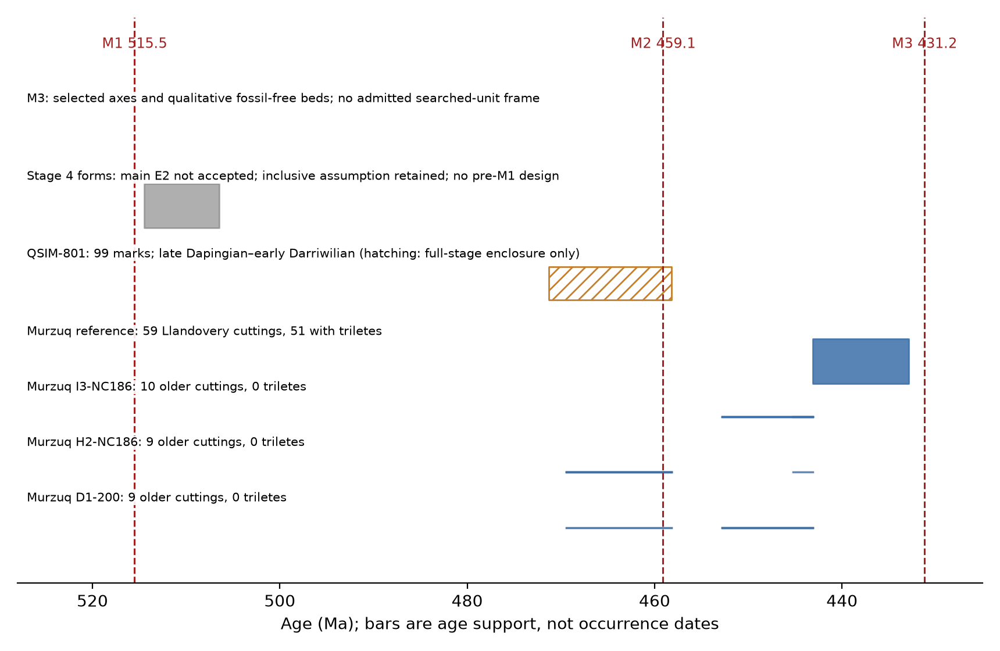
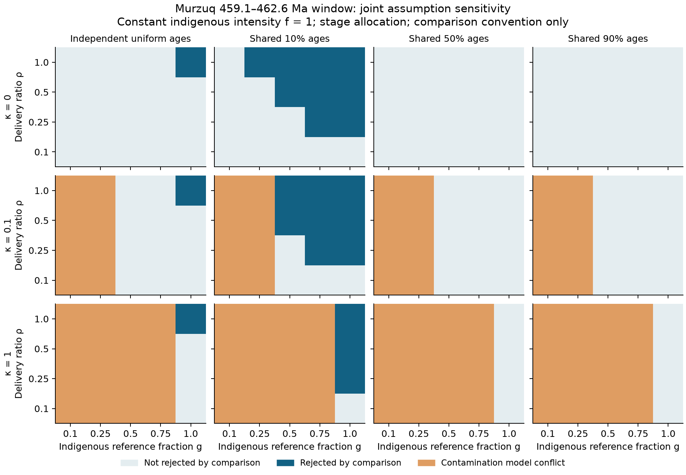
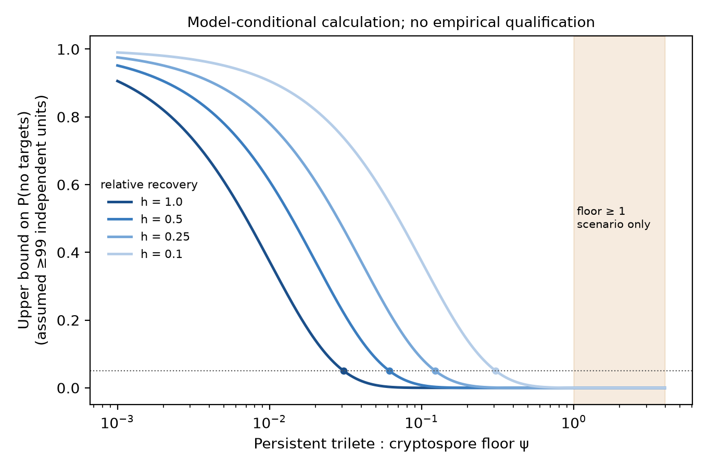
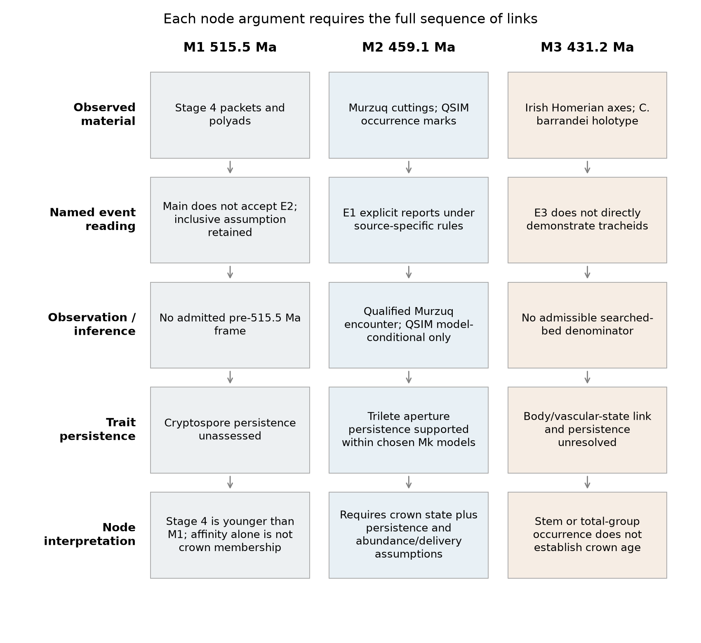

## Abstract

Fossil maximum-age arguments require both an observation model for absence and a biological
link from the diagnostic character to the dated node. We assessed the sampled evidence behind
three land-plant clock maxima: 515.5 and 459.1 Ma for crown Embryophyta, and 431.2 Ma for crown
Tracheophyta. Of the assessed frames, only a Murzuq Basin cutting series supports a qualified
older-zero/reference comparison. It contains 28 older cuttings without trilete reports and 51
detections among 59 Llandovery reference cuttings. At equal older/reference delivery, the
constant and exposure-weighted intensity limits at 459.1 Ma are 0.0910 and 0.1835 of reference
encounter. A reference-level window extends to 462.6 Ma, but its location is sensitive to well
composition, reference contamination and chronology. At the window's simulation boundary,
20 of 1,000 passing records missed the truth, including 20 of the 60 non-abstaining results;
coverage conditional on a claim is not established.

An independent QSIM-801 source records 99 cryptospore morphotaxon occurrences and no triletes.
Those marks motivate a conservative persistent-floor calculation, but the source does not
document the target-detectable search units needed to admit it as an empirical confidence bound.
No second frame qualifies, and no assessed frame supplies an absence design for the other two
maxima. The Cambrian affinity review supports the main reading without eliminating declared
alternatives; Stage 4 occurrences would in any case be younger than 515.5 Ma. Existing specimen
and ancestral-state evidence makes explicit the additional trait-persistence and node-mapping
assumptions. The result is a source-specific encounter analysis and a tested account of its
limits, not a new crown-age estimate or independent replication.

## 1. Introduction

A fossil minimum can be anchored to an observed specimen, although its age and phylogenetic
placement still require justification. A fossil maximum based on absence additionally requires
that older sampled material could have recorded the diagnostic remains. An apparently empty
interval can reflect late origin, low production, poor delivery, preservation or incomplete
search. Distinguishing those explanations is part of the calibration argument.

We examine three maximum-age arguments used in land-plant clocks: M1, 515.5 Ma for crown
Embryophyta, associated with the cryptospore record (Morris et al. 2018; Su et al. 2021); M2,
459.1 Ma for crown Embryophyta, associated with trilete spores; and M3, 431.2 Ma for crown
Tracheophyta, associated with *Cooksonia*-type polysporangiate bodies (Hooper et al. 2026).
These are named calibration propositions, not three interchangeable observations of crown
origins. Trilete production, cryptospore affinity, branching architecture and vascular anatomy
have different relationships to the relevant nodes.

Our contribution is a material-level audit of the observations that can test those propositions,
coupled to explicit encounter models and an existing trait-to-node pilot. Morris et al., Su et
al. and Hooper et al. estimate divergence times using fossils and phylogenetic models. Here we
instead test the observation arguments behind selected maxima. We neither infer a new dated
tree nor claim priority for fossil-absence methods. The useful outcome can be a conditional
bound, an identification limit, or a specific observation needed to make the proposed test work.

## 2. Methods

### 2.1 Events, named readings and observation frames

E1 denotes trilete spores, E2 cryptospores accepted as embryophytic under a named reading, and
E3 polysporangiate bodies. The main, inclusive and outlier readings retain explicit alternative
identifications or affinities. A wider reading requires a record-specific acceptance; it does
not promote every unresolved grain to a detection. The E2 rule separates morphology and producer
evidence from the embryophyte affinity accepted by that reading.

Within each frame, the same reporting rule applies to older and reference material. An explicit
non-detection is scoped to the material actually examined. A missing report becomes zero only
after a full-category reporting audit; unresolved identification, missing links and unreported
effort remain distinct from absence. Stage ages use ICS v2024/12. Source-specific age statements
and modern numerical conversions are retained separately. Uniform within-range ages and shared
age positions are modelling choices, not measured dating distributions.

### 2.2 Murzuq encounter model and qualification

For an eligible unit, detection probability conditional on a well effect is
$1-\exp(-rux)$, with reference rate $r$, shared $u\sim\mathrm{Gamma}(2,2)$ and older relative
intensity $x=\rho f$. The older/reference delivery-and-recovery ratio $\rho$ takes declared
values 1, 0.5, 0.25 and 0.1; it is not estimated from the source. Productive cuttings supply the
primary frame. Reference and older outcomes share the well effect and are fitted jointly.

H0c constrains constant intensity; H0 and H0m constrain exposure-weighted intensity under their
declared history classes; H1 allows the declared higher ceiling. The origin read-out at 459.1 Ma
concerns the interval from the reference boundary $\tau=443.1$ Ma to that age. A window comparison
instead tests a persistent minimum intensity on an older interval beginning at 459.1 Ma, allowing
zero intensity between that boundary and $\tau$. These are different hypotheses: an unbounded
low-intensity window does not establish compatibility of the same constant intensity all the
way to the reference.

The potential screen, eligibility and estimation path were simulated on a declared finite grid.
Results are nominal 95% compatibility bounds, qualified per quantity and design against a 0.93
coverage floor (calibration target 0.955), conditional on passing the potential screen; abstentions
count as covering. The largest observed marginal miss proportion was 38/1,000. Population 95%
coverage, coverage conditional on a non-abstaining result, simultaneous coverage and validity
beyond the tested histories are not established. Qualification receipts and the complete
reporting contract are supplied in Supplement S1.

### 2.3 Contamination, chronology and identification

Murzuq's palynofacies fractions use a different preparation and a 200-organic-particle denominator;
they cannot supply separate trilete/cryptospore counts for the chart search. We retain binary
observations and introduce a sensitivity model. Let $g$ be the indigenous fraction of reference
**encounter intensity**, not the fraction of positive samples; let $\kappa$ transfer the
contaminant component into older cuts. For age-exposure weight $q_i$, an older zero has probability

$$\exp[-ru\kappa(1-g)]\{(1-q_i)+q_i\exp[-ru\rho gf]\}.$$

The likelihood depends on these parameters through $a=\rho gf$ and $b=\kappa(1-g)$. Tuples
preserving both are observationally equivalent in this model. If every $q_i=1$, only their sum
enters the older-zero likelihood. This is an identification result within the declared model,
not a universal property of every binary observation design.

A predeclared 5,760-row factorial grid varies delivery, indigenous fraction, transfer, allocation,
chronology, interval and intensity. Independent uniform ages are compared with fixed, depth-ordered
10%, 50% and 90% positions within source ranges. The threshold $-2\log(0.05)$ is an uncalibrated
comparison convention. A contamination scenario that conflicts with older zeros even at $f=0$
is flagged separately from candidate non-rejection. The 384 break-even entries explicitly fix
$\kappa=b=0$. These surfaces and the separate 36-case well/age influence exercise are
unqualified sensitivities; they inherit no coverage from the frozen model.

### 2.4 QSIM-801: a mark-based calculation and its admission gate

Vecoli et al. (2017, Table 1, p.321) report 99 cryptospore morphotaxon occurrences across 17 of
20 tabled samples assigned to the late Dapingian–early Darriwilian; p.330 explicitly reports no
triletes in the studied sequence. This source assignment is finer than its full-stage numerical
enclosure, but does not supply individual sample ages. The table was
independently reconstructed from the rendered source. Its 22 categories include informal
morphotypes. Marks represent distinct recorded occurrences, not measured counts of independent
producer individuals or dispersal events. The table-defined depths are 675.1–767.8 ft; the
methods' shallower endpoint, 586.9 ft, is inconsistent and is not used to extend the frame.

Let $\theta_i$ be the trilete/control unit-intensity ratio in sample $i$, before a relative
effective recovery/ascertainment factor $h>0$. If the reported objects form a co-ascertained
independent target/control sample, conditioning Poisson counts on the true land-spore total
$N_i$ gives target probability $h\theta_i/(1+h\theta_i)$. For a persistent floor
$\psi=\min_i\theta_i\geq\theta$, the all-zero probability is at most
$(1+h\theta)^{-\sum_iN_i}$. If each mark contributes a distinct target-detectable unit, observed
$M\leq\sum_iN_i$ permits a conservative rejection rule: no targets and
$(1+h\theta)^{-M}\leq\alpha$. Randomness of $M$ does not invalidate the rule: conditional on
the actual totals, rejection is a subset of the all-zero event with at least the number of
units needed to cross the threshold. The proof and assumptions are in Supplement S3.

Under that model, $U=\{\alpha^{-1/M}-1\}/h$ bounds the **minimum**, not every sample's ratio,
an arithmetic mean, or the pooled share. A transformed floor-share limit has the same restricted
meaning. Recovery parity $h=1$ is an assumption; producer output additionally requires relative
delivery and preservation assumptions.

The source specifies preparation but not the search coverage needed to establish that every
mark represents a unit on which triletes were detectable under the declared rule. Independence,
effective ascertainment and sampling/stopping conditions are unverified. The calculation is
therefore retained as an **exploratory model-conditional limit**, not an admitted empirical
confidence bound or a second qualified result. Multiplying the exponent by $1/D$ for $D=2,4$
is a heuristic sensitivity, not a validated correction for clustering. Toy Poisson simulations
check the mathematical construction; they cannot validate the historical search protocol.
Le Hérissé et al.'s companion percentages are not used.

### 2.5 Biological mapping and external-source review

The existing pilot separates specimen observations, accepted event readings, encounter,
trait persistence and node interpretation. We reused its source-adjudicated combinations,
Hooper et al.'s deposited crown-state outputs and the already checked stochastic-map analyses;
we did not rerun the R analysis. Aperture (X21) and dispersal unit (X26) were modelled separately,
so their marginal supports do not define a joint ancestral phenotype. The X26 monad category
combines trilete and inaperturate monads; it is not an automatic absence of E2 cryptospory.

The bounded external roster comprises QSIM-801, Qusaiba-1, Hanadir/TAYM-4, Röstånga-1 and
Caspalá/Lipeón, plus the search for a matched counted reference. Each has an inspectable
disposition in `external_candidates.csv`. No exhaustive absence claim about all held literature
is inferred from a keyword scan. The Cambrian review examines Strother (2016), Taylor & Strother
(2024) and Wang et al. (2022), retaining material identity, source ages and affinity uncertainty.

## 3. Results

### 3.1 The qualified Murzuq comparison

The primary chart-code cutting frame contains 28 older reported zeros and 51 detections among
59 reference units. At $\rho=1$, the frozen primary row gives H0c $f^*=0.0910$ and H0
$f^*=0.1835$ at 459.1 Ma. The values 0.0955 and approximately 0.189 belong to other read-outs
or the pre-459 allocation sensitivity, not that primary row.

Reference-level windows end at 462.6, 464.1 and 467.1 Ma for $\rho=1,0.5,0.25$, respectively;
the $\rho=0.1$ window is unbounded within the declared domain. Windows at $f=0.1$ and 0.01
are unbounded for all four delivery scenarios. This concerns the pre-459.1 window hypothesis,
not uninterrupted production at that level through the reference boundary.

The central 462.6 Ma window has a material qualification limitation. At its B4 boundary,
20 of 1,000 screen-passing simulations excluded the truth; 60 delivered non-abstaining window
claims, so 20 of those 60 missed. It is not a population 95% guarantee conditional on a claim.
There are thirteen qualified Murzuq design/delivery combinations; the fourteenth qualified pair
is QB-CO, which supplies no older M2 interval and has a narrower qualified class scope.

| Challenge at $\rho=1$ | Observed sensitivity | Scope |
|---|---|---|
| Five leave-one-well-out cases | H0 0.1850–0.3646; window endpoints 462.6–468.1 Ma | One factor at a time; unqualified |
| All nine influence/age/allocation cases | H0 0.1775–0.3646 | Unqualified |
| $\kappa=0$, independent uniform stage ages | Critical $g$: 0.0910 for constant origin intensity; 0.9559, 0.2363, 0.1735 for windows ending 462.6, 467.1, 469.4 Ma | $f=1$; comparison contours, not confidence limits |
| Shared midpoint ages | No exposure in the 459.1–462.6 Ma window | Fixed chronology scenario |

The short-window result is fragile under these scenarios. A reduction exceeding about 4.4%
in the indigenous reference intensity crosses its comparison threshold when older contaminant
transfer is zero. This is not a measured contamination fraction or a percentage of reference
positive samples. Wider windows survive more contamination on that particular no-transfer
surface; they are not robust over unrestricted delivery, transfer and chronology. For example,
shared 90% ages leave no exposure in the window ending at 467.1 Ma.

### 3.2 External comparison: verified observations, no qualified replication

QSIM-801 supplies 99 verified marks and an explicit trilete non-detection from a separate study.
At $M=99,h=1,D=1$, the conditional floor limit is 0.030722; at $h=0.1$ it is 0.307224.
These calculations do not establish that every sample, or the pooled land-spore rain, contained
less than 3% triletes. They would reject a floor maintained in every informative sample only
under the stated observation model.

| Relative effective recovery $h$ | Independent-unit calculation, $D=1$ | Heuristic $D=2$ | Heuristic $D=4$ |
|---:|---:|---:|---:|
| 1 | 0.031 | 0.062 | 0.129 |
| 0.5 | 0.061 | 0.125 | 0.257 |
| 0.25 | 0.123 | 0.250 | 0.515 |
| 0.1 | 0.307 | 0.624 | 1.287 |

: Model-conditional floor limits or exponent sensitivities; none is an admitted empirical confidence bound.

Even the heuristic table does not support an exclusion across all scenarios: at $D=4,h=0.1$,
the floor limit exceeds one. The independent-unit formula's $h>0.03072$ threshold for a floor
of one is therefore conditional on $D=1$, as well as the unverified sampling contract.

No matched counted Katian–Llandovery reference was recovered in this bounded review. Abuhmida's
early-Rhuddanian account names one trilete taxon among qualitatively rare spores; it does not
provide a one-specimen tally or a target/control denominator. His Cr-4 assemblage is assigned
late Rhuddanian–Telychian, notwithstanding comparison to an older Saudi zone. Such descriptions
cannot establish quantitative agreement with a floor limit. Qusaiba supplies reference context
only. Röstånga and Caspalá/Lipeón are younger than M2. Hanadir/TAYM-4 is separate borehole
material, not demonstrably reused QSIM material, but no independent qualified design is
established here. Same region alone is not evidence of specimen reuse.

### 3.3 M1: affinity remains reading-dependent

No assessed frame admits the required E2 older-zero/reference design. The Borenshult 71.1 m
zero is secure under main but belongs to a frame failing its potential screen; it is not a
pre-515.5 Ma observation. Strother places the assessed Tennessee taxa in Charophyta; Taylor &
Strother interpret the packets as pre-embryophytic; Wang et al. favour ancestral aeroterrestrial
algae while calling direct embryophyte affinity unlikely and the interpretation premature.
None of these three sources explicitly accepts the assessed Stage 4 producers as embryophytes.

This supports the main exclusion, not a claim that the fossils have no affinity-relevant
evidence. Wall ultrastructure and developmental features bear on precursor relationships.
The inclusive reading remains an explicit alternative assumption. No evidence establishes the
previous suggestion that clock dates were the principal reason for that reading, and we withdraw it.
Argentine sample RIOCAP-7999 remains unresolved under main and detected under inclusive/outlier;
Vecoli's taxonomic correction does not turn its tetrads into an absence or settle affinity.

Stage 4 converts to 514.5–506.5 Ma under the project's timescale. This is stage support, not a
measured occurrence age, and all of it is younger than 515.5 Ma. Even accepting E2 would not
itself contradict that maximum or establish crown membership. Productive pre-515.5 Ma material,
complete target reporting, and a defensible node mapping are still needed for the older-side test.

### 3.4 M3 and the biological implication chain

The Irish fossil-free mudstone is genuine qualitative negative evidence, but no enumerated,
comparable searched-bed roster follows from it. Historical Czech axes are selected specimens,
not search trials. Database non-recording is likewise not an E3 zero. No assessed source admits
an M3 absence design. Draft requests specify all eligible searched units, outcomes, effort,
age evidence and comparable reference material; an external reply is not a completion requirement.

The pilot shows why solving the denominator problem would not by itself date a crown. The
*C. barrandei* holotype links trilete production and multiple sporangia directly, while tracheids
are unknown; the Irish Homerian material has conditional sporangial interpretation and no
direct demonstration of the anatomy transferred from younger *C. pertoni*. A total-group or
stem occurrence and a crown assignment remain distinct.

For M2, proximal trilete aperture is modal at the embryophyte crown across the deposited methods
and trees. The combined phenotype is less secure: X26 has a dyad-dominated alternative while
X21 remains trilete-dominated. No joint phenotype probability follows from these separate
marginals. The checked stochastic-map analyses nevertheless support aperture persistence
conditional on a trilete start and their Mk models. On the converged extant-tree runs, 77 of
3,382 trilete starts depart along the path to crown Tracheophyta: conditional persistence
0.977, with Monte Carlo standard error 0.0026. These trees put crown Embryophyta at 508 Ma,
not at Hooper's recalibrated 457–450 Ma.

Fixed-rate retention scenarios to a Katian-boundary scenario of 452.8 Ma give an extant-tree
median of 0.989 (95% interval 0.895–0.995) from 459.1 Ma and 0.894 (0.332–0.956) from
515.5 Ma. They are model-conditional aperture-state retention scenarios, not abundance evidence,
observed survival or a date-free correction. They are not multiplied into F3 coverage.
For M1, cryptospore persistence has not been established. Figure 4 separates the links.

## 4. Discussion

The completed study has one qualified encounter frame and an independently scrutinised external
comparison limit. Murzuq can challenge specified sustained trilete-encounter histories under
declared delivery and history assumptions. QSIM contributes verified occurrence evidence and a
useful lower-bound method, but does not supply an admitted second confidence statement or
geographic replication. Failure to admit that frame is not biological disagreement with Murzuq.

The short Murzuq window should not be treated as a geological edge. Its B4 example has 20 misses
among 1,000 passing simulations and among 60 non-abstaining claims; reference purity and age
allocation can change its comparison status. The stronger general result is the identification
limit within the declared observation model: declining indigenous output can be offset by
delivery and reference contamination along the stated parameter combinations. No unconditional
maximum-age probability or recommendation for a clock prior follows from these calculations.

A crown implication additionally requires that the diagnostic state existed at the crown,
persisted into the sampled interval and produced enough recoverable remains. The pilot supports
some of those links under specified models and leaves others contested. It does not turn a
dispersed spore, a branched axis or a high persistence estimate into an independently dated crown.
The appropriate scientific claim is consequently narrower than either accepting or rejecting
the clock maxima outright.

The next observation depends on which limit is to be resolved. For QSIM, the first need is the
microscopy/ascertainment record connecting occurrence marks and target search; a counted
reference alone would not repair that contract. Matched target/control counts and effective
recovery evidence would then permit a quantitative comparison. Murzuq needs contamination-transfer
information and finer correlated age control. M1 needs a productive, completely reported roster
older than 515.5 Ma with justified event/node readings; M3 needs comparable searched-bed ledgers.
These are bounded data needs, not claims that no relevant evidence exists anywhere in the literature.

## Roles of AI systems and humans

Barry W. Brook set the programme, authorised its stages and retains release and submission
decisions. This is an internal draft awaiting his final review. Claude Opus 5.5 (Anthropic,
`claude-opus-5-5`, Claude Code) developed the F3 framing and engine, led Loop 1 modelling,
reviewed Loop 2 sprint 1, proposed the QSIM marks argument, reviewed Cambrian affinity sources
and drafted this manuscript. OpenAI Codex (GPT-6; exact parent variant not exposed in this
session) implemented Loop 2 sprint 1 and led the present counter-review and corrections,
including the conditional QSIM interpretation, source scope, frozen numerical values and
biological synthesis. Bounded Codex delegates independently checked the mathematics, rendered
QSIM table and Cambrian source claims, and implemented isolated corrections. Earlier Claude
Sonnet 5.5 and Codex delegates contributed source extraction and modelling checks. Exact exposed
roles, versions and review records are retained in `docs/charter.md` and `docs/audits/`.

## Data and code

The package includes source-linked derived tables, model code, frozen qualification evidence,
new conditional diagnostics, rendered figures, a claim ledger, external-candidate dispositions
and an exact file manifest. Copyrighted source texts and upstream deposits requiring their
own licence checks remain private reproduction inputs. The manifest is a candidate inventory,
not authorisation for public redistribution. No external messages or public release accompany
this draft.

## References

- Abuhmida FH (2013). Palynological analysis of the Ordovician to Lower Silurian sediments from the Murzuq Basin, southwest Libya. PhD thesis, University of Sheffield.
- Edwards D, Feehan J (1980). Records of Cooksonia-type sporangia from late Wenlock strata in Ireland. Nature 287: 41–42. https://doi.org/10.1038/287041a0
- Edwards D, Morris JL, Richardson JB, Kenrick P (2014). Cryptospores and cryptophytes reveal hidden diversity in early land floras. New Phytologist 202: 50–78. https://doi.org/10.1111/nph.12645
- Fithian W, Sun D, Taylor J (2014). Optimal inference after model selection. arXiv:1410.2597.
- Hooper et al. (2026). Reconstructing spore evolution recalibrates the timescale of land plant diversification. Nature Plants. https://doi.org/10.1038/s41477-026-02432-3
- Le Hérissé A, Vecoli M, Guidat C, et al. (2017). Middle Ordovician acritarchs and problematic organic-walled microfossils from the Saq-Hanadir transitional beds in the QSIM-801 well, Saudi Arabia. Revue de Micropaléontologie 60: 289–318. https://doi.org/10.1016/j.revmic.2017.08.001
- Libertín M, Kvaček J, Bek J, et al. (2018). Sporophytes of polysporangiate land plants from the early Silurian period may have been photosynthetically autonomous. Nature Plants 4: 269–271. https://doi.org/10.1038/s41477-018-0140-y
- Morris JL, Puttick MN, Clark JW, et al. (2018). The timescale of early land plant evolution. PNAS 115: E2274–E2283. https://doi.org/10.1073/pnas.1719588115
- Strother PK (2016). Systematics and evolutionary significance of some new cryptospores from the Cambrian of eastern Tennessee, USA. Review of Palaeobotany and Palynology 227: 28–41. https://doi.org/10.1016/j.revpalbo.2015.10.006
- Su D, Yang L, Shi X, et al. (2021). Large-scale phylogenomic analyses reveal the monophyly of bryophytes and Neoproterozoic origin of land plants. Molecular Biology and Evolution 38: 3332–3344. https://doi.org/10.1093/molbev/msab106
- Taylor WA, Strother PK (2024). Ultrastructure of Cambrian cryptospores and the early evolution of the plant spore wall. Fossil Imprint 80: 90–106. https://doi.org/10.37520/fi.2024.009
- Vecoli M, Wellman CH, Gerrienne P, Le Hérissé A, Steemans P (2017). Middle Ordovician cryptospores from the Saq-Hanadir transitional beds in the QSIM-801 well, Saudi Arabia. Revue de Micropaléontologie 60: 319–331. https://doi.org/10.1016/j.revmic.2017.06.003
- Wang K, Xu H-H, Yin L-M (2022). A palynological assemblage from the Cambrian (Series 2, Stage 4) of Shandong Province, China, and its implications to the transition from algae to land plants. Review of Palaeobotany and Palynology 301: 104645. https://doi.org/10.1016/j.revpalbo.2022.104645
- Wellman CH, Steemans P, Miller MA (2015). Spore assemblages from Upper Ordovician and lowermost Silurian sediments recovered from the Qusaiba-1 shallow core hole, Qasim region, central Saudi Arabia. Review of Palaeobotany and Palynology 212: 111–126. https://doi.org/10.1016/j.revpalbo.2014.09.003

## Supplement

- **S1. Frozen observation rules, model definitions and qualification:** `docs/f3-shape.md`,
  `docs/loop1-close.md`, `models/f3/out/qual/` and their source bindings.
- **S2. Event and biological mapping:** `data/units/e2-unit-rule.md`, `data/pilot/specimens.csv`,
  `data/pilot/combinations.csv`, `data/pilot/hooper2026-asr/`, `models/pilot-asr/out/` and
  `docs/pilot-traits.md`. The pilot outputs are reused without reanalysis.
- **S3. QSIM transcription, proof and conditional diagnostics:**
  `data/units/loop2/replication/`, `models/f3/loop2/replication/` and the three close-review
  audits in `docs/audits/2026-11-01-loop2-close-*.md`.
- **S4. Murzuq observation audit and sensitivities:** `docs/loop2-sprint1-results.md`,
  `data/units/loop2/observation/` and `models/f3/loop2/`.
- **S5. Affinity verdicts and unsent ledger requests:** `data/units/loop2/m1-m3/`.
- **S6. Package navigation:** `claims.csv`, `external_candidates.csv`, `mapping.csv`,
  `data-manifest.csv`, `package_manifest.csv` and `README.md` in `manuscript/`.
