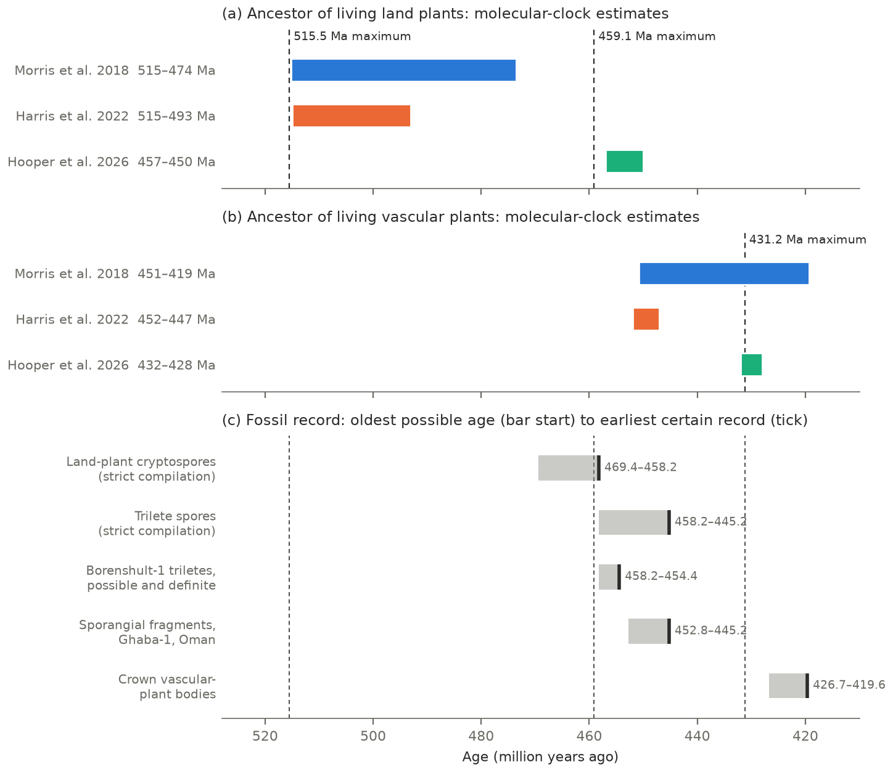
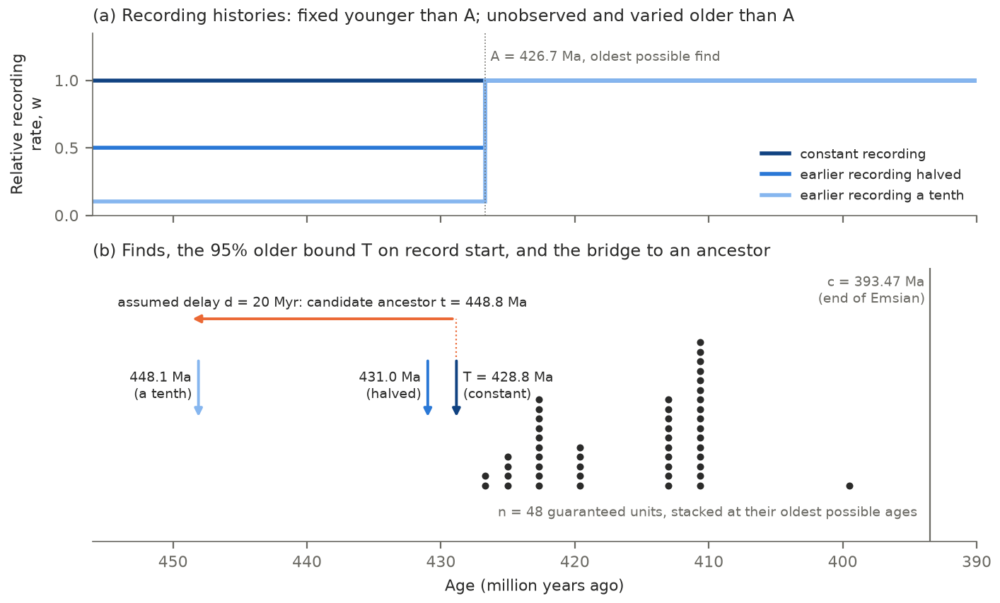
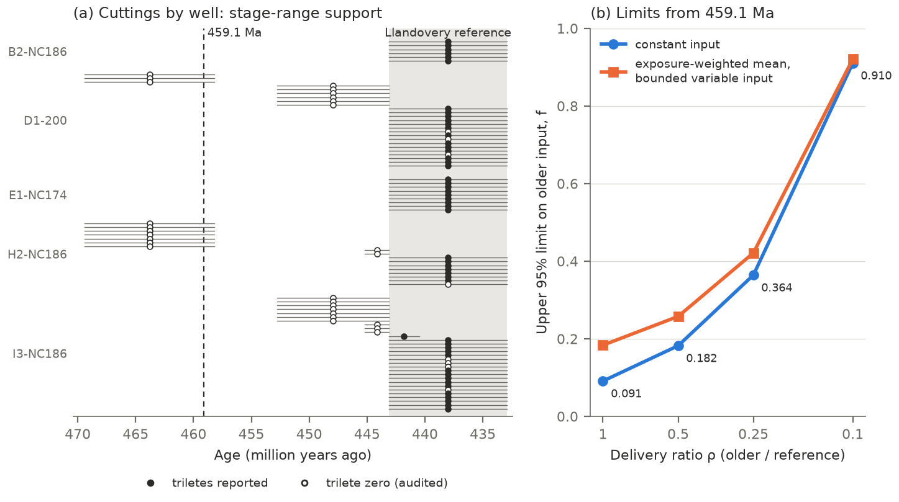
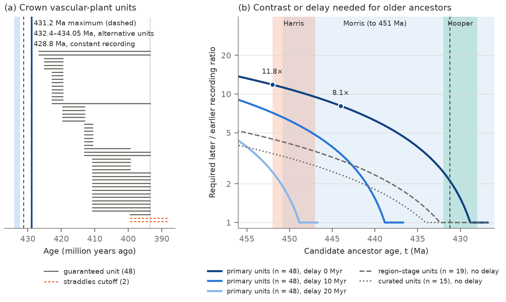

# Reconstruction step 4: final detailing

Claude Opus 5.5, revised by Codex (`gpt-6.1-sol`), 11 November 2026, from the locked step 3c draft at
`ef253d6`. Claude's step-4 version is preserved at `7e560c5`. Barry's instruction (chat,
11 November 2026): add references, formatting and display-item legends, give it "a hard edit, to cut
verbiage", repeat the main message strategically, then make a second pass for "context, clarity, your
target audience, and a general audience: no re-structures at this stage". Numbers carry ledger
bindings; citation keys resolve in `references/refs.yaml`. The canonical products in `manuscript/text/`
stay frozen until this draft is reviewed. Notes on the edit follow the article.

---

# When did living land plants arise? What their fossil age limits require

## Abstract

Molecular clocks place the ancestor of living land plants anywhere from the Cambrian to the Late
Ordovician, partly because they use different fossil maximum ages. We examined three maxima:
515.5 and 459.1 million years ago (Ma) for living land plants, and 431.2 Ma for living vascular plants
(ferns, seed plants and relatives). We audited their sources, modelled Libyan spore records and
bounded when the vascular-plant body-fossil record began. The oldest maximum rests on a
qualitative preservation argument. In Libya, three-rayed (trilete) spores occur in [51 of 59]{.C02}
younger rock samples and none of [28]{.C01} older ones; with equal delivery, constant local spore input
from 459.1 Ma fits at up to [0.091]{.C24} of the younger level. For vascular-plant bodies, constant
recording gives a one-sided 95% older bound of [428.8]{.C27 .V003} Ma on their record's start, and
alternative counting units give [432.4–434.05]{.C30} Ma. If recognisable bodies appeared with the
ancestor, ancestors at 444–452 Ma fit when earlier bodies were recorded [8]{.C48 .V054}–[12]{.C48 .V055}
times less often, or [2.4]{.C48 .V056}–[4.5]{.C48 .V057} times under alternative units. Older dates for
living land plants fit the fossil record if early plants were found several times less often, or
recognisable features evolved later.

**Keywords:** molecular clock; fossil calibration; land plants; vascular plants; stratigraphic
confidence interval; Ordovician–Silurian

## Introduction

Molecular clocks estimate when lineages diverged by combining DNA differences with fossil limits on the
ages of selected ancestors. A crown group comprises the most recent ancestor shared by its living
members and all its descendants, including extinct lineages. For the ancestor of all living land plants (crown embryophytes),
@morris2018TimescaleEarlyLand obtained 515–474 Ma across seven tree topologies and
@harris2022DivergentEvolutionaryTrajectories 515–493 Ma. @hooper2026ReconstructingSporeEvolution
reanalysed Harris et al.'s DNA data with revised fossil calibrations and obtained 457–450 Ma, a mean
55 Myr younger. For the ancestor of living vascular plants (crown tracheophytes: clubmosses and their
relatives, ferns and seed plants), the three studies give 451–419, 452–447 and 432–428 Ma (figure 1);
@su2021LargescalePhylogenomicAnalyses obtained older land-plant ages still, under a Proterozoic maximum.
The dates bear on the order in which plant characters were assembled, and on how early plants changed
productivity, weathering and climate [@kenrick2012TimelineTerrestrializationConsequences;
@donoghue2021EvolutionaryEmergenceLand; @strother2021FossilRecordLand; @lenton2012FirstPlantsCooled].
They date the ancestors of living plants; extinct lineages may have reached land earlier.

A fossil sets a minimum age: its lineage existed by the age of its oldest secure member. An
absence-based maximum adds an argument that older rocks would probably have preserved and yielded
recognisable remains had the lineage existed [@benton2006PaleontologicalEvidenceDate]. How calibrations
are specified can strongly shape estimated dates, and with large sequence datasets they can dominate
the uncertainty in absolute ages [@ho2009AccountingCalibrationUncertainty;
@dosreis2015BayesianMolecularClock]. A soft maximum permits older ages through a specified tail of the
calibration prior [@yang2005BayesianEstimationSpecies]. Whether absence can set a maximum is contested
[@hedges2018AccurateTimetreesRequire; @morris2018ReplyHedgesEt], and best practice asks each calibration
to justify its maximum from the relevant geological, geographical and taphonomic record
[@parham2011BestPracticesJustifying].

Linking a fossil to an ancestor crosses two intervals: from divergence to the first recognisable
character, and from that character to its first recorded fossil [@marshall2019UsingFossilRecord]. Both
are uncertain for early land plants. Dispersed spores appear tens of millions of years before branched
plant bodies [@wellman2000MicrofossilRecordEarly; @rubinstein2010EarlyMiddleOrdovician;
@steemans2009OriginRadiationEarliest], terrestrial deposits are scarce before the latest Silurian, at
least in western Europe [@kenrick2012TimelineTerrestrializationConsequences], and the oldest parent
plants known in detail are minute [@edwards2014CryptosporesCryptophytesReveal].

Three maxima divide the current clocks (table 1). Morris et al. set 515.5 Ma for living land plants,
arguing that older marine rocks rich in algal cysts would also have yielded land-plant spores
[@morris2018TimescaleEarlyLand; @morris2018ReplyHedgesEt]. Hooper et al. set 459.1 Ma from the oldest
possible trilete (three-rayed) spores, in the Borenshult-1 core of southern Sweden
[@rubinstein2019BalticaCradleEarly], and 431.2 Ma for living vascular plants from Irish *Cooksonia*
[@edwards1980RecordsCooksoniatypeSporangia]. The three therefore rest on a preservation analogy, on
dispersed spores and on plant bodies, each with its own route into the record, and each needs its own test.

We ask three questions of the published record. What evidence supports each maximum, and which links
connect it to the dated ancestor? How much sustained spore input before the Silurian do the records of
one Libyan basin allow? What reduction in early fossil recording, or delay before recognisable bodies,
would accommodate older vascular-plant ancestors? Established theory sets an
expectation for each. An absence argument needs documented opportunities for delivery, preservation and
discovery [@parham2011BestPracticesJustifying; @marshall2019UsingFossilRecord]. With comparable
exposure, accumulating zero records increasingly constrain high sustained spore input. For a fixed oldest
find, younger cutoff and recording history, more independent finds narrow the bound on when a record began, and lower
earlier recording extends it [@strauss1989ClassicalConfidenceIntervals;
@marshall1990ConfidenceIntervalsStratigraphic]. The audit identifies what each maximum assumes; the
quantitative tests bound local spore input and describe the earlier recording or diagnostic delays
compatible with older vascular-plant dates.

**Table 1.** The three maxima examined: the evidence each rests on, the test the published record
allows, and the links a clock must still assume. GTS2012, Geologic Time Scale 2012.

| Maximum | Set by | Evidence | Test available | Links assumed |
|---|---|---|---|---|
| 515.5 Ma, living land plants | Morris et al. | Base of the *Olenellus* Biozone, below the oldest possible Cambrian spore-like packets; older marine rocks with algal cysts | Affinity of the Cambrian packets; any enumerated older sequence | Spore delivery to marine basins, catchment, search effort, spore production by the earliest members |
| 459.1 Ma, living land plants | Hooper et al. | GTS2012 Sandbian base plus uncertainty, keyed to the oldest possible trilete spore (Borenshult-1, Sweden) | Older zeros against younger positives, Murzuq Basin, Libya | Earliest crown members produced triletes, the trait persisted, producers lived in the catchment |
| 431.2 Ma, living vascular plants | Hooper et al. | GTS2012 Homerian base plus uncertainty, keyed to Irish Homerian *Cooksonia* | A bound from the body-fossil record, and what older ancestors require | Recording before the oldest find, delay before recognisable bodies, the anchor lies within the vascular crown |

## Material and methods

**(a) Timescale and readings.** Analysed ages use the stage bases of the International
Chronostratigraphic Chart, v2024/12 [@cohen2013IcsInternationalChronostratigraphic]; literature ages
were mapped by stage. Published maxima keep their source timescale, GTS2012, so they can be compared as
their authors set them. Each analysis declares its reading of disputed identifications, main or
inclusive, so contested fossils enter as alternatives.

**(b) Source audit.** For each maximum we traced the calibration fossil, its age rule and its recovery
route to the original descriptions, and recorded each published reading of the fossil's identity with
its evidence [@parham2011BestPracticesJustifying]. A reported non-detection applies to the material
examined, and a missing report counts as a zero only where the source reports the target fully.

**(c) Libyan spore records.** @abuhmida2013PalynologicalAnalysisOrdovician reported spores and other
microfossils from Ordovician to lower Silurian wells in the Murzuq Basin, southwest Libya. We transcribed
all [164]{.C38} appendix samples with their chart and prose reports. The primary frame uses the
chart-coded cuttings (rock chips returned during drilling) of five wells: three supply [28]{.C01}
cuttings older than the Llandovery (earliest Silurian), and all five supply [59]{.C02} Llandovery
reference cuttings. The source states the absence of trilete spores explicitly for part of the sequence;
for the Hawaz Formation, zeros rest on complete reporting charts and the stated microscopy protocol. The
basin lay near the Ordovician South Pole, within the area of Hirnantian glaciation
[@cocks2021OrdovicianPalaeogeographyClimate; @scotese2021PhanerozoicPaleotemperaturesEarths]
(figure 3*a*).

**(d) Spore encounter model.** We jointly fitted the reference encounter rate and older input, with a
mean-one gamma-distributed effect (shape and rate 2) shared by the cuttings of each well. Given this
effect and their ages, which are uniform within each cutting's stage range, cutting outcomes are
independent. Older input is a fraction *f* of Llandovery input, and a fixed delivery ratio *ρ* covers
differences in transport, preservation and preparation. We computed upper 95% compatibility limits on
*f* for constant input, and for the exposure-weighted mean of variable histories, from a postulated
start, with input between zero and the reference level. The potential screen sets older reports to
zero and checks whether the frame could exclude constant reference-level input when every older
cutting is exposed, with a usable younger reference. Each simulation uses the same screen; the
analysis uses the actual reports. Acceptance simulations independent of calibration then qualified
each declared quantity on a finite scenario grid. Among replicates passing the
screen, with withheld claims counted as non-errors, the one-sided 95% lower confidence limit on coverage
had to exceed 0.93; borderline quantities went to a preplanned pooled rule (electronic supplementary
material, S2).

**(e) Body-fossil units.** We assembled land-plant body fossils dated to 453–393 Ma from Paleobiology
Database (PBDB) occurrences, whose names an AI model classified with cited sources before our audit,
and from a source-reviewed set of the oldest records with their competing readings. Collections, taxa
or papers sharing a locality and age count once, as proxies for independent fossil horizons. We declare
three nested categories. Land-plant bodies are any accepted macro- or mesofossil. Polysporangiophytes
have documented branched axes bearing sporangia (spore capsules), or placement within the vascular crown. Crown
vascular plants belong to the lycophyte line (clubmosses and relatives) or the euphyllophytes
(ferns and seed plants) [@kotyk2002MorphologicallyComplexPlant;
@libertin2018SporophytesPolysporangiateLand; @earp2024NotanopliidBrachiopodsAssociated;
@libertin2024GenusAberlemniaSiluriandevonian]. The main reading gives [78]{.C25}, [71]{.C25} and
[50]{.C25} units, of which [76]{.C40 .V021}, [69]{.C25} and [48]{.C25} are certainly older than the end
of the Emsian ([393.47]{.C25} Ma) (electronic supplementary material, S5.1).

**(f) Bound on record start.** Let *w*(*s*) be a fixed relative rate at which identifiable occurrences
of a category are recorded at age *s*, and $U(a)=\int_c^a w(s)\,ds$ the cumulative recording above a
younger cutoff *c*, here the end of the Emsian. For *n* independent units with oldest age *A*, the
one-sided 95% older bound *T* on the start of the recognisable record solves $U(T)=U(A)\,0.05^{-1/n}$
(figure 2). With constant *w* this is the classical confidence interval on a stratigraphic range, and
the absolute rate cancels [@strauss1989ClassicalConfidenceIntervals;
@marshall1990ConfidenceIntervalsStratigraphic]; varying *w* follows the extensions to non-random fossil
horizons [@marshall1994ConfidenceIntervalsStratigraphic; @marshall1997ConfidenceIntervalsStratigraphic].
Units dated by ranges enter through the greatest possible oldest age and the minimum number guaranteed to
lie within the window. The bound concerns the start of the record; the Discussion treats its link to
ancestors.

**(g) Recording histories and shape tests.** We compared six fixed histories: constant recording;
recording proportional to PBDB land and marginal-marine collections per Myr
[@brook2026FrozenPaleobiologyDatabase], with or without collections matching plant occurrences;
exponential declines into the past with 25 or 10 Myr timescales; and plant-excluded collection density
multiplied by the 10 Myr decline. The collection records extend to [469.4]{.C27 .V007} Ma, which sets
the analysis domain. Finite-sample Kolmogorov–Smirnov tests compared each history with the observed age
sequence, conditional on the count and the oldest find. For each history we searched every admissible
allocation of ages within their ranges, and each inclusion state of the units straddling the cutoff,
for the most favourable allocation [compare @berger1994PValuesMaximized]. A history that fails under
every allocation and state is rejected for this diagnostic (electronic supplementary material, S5.2).

**(h) Recording contrast and diagnostic delay.** The primary step model keeps later recording constant
and lowers earlier recording before [426.7]{.C32} Ma, the oldest possible age of a crown vascular-plant
find. For a candidate ancestor age *t* and an assumed delay *d* before recognisable bodies, the
earlier-to-later rate ratio that places *t* − *d* on the bound is $r=(A-c)(0.05^{-1/n}-1)/(t-d-A)$,
defined where $t-d>A$; the recording contrast is $1/r$. We placed the step after inspecting the record,
so its contours describe retrospective compatibility. Longer assumed delays reduce the contrast a given
candidate age requires [@marshall2019UsingFossilRecord].

## Results

**(a) The 515.5 Ma maximum rests on a qualitative control.** Morris et al. placed this maximum below
the oldest possible total-group records, spore-like packets and clusters from the Cambrian Stage 4 Rome
Formation, at the base of the *Olenellus* Biozone (about [515.5]{.C46} Ma). Its preservation control,
older marine sequences with algal cysts and without land-plant spores, shows that walled microfossils
survived and were recovered [@morris2018TimescaleEarlyLand; @morris2018ReplyHedgesEt]. Spore delivery to those basins, the land areas they drained and the search
effort remain unquantified in the sources we assessed[]{.C16}. All [three]{.C15} sources we examined
assign the Cambrian packets to algae or pre-land-plant lineages: Charophyta
[@strother2016SystematicsEvolutionarySignificance], a pre-embryophytic grade
[@taylor2024UltrastructureCambrianCryptospores] or ancestral aeroterrestrial algae
[@wang2022PalynologicalAssemblageCambrian] (electronic supplementary material, S4).

**(b) The younger maxima follow a stage-base rule.** Hooper et al. set both younger maxima as a GTS2012
stage base plus its uncertainty. They keyed 459.1 Ma ([458.4 + 0.7 = 459.1]{.C42} Ma) to a possible
trilete spore at 48.2 m in the Borenshult-1 core [@rubinstein2019BalticaCradleEarly]. The oldest
definite trilete level, at 43.1 m, is also Sandbian and lies below the [454.41]{.C43} Ma Kinnekulle
K-bentonite, so the rule gives the same value from either level (electronic supplementary material,
S2.4). They keyed 431.2 Ma ([430.5 + 0.7 = 431.2]{.C47} Ma) to Irish Homerian *Cooksonia*
[@edwards1980RecordsCooksoniatypeSporangia]. The older Czech *Cooksonia barrandei*, a branched
sporophyte with terminal sporangia from a Sheinwoodian (early Silurian) horizon inferred from slab fauna
and correlation [@libertin2018SporophytesPolysporangiateLand], meets the same character criterion. On the
current timescale the rule gives outer values of [431.9]{.C47} Ma for the Homerian and [434.1]{.C47} Ma
for the Sheinwoodian.

**(c) Libyan zeros limit sustained, well-delivered spore input.** Trilete spores occur in
[51 of 59]{.C02} reference cuttings and none of the [28]{.C01} older cuttings (figure 3*a*). For input
starting at 459.1 Ma with equal delivery, the upper compatibility limit is [0.091]{.C24} of reference
input for constant histories, and [0.184]{.C24} for the exposure-weighted mean of bounded variable
histories (figure 3*b*). With delivery at a tenth of the reference, constant input near the reference
level fits ([0.910]{.C24}). For constant histories the record constrains the product $\rho f$, which
stays at [0.091]{.C24} across delivery scenarios.

**(d) The Libyan limits cover the later Ordovician.** Most older exposure comes from [18]{.C45}
Katian–Hirnantian (Late Ordovician) cuttings, all younger than 459.1 Ma. Only [10]{.C45} broadly dated
Darriwilian (Middle Ordovician) cuttings, from two wells, have age ranges extending before 459.1 Ma.
Their contribution under a start at that age depends on how ages are spread within the stage; shared
midpoint ages give them none[]{.C09}. The limits therefore concern sustained input through the later
Ordovician in one high-latitude basin.

**(e) The vascular-plant body record has an older bound near 429 Ma.** The [48]{.C25} crown
vascular-plant units give a one-sided 95% older bound of [428.8]{.C27 .V003} Ma under constant recording
(figure 4*a*). Histories tracking collection density give [428.9]{.C27 .V009} Ma, or [428.5]{.C27 .V010}
Ma with plant-matched collections removed, and a 25 Myr decline into the past gives
[431.6]{.C27 .V011} Ma. The pure 10 Myr decline leaves the start unresolved through [469.4]{.C27 .V007}
Ma and fails the shape diagnostic under every admissible allocation and inclusion state[]{.C49}. For the
25 Myr decline, one admissible allocation of all [50]{.C49 .V107} possible units gives
*p* = [0.067]{.C49 .V104}, whereas every allocation of the [48]{.C49 .V069} guaranteed units fails
(best *p* = [0.035]{.C49 .V106}).

**(f) Counting units move the bound across 431.2 Ma.** Collapsing units to region–stage cells
([19]{.C30} units) gives [432.4]{.C30} Ma, and the curated oldest-record set alone ([15]{.C30} units)
gives [434.05]{.C30} Ma, both under constant recording. Shifting stage boundaries by their quoted
uncertainties, in the tested shared-boundary scenarios, moves the primary bound between
[427.31]{.C50 .V062} and [430.42]{.C50 .V063} Ma (electronic supplementary material, S5.3).

**(g) Older vascular-plant dates fit sparser early recording or later recognisable bodies.** In the primary step
model, halving earlier recording gives [431.0]{.C53 .V108} Ma, still younger than the 431.2 Ma maximum.
With zero assumed delay, ancestors at 444–452 Ma, spanning the Morris et al. mean dates and the Harris
et al. interval, need earlier recording [8]{.C48 .V054}–[12]{.C48 .V055} times lower than later
recording (figure 4*b*). Under region–stage or curated units the contrast falls to
[2.4]{.C48 .V056}–[4.5]{.C48 .V057} times, and 431.2 Ma needs none. With constant recording, the same
ancestors instead need assumed delays of at least [15–23]{.C33} Myr before recognisable bodies. Smaller
contrasts combine with shorter delays (figure 4*b*).

**(h) One Ordovician find moves the broader land-plant bound.** Sporangial fragments with in situ
cryptospores from the Ghaba-1 borehole, Oman, dated to the Katian on later correlation
[@wellman2003FragmentsEarliestLand], form one land-plant body unit. Adding them moves the broader
category's constant-recording bound from [434.5]{.C28} to [455.2]{.C40 .V022} Ma, and the augmented
sequence fails the shape diagnostic under all six fixed histories[]{.C49}. The fragments came from
palynological preparation of borehole material, whereas most later units are compressions collected
from bedding planes [@edwards1979RecordsFertileRhyniophytina].

## Discussion

The early record allows older ancestors, and the analyses state what each would require. In the Murzuq Basin, sustained,
well-delivered trilete input at the Llandovery level through the later Ordovician conflicts with the
zero records; lower delivery, lower local input or producers outside the catchment all remain
compatible. Under constant or collection-density recording, the one-sided 95% older bound on the
recognisable crown vascular-plant record lies near [429]{.C27 .V018} Ma, and coarser or curated units
put it at [432.4–434.05]{.C30} Ma. For these unit treatments, sparser earlier recording, later
recognisable bodies or both can accommodate ancestors older than the corresponding fixed-history
bounds; the models size each requirement in aggregate.

Several processes could have made early plants scarcer in the record. Producers may have been rarer,
more geographically restricted, concentrated where little terrestrial sediment accumulated, or preserved in
intervals that have been searched less. Body size, cuticle and lignified tissue could also raise the chance that a
body is preserved, found and recognised. Branched sporophytes and conducting tissue were acquired
stepwise along the lineages being dated [@kenrick1997OriginEarlyEvolution]. The early branched
sporophyte *C. barrandei* is preserved in marine sediments [@libertin2018SporophytesPolysporangiateLand],
and the Oman fragments show that small sporangia can survive [@wellman2003FragmentsEarliestLand]. The
models quantify the combined contrast a candidate age requires; the contribution and plausibility of
each process remain open.

@silvestro2015RevisitingOriginDiversification modelled genus-level PBDB plant occurrences with a joint
Bayesian model of preservation and diversification, and estimated the origin of vascular plants at a mean
of 433.5 Ma (95% highest posterior density 449.0–424.0 Ma). They estimate when the earliest
vascular-plant genus lineage arose, with a fitted, varying preservation rate; we bound the start of the
recognisable record of a declared crown category under fixed recording histories, then ask what older
ancestors require. The two analyses target different quantities from partly shared data and test
different assumptions. CladeDate builds calibration densities directly from fossil times
[@claramunt2022CladedateCalibrationInformation], and Hooper et al. link spore-character reconstruction
to revised calibrations. We make the maxima's observational requirements explicit, quantifying local
spore input and the body-recording contrasts or diagnostic delays compatible with older vascular-plant dates.

**Conditions.** The spore limits assume an indigenous younger reference, comparable reporting in older
and younger cuttings, ages uniform within stages, and cutting outcomes independent given a shared well
effect. Three exploratory dependence checks, with unqualified coverage, give
contours of [0.0995]{.C51 .V058} with separate reference rates per well and no random well effect, near
[0.4]{.C51 .V081} with well–formation block weighting, and [0.185–0.365]{.C07} (exposure-weighted) with
one well left out at a time. Linking the local spore record to ancestors requires that the earliest crown
embryophytes produced recognisable trilete spores, that the trait persisted and that producers lived in
the catchment (electronic supplementary material, S6).

The body bounds and conservative shape rejections assume independent continuous ages; fixed histories,
cutoff, timescale, inventory and unit rules; and an observation model whose age ranges contain all true
ages and inclusion states with probability one. Geological ranges have no demonstrated joint coverage;
if containment fails with probability $\delta$, the direct test-size bound is $\alpha+\delta$, where
$\alpha$ is the exact-age significance level. Matched exact-age simulations gave coverage of
[0.941–0.958]{.C34}, falling to about [0.78]{.C34} when paired duplicate horizons were treated as
independent (electronic supplementary material, S5.6). The step model is retrospective. Linking the vascular-body bound to
ancestors requires crown membership of the oldest finds and a specified delay before
recognisable bodies.

Published evidence could narrow these requirements. Records of searched Silurian
terrestrial beds, with effort and empty beds included, would help constrain early recording, and
compilations of rock units could supply proxies for the terrestrial rock available at each age
[@peters2018MacrostratPlatformGeological]. A second complete older-zero, younger-positive spore sequence
outside polar Gondwana, with counted target and control grains, would test whether the Libyan result is
general; an enumerated marine sequence older than 515.5 Ma, with comparable recovery documented, would
help quantify the oldest maximum's absence argument. Finer, independent ages for the Yea (Victoria,
Australia) and Bathurst Island (Arctic Canada) horizons, which hold the oldest possible crown
vascular-plant finds, would sharpen the body bound [@earp2024NotanopliidBrachiopodsAssociated;
@kotyk2002MorphologicallyComplexPlant]. Characters placing the oldest branched sporophytes on the
lycophyte or euphyllophyte side of the vascular crown could change which fossils enter the category, as
well as their link to the ancestor.

## Conclusion

An absence-based fossil maximum combines expectations about ancestral characters with the chance of
finding their remains in older rocks. Clock builders can
state each maximum's character, geographical and recording assumptions, and justify the probability
assigned to older ages against them [@parham2011BestPracticesJustifying;
@yang2005BayesianEstimationSpecies]. Testing alternative defensible maxima then shows how much each
assumption moves the timescale, and sampling the joint age prior without molecular data, then comparing
its effective marginal ages with the posteriors, shows what the molecular data add
[@brown2017PastSureTense]. The same separation of evidence, recording and mapping applies to any maximum
argued from absence. Older dates for living land plants fit the fossil record if early plants were found
several times less often, or recognisable features evolved later.

## Ethics

We analysed published descriptions and data. The study involved no fieldwork, specimen collection or
research involving human participants.

## Data accessibility

The repository <https://github.com/BWBrook/silurian_plants> holds the source-linked derived tables, model
code, qualification evidence, body-record outputs with hash receipts, figure and table scripts, and the
claims ledger that binds every reported number to its evidence. The frozen PBDB collections extract used
by the effort histories is archived under CC0 [@brook2026FrozenPaleobiologyDatabase]. Copyrighted full
texts are excluded from the repository; source routes and held-file hashes are recorded separately.
Openly licensed third-party deposits are fetched by script and hash-checked. Supplementary material is
available online.

## Declaration of AI use

Claude Opus 5.5 (Anthropic) developed and ran analyses and drafted and revised the manuscript. OpenAI
Codex (`gpt-6.1-sol` and `gpt-6.1-terra`) curated and checked source data, implemented analyses, audited
statistical methods and reproduction, and revised the manuscript. Earlier Codex work used `gpt-5.6-sol`
and `gpt-5.6-luna` for source recovery and methodological checks. Claude and Codex reviewed each other's
work. GPT-6 Pro (OpenAI) supplied independent critiques, which were checked against sources and saved
outputs before integration. Barry W. Brook originated and guided the programme and contributed scientific
decisions; he will review the final manuscript before submission. Task-specific roles, model versions and
the limits of sessions whose exact variant was unavailable are recorded in `docs/charter.md`,
`docs/audits/` and `manuscript/reconstruction/`, with adopted decisions in `docs/decisions.md`.

## Authors' contributions

[Byline and final CRediT wording remain deferred to the submission phase. A contribution inventory is
prepared in `4-submission-materials.md`.]

## Conflict of interest declaration

[Barry to confirm.]

## Funding

This research received no specific funding.

## References

<!-- Generated from references/refs.yaml at build; Proc B uses numbered Vancouver style. -->

## Figure legends

**Figure 1.** The dating dispute and its fossil evidence. Upper bars give dates for the ancestor of
living land plants; the next group gives living vascular plants. Morris et al.'s bars envelope 95%
highest posterior density (HPD) intervals across seven tree topologies; Harris et al. and Hooper et al.
give their study-specific 95% HPD intervals [@morris2018TimescaleEarlyLand;
@harris2022DivergentEvolutionaryTrajectories; @hooper2026ReconstructingSporeEvolution]. Vertical lines
mark the maxima of 515.5, 459.1 and 431.2 Ma. Clock estimates and maxima retain their published
numerical ages. Fossil stage supports use the International Chronostratigraphic Chart v2024/12;
independent radiometric ages retain their published values. Fossil bars show first-appearance supports
within the declared inventories, spanning earliest possible to earliest certain occurrence; endpoints
may come from different finds. Separate bars identify cryptospores and triletes under the strict
compilation reading, possible and definite Borenshult triletes [@rubinstein2019BalticaCradleEarly],
Oman's sporangial fragments [@wellman2003FragmentsEarliestLand], and crown vascular-plant bodies
[@earp2024NotanopliidBrachiopodsAssociated; @kotyk2002MorphologicallyComplexPlant].

**Figure 2.** How the body-record calculation links fossils to ancestors. Dots mark the guaranteed finds above the younger cutoff *c*, stacked where
they share an oldest possible age. For a specified fixed recording history, the oldest find *A* and count
*n* give a one-sided 95% older bound *T* on when the recognisable record began. For range-dated finds,
*A* is the greatest possible oldest age and *n* the minimum guaranteed count. In the retrospective step
scenarios, lower earlier recording moves the compatibility endpoint older; an assumed delay *d*
before recognisable bodies connects record start to candidate ancestor age *t*. The selected step's
curves describe retrospective compatibility. For the chosen units and cutoff, sparser earlier
recording or an assumed diagnostic delay can accommodate ancestors older than the fixed-history bound.

**Figure 3.** Spore records from the Murzuq Basin, Libya [@abuhmida2013PalynologicalAnalysisOrdovician].
(*a*) Age ranges of chart-coded cuttings (drilling chips) from five wells. Filled symbols denote
triletes; open symbols denote audited trilete-zero reports, from explicit statements or complete
reporting charts. All [28]{.C01} older cuttings are coded zero; [51 of 59]{.C02} Llandovery (earliest
Silurian) reference cuttings are positive. Of the older frame, [18]{.C45} cuttings are wholly younger
than 459.1 Ma; only [10]{.C45} broadly dated Darriwilian cuttings in two wells have support extending
older. Shading marks the reference interval; the dashed line marks 459.1 Ma. (*b*) Upper 95%
compatibility limits on older input divided by reference input, *f*, for constant histories and the
exposure-weighted mean of bounded variable histories beginning at 459.1 Ma. The older/reference
delivery ratio *ρ* includes transport, preservation and preparation; *ρ* = 1 means equal delivery.
Values below a curve remain compatible under its stated history class and the primary shared-well
model. The curves compare specified delivery scenarios; poorer delivery permits input near the
reference level.

**Figure 4.** Recording scenarios compatible with older vascular-plant ancestors. (*a*) The
[50]{.C25} possible locality–age units, ordered by oldest possible age; [48]{.C25} are guaranteed within
the analysis window, and the two cutoff-straddling units are marked separately. The one-sided 95%
older bound under constant recording is [428.8]{.C27 .V003} Ma; region–stage and curated alternatives
give [432.4–434.05]{.C30} Ma. (*b*) Later-to-earlier recording ratios on retrospective compatibility
contours. Later recording is constant, the step is at the oldest possible age *A* = [426.7]{.C32} Ma,
and the younger cutoff is *c* = [393.47]{.C25} Ma. The contour sets the probability of an oldest
recorded age at most *A* to 0.05, conditional on count. Primary curves use *n* = [48]{.C25} and assumed diagnostic
delays of zero, ten and twenty Myr; zero-delay comparison curves use region–stage
(*n* = [19]{.C30}) and curated (*n* = [15]{.C30}) units. Shading identifies the published clock
summaries. Undefined combinations with *t* − *d* ≤ *A* are omitted; ratios requiring no reduction are
drawn at one. These data-selected contours describe compatibility scenarios. Older ancestors fit if
early bodies were recorded several times less often, or recognisable bodies appeared later.

---

## Notes on the step-4 edit

- **Strategic repetition.** The adopted message closes the Abstract and Conclusion verbatim. The
  Introduction distinguishes the audit from its quantitative tests; Results heading (g) and the
  Discussion interpret body-recording and diagnostic-delay scenarios. Figures 2 and 4 each repeat
  that conditional body message for readers of the standalone figure. This retains repetition while
  keeping the qualitative 515.5 Ma audit and local spore-encounter limits attached to their targets.
- **Headings.** Unnumbered, following the five *Proc B* comparators
  (`docs/audits/2026-11-10-procb-format-comparison.md`); Results sub-headings now state their finding. The
  final Discussion paragraph became a one-paragraph Conclusion, as the Royal Society guidance lists
  conclusions among the usual sections. No paragraph moved.
- **Added front and end matter.** Six keywords, Ethics, Authors' contributions and Conflict of
  interest placeholders, a References heading, and full figure legends written for a reader who sees only
  the figure. The Zenodo PBDB extract is cited as a dataset in the reference list
  (`brook2026FrozenPaleobiologyDatabase`, from its DataCite metadata), as the Royal Society requires.
- **References.** No further works were needed. The figure and table cross-references follow *Proc B*
  ("figure 3*a*", "table 1"). Numbered Vancouver style is a build setting for the canonical integration;
  the current CSL is Chicago author-date.
- **Plain-language pass.** Stage names gain their period at first use (Llandovery, Katian–Hirnantian,
  Darriwilian, Sheinwoodian); "crown" is glossed as "living group" in reader-facing places; question 3 is
  restated in plain terms; "palynology" became "spores and other microfossils".
- **Hard edit.** Cut the Results restatement of Morris et al.'s argument (stated in the Introduction),
  the Introduction's list of three fossil kinds (carried by table 1 and the next paragraph), and a
  repeated statement that the earliest parent plants were minute; split the four longest sentences
  (qualification rule, body categories, dependence checks); replaced two "price" metaphors with literal
  statements. Main text about 3,030 words (Introduction to Conclusion) against 3,040 at 3c, after adding
  the Conclusion heading and finding-led sub-headings; abstract 191 words.
- **Codex review.** `codex-4-science-check.md` and `codex-4-argument-check.md` record the independent
  checks and source/case limits. Restore the fixed younger cutoff, potential-screen definition and
  independent acceptance batch. The legends now distinguish source-era clocks from stage-mapped
  fossil supports, audited zeros from explicit absences, fixed-history confidence bounds from
  retrospective scenarios, and 50 possible units from 48 guaranteed. Figure 4 specifies the contour
  cases and display floor; these are drawing contracts, with no figure rendered in this turn.
- **Prepared submission material:** `4-submission-materials.md` contains an exact 100-word media
  summary, evidence trace and proposed contribution inventory. Byline and final CRediT wording
  remain deferred under Barry's decision. The competing-interest statement awaits his answer.
- **Figures.** Built by `figures_step4.py` from the frozen and reviewed output tables into `figures/`, with
  input and output hashes in `figures/figures.json`; each figure asserts its ledger counts and selectors.
- **Still open:** the deferred byline/final CRediT statement and the competing-interest
  declaration. The Vancouver style switch remains for canonical integration. The archived eleven-source
  reading receipt and the dataset citation have now been checked; their provenance issues are closed.
