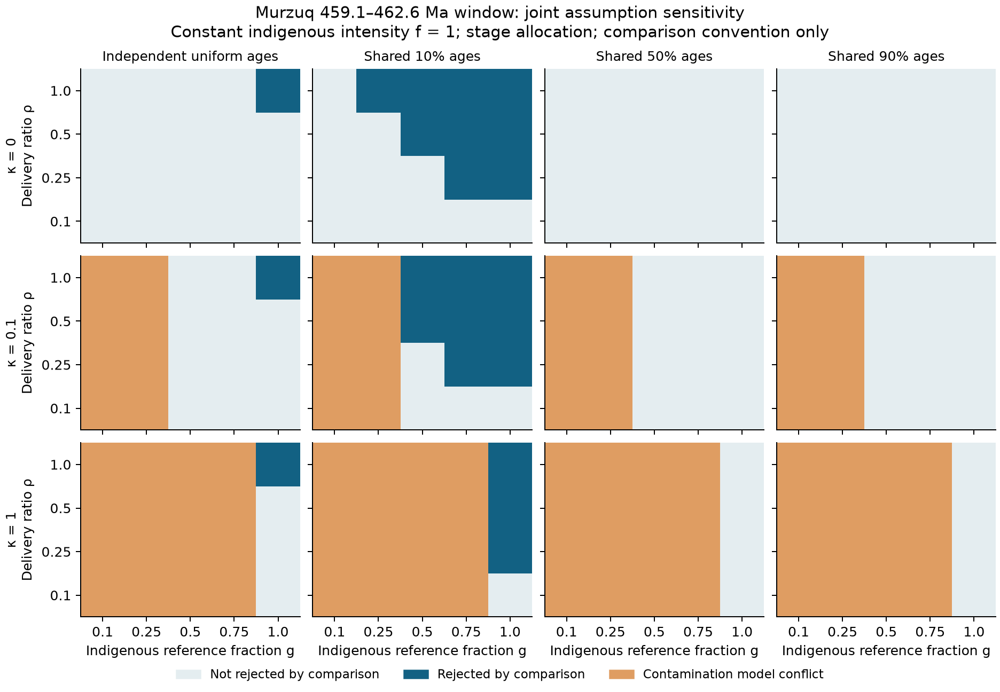
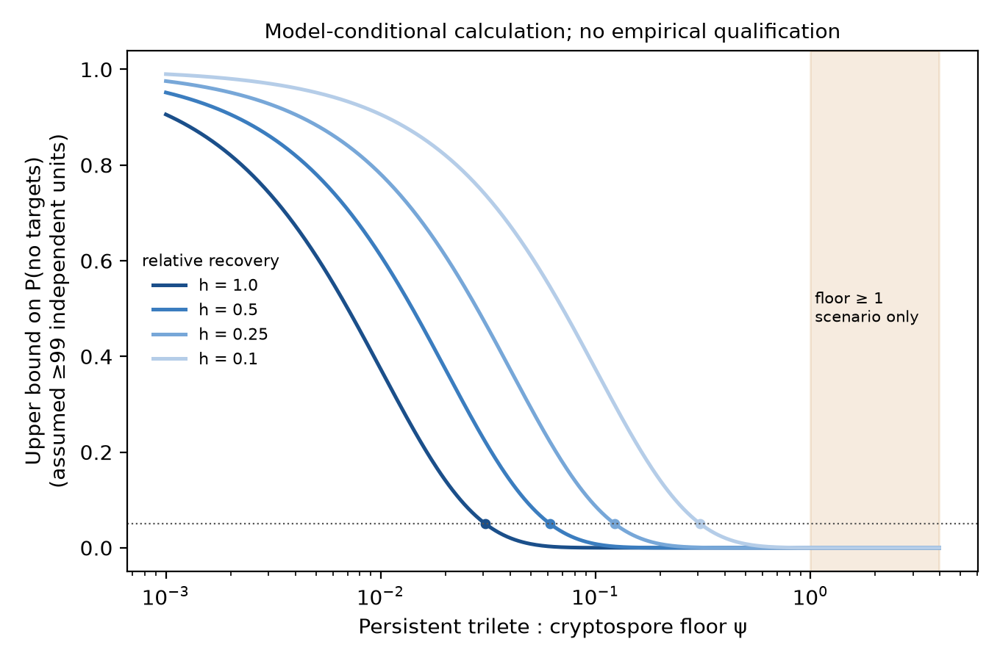
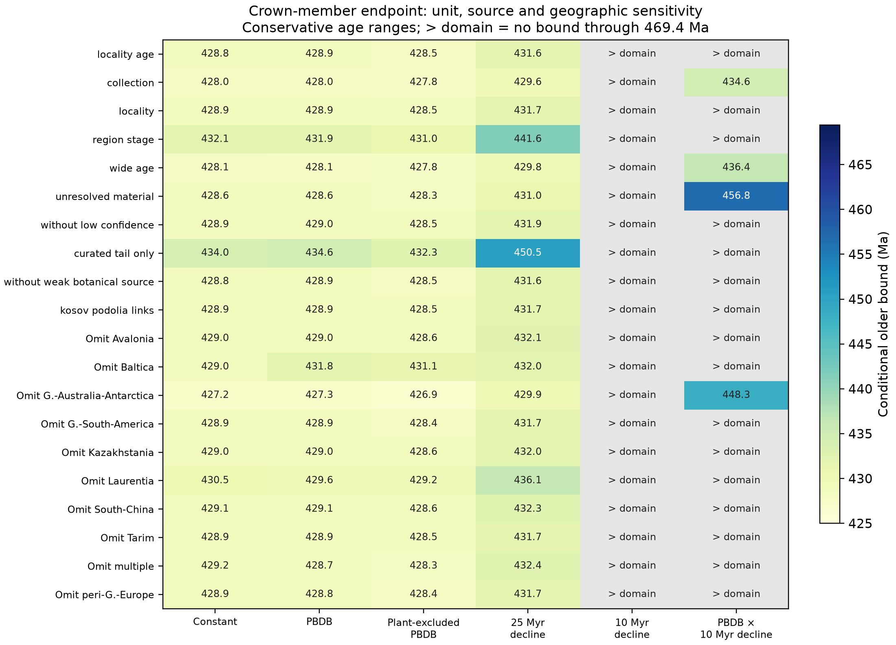
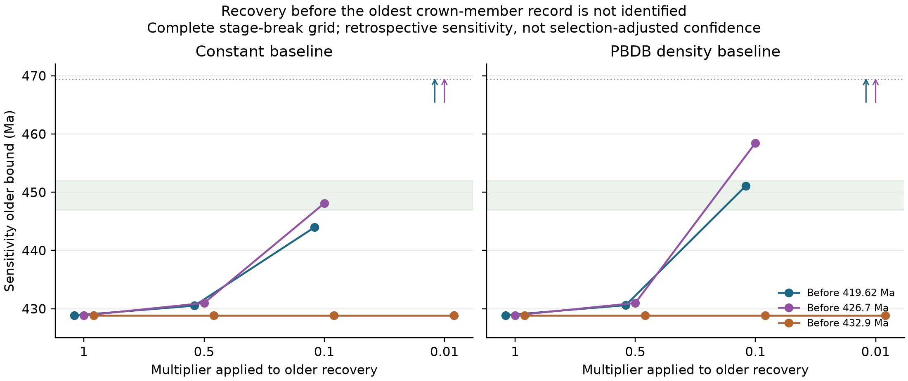

This supplement holds the machinery behind the main text. Repository paths are given so that every
number can be traced to the table or script that produced it. Internal labels appear here because
the repository uses them: **M1**, **M2** and **M3** are the 515.5, 459.1 and 431.2 Ma maxima; **E1**
trilete spores, **E2** cryptospores accepted as embryophytic under a named reading, **E3**
polysporangiate bodies, and **E5** crown vascular-plant members. **B0**, **B1** and **B2** are the
body-record categories: any land-plant body, polysporangiophyte body and crown vascular-plant member.

## S1. Readings, observations and units

**Named readings.** Disputed identifications, affinities and ages are carried as alternatives, not
resolved by fiat. The *main* reading accepts what the cited sources accept. The *inclusive* reading
adds records that a named source accepts against others, and the *outlier* reading admits further
records that are explicitly contested. A wider reading requires a record-specific acceptance; it does
not promote every unresolved grain or axis to a detection. The E2 rule separates spore morphology and
producer evidence from the embryophyte affinity accepted by each reading (`data/units/e2-unit-rule.md`).
Rejected, reassigned and disputed records are listed in `docs/rejected-records.md`.

**Observations.** Within each frame, the same reporting rule applies to older and reference material.
An explicit non-detection is scoped to the material actually examined. A missing report becomes a zero
only after a full-category reporting audit. Unresolved identification, missing links and unreported
effort remain distinct from absence.

**Ages.** Stage bases follow ICS v2024/12 (`data/timescale.csv`). Source-specific age statements and
their numerical conversions are retained separately. Literature before 2024 mostly uses GTS2012 Early
Devonian boundaries, which differ from ours by up to 3 Myr. Uniform within-range ages and shared
within-range positions are modelling choices, not measured dating distributions.

## S2. The Murzuq encounter comparison

### S2.1 Source and frame

Abuhmida (2013) reports palynology from six Murzuq Basin wells. All 164 appendix samples were
transcribed independently, with 158 chart depth and type labels (153 exact matches). The 164 prose-scope
rows and 158 chart reports were mapped, retaining barren material and possible caving
(`data/units/libya_*.csv`; `docs/audits/2026-10-31-libya-event-map.md`). The primary frame is the
chart-coded cuttings design `LY-MZ-CU`. Five wells contribute 59 Llandovery reference cuttings (51 with
trilete reports), and three of them contribute 28 older cuttings without trilete reports.

### S2.2 Model and qualification

For an eligible unit, the detection probability conditional on a well effect is $1-\exp(-rux)$. Here
$r$ is the reference rate, $u\sim\mathrm{Gamma}(2,2)$ is shared within a well, and $x=\rho f$ is the older
relative intensity. The older/reference delivery-and-recovery ratio $\rho$ takes the declared values 1,
0.5, 0.25 and 0.1; it is not estimated from the source. Reference and older outcomes share the well
effect and are fitted jointly.

H0c constrains constant intensity; H0 and H0m constrain exposure-weighted intensity under their
declared history classes; H1 allows the declared higher ceiling. The origin read-out at 459.1 Ma
concerns the interval from the reference boundary $\tau=443.1$ Ma to that age. A window comparison
instead tests a persistent minimum intensity on an older interval beginning at 459.1 Ma, allowing zero
intensity between that boundary and $\tau$. An unbounded low-intensity window therefore does not show
that the same intensity is compatible all the way to the reference.

Inference is by test inversion with a declared, simulation-calibrated critical value (`docs/f3-shape.md`).
The potential screen, eligibility and estimation path were simulated on a declared finite grid. Results
are nominal 95% compatibility bounds, qualified per quantity and design against a 0.93 coverage floor
(calibration target 0.955), conditional on passing the potential screen, with abstentions counted as
covering. The largest observed marginal miss proportion was 38/1,000. At the B4 boundary of the 462.6 Ma
window, 20 of 1,000 screen-passing simulations excluded the truth, and 60 delivered non-abstaining window
claims, so 20 of those 60 missed. Population 95% coverage, coverage conditional on a non-abstaining
result, simultaneous coverage and validity beyond the tested histories are not established. Thirteen
Murzuq design/delivery combinations qualify. A fourteenth qualified pair, QB-CO, supplies no older M2
interval and has a narrower class scope. The receipts are in `models/f3/out/qual/`.

### S2.3 Contamination and an identification limit

Murzuq's palynofacies fractions use a different preparation and a 200-particle denominator. They cannot
supply separate trilete and cryptospore counts for the chart search, so binary observations are retained
and contamination enters as a sensitivity model. Let $g$ be the indigenous fraction of reference
*encounter intensity* (not of positive samples), and $\kappa$ the transfer of the contaminant component
into older cuttings. For age-exposure weight $q_i$, an older zero has probability

$$\exp[-ru\kappa(1-g)]\{(1-q_i)+q_i\exp[-ru\rho gf]\}.$$

The likelihood depends on these parameters only through $a=\rho gf$ and $b=\kappa(1-g)$, so tuples
preserving both are observationally equivalent within the model. If every $q_i=1$, only their sum
enters the older-zero likelihood. Declining indigenous output can thus be offset by delivery and
reference contamination along stated parameter combinations. This is an identification result within
the declared model, not a universal property of binary observations.

A predeclared 5,760-row factorial grid varies delivery, indigenous fraction, transfer, allocation,
chronology, interval and intensity. Independent uniform ages are compared with fixed, depth-ordered
10%, 50% and 90% positions within source ranges. The threshold $-2\log(0.05)$ is an uncalibrated
comparison convention. A contamination scenario that conflicts with older zeros even at $f=0$ is
flagged separately. The 384 break-even entries fix $\kappa=b=0$. These surfaces and the 36-case
well/age influence exercise are unqualified sensitivities.

| Challenge at $\rho=1$ | Observed sensitivity | Scope |
|--------------------|------------------------------|----------------|
| Five leave-one-well-out cases | H0 0.1850–0.3646; window endpoints 462.6–468.1 Ma | one factor at a time; unqualified |
| All nine influence/age/allocation cases | H0 0.1775–0.3646 | unqualified |
| $\kappa=0$, independent uniform stage ages | critical $g$: 0.0910 for constant origin intensity; 0.9559, 0.2363, 0.1735 for windows ending 462.6, 467.1, 469.4 Ma | $f=1$; comparison contours, not confidence limits |
| Shared midpoint ages | no exposure in the 459.1–462.6 Ma window | fixed chronology scenario |
| Shared 90% ages | no exposure in the window ending at 467.1 Ma | fixed chronology scenario |

: Murzuq sensitivities (`models/f3/loop2/out/`; `docs/loop2-sprint1-results.md`). {#tbl-murzuq-sens}

{#fig-joint}

## S3. QSIM-801: a model-conditional floor calculation

Vecoli et al. (2017, Table 1, p. 321) report 99 cryptospore morphotaxon occurrences across 17 of 20
tabled samples assigned to the late Dapingian–early Darriwilian. Their p. 330 explicitly reports no
triletes in the studied sequence. The table was independently reconstructed from the rendered source
(`data/units/loop2/replication/`). Its 22 categories include informal morphotypes. Marks are distinct
recorded occurrences, not counts of independent producers or dispersal events. The table-defined depths
are 675.1–767.8 ft. The methods' shallower endpoint, 586.9 ft, is inconsistent and is not used.

Let $\theta_i$ be the trilete/control unit-intensity ratio in sample $i$, and $h>0$ a relative effective
recovery factor. Suppose the reported objects form a co-ascertained, independent target/control sample.
Conditioning Poisson counts on the true land-spore total $N_i$ then gives target probability
$h\theta_i/(1+h\theta_i)$. For a persistent floor $\psi=\min_i\theta_i\geq\theta$, the all-zero
probability is at most $(1+h\theta)^{-\sum_iN_i}$. If each mark contributes a distinct target-detectable
unit, $M\leq\sum_iN_i$ permits a conservative rejection rule: no targets and $(1+h\theta)^{-M}\leq\alpha$.
Randomness of $M$ does not invalidate the rule: conditional on the actual totals, rejection is a subset
of the all-zero event with enough units to cross the threshold. Then $U=\{\alpha^{-1/M}-1\}/h$ bounds the
*minimum* ratio, not every sample's ratio, a mean, or the pooled share.

| Relative effective recovery $h$ | Independent units, $D=1$ | Heuristic $D=2$ | Heuristic $D=4$ |
|---:|---:|---:|---:|
| 1 | 0.031 | 0.062 | 0.129 |
| 0.5 | 0.061 | 0.125 | 0.257 |
| 0.25 | 0.123 | 0.250 | 0.515 |
| 0.1 | 0.307 | 0.624 | 1.287 |

: Model-conditional floor limits; none is an admitted empirical confidence bound. $D$ divides the exponent as a heuristic for clustering, not a validated correction. {#tbl-qsim}

The source specifies preparation but not the search coverage needed to show that every mark represents
a unit on which triletes were detectable. Independence, effective ascertainment and sampling and stopping
conditions are unverified. The calculation therefore stays exploratory. Toy Poisson simulations check the
algebra but cannot validate the historical protocol. No matched counted Katian–Llandovery reference was
recovered. Qusaiba-1 supplies reference context only. Röstånga and Caspalá/Lipeón are younger than M2,
and Hanadir/TAYM-4 is separate material without a qualified design (`manuscript/external_candidates.csv`).

{#fig-qsim}

## S4. The Cambrian affinity review (M1)

No assessed frame admits an E2 older-zero/reference design. The Borenshult 71.1 m zero is secure under
the main reading but belongs to a frame that fails its potential screen. It is not a pre-515.5 Ma
observation. Strother (2016) places the Tennessee taxa in Charophyta. Taylor & Strother (2024) interpret
the packets as pre-embryophytic, and Wang et al. (2022) favour ancestral aeroterrestrial algae while
calling direct embryophyte affinity unlikely and the interpretation premature. None explicitly accepts
the assessed Stage 4 producers as embryophytes. Wall ultrastructure and developmental features bear on
precursor relationships, so the inclusive reading stays an explicit alternative. Argentine sample
RIOCAP-7999 is unresolved under main and detected under inclusive and outlier readings. Stage 4 converts
to 514.5–506.5 Ma, all younger than 515.5 Ma (`data/units/loop2/m1-m3/`).

## S5. The positive body-record analysis

### S5.1 Inventory and units

**Names.** The 241 distinct PBDB macrofossil names overlapping 445.2–393.47 Ma were classified by
`gpt-6.1-sol` with web search. Each name received a category, polysporangiophyte and crown-member flags,
a basis, a cited source and a confidence (`data/macro/name_classifications.csv`). Names judged
implausible for the window, for example the Cretaceous angiosperm leaf genus *Protophyllum*, cannot enter
any category. A stratified source audit is in `docs/audits/2026-11-01-loop3-source-review.md`; it does not
certify all 241 assignments.

**Material identity.** Only explicit collection or occurrence identifiers justify replacing a PBDB record
with its curated interpretation. Country, taxon and overlapping ages do not establish identity; the pilot
used them and falsely merged distinct localities (S7). Regional checklists and unresolved duplicates are
withheld from the primary count and kept in a sensitivity. Source decisions are in
`data/macro/source_adjudications.csv`. Example: the two Yea horizons are kept as separate units with the
full disputed Gorstian–Emsian range, because the Gorstian attribution rests on a disputed graptolite
identification. Neither a fixed Gorstian nor a fixed Devonian age is justified.

**Units.** The primary unit is a locality–age proxy: PBDB formation plus coordinates rounded to 0.1° and
identical age support, or a curated named site plus identical age support. For a collapsed unit, the
oldest-member age has support from the maximum of member lower ages to the maximum of member upper ages.
Missing geographic keys retain the collection identifier. The proxy is conservative but is not a verified
bed (`models/f3/loop3/out/primary_unit_membership.csv` lists every constituent record).

**Older screen.** A separate screen covers all 556 older-only non-spore PBDB rows (69 names). Source
review of the seven plausible or unplaced names (17 occurrences) found cyanobacteria, algae or trace
fossils and the rejected *Boiophyton*, not an additional embryophyte body. These exclusions are not
fossil non-detections, and the screen is not a search denominator
(`data/macro/older_records_screen.csv`; `docs/audits/2026-11-01-loop3-older-records-review.md`).

### S5.2 The endpoint calculation

For a fixed younger cutoff $c$, let $U(a)=\int_c^a w(s)\,ds$ be cumulative recovery. Conditional on $n$
independent units with ages drawn with density proportional to $w$ on $[c,T]$, the maximum $A$ satisfies
$P(A\leq a)=\{U(a)/U(T)\}^n$. Inverting at 0.05 gives the exact one-sided 95% older bound

$$U(T_{\mathrm{upper}})=U(A)\,0.05^{-1/n}.$$

The absolute recovery rate cancels. For constant $w$ this is the Strauss & Sadler (1989) and Marshall
(1990) expression with a fixed cutoff, which uses all $n$ observations. Marshall (1994, 1997) and Wang
et al. (2016) relax the assumption of uniform recovery in other ways. A bound beyond the declared history's
domain (469.4 Ma, where the held PBDB effort series ends) is reported as *not bounded within the domain*,
not as an infinite-age inference.

**Age envelope.** The primary age treatment uses the greatest possible oldest age and the smallest number
of units guaranteed older than $c$. The bound increases with $A$ and decreases with $n$, so this is an
envelope of the exact-age bounds whenever every reported age interval contains the true age. That
geological condition is separate from statistical coverage. Independent-uniform and shared-quantile
allocations (256 draws, seed 20261102) are reported as sensitivities. Their quantiles are not confidence
bounds (@tbl-ages).

**Histories.** Six histories are fixed without fitting them to the focal fossils:

1. constant recovery in calendar time;
2. PBDB all-taxa land and marginal-marine collections per Myr, apportioned by age overlap;
3. the same, with collections matching the held plant-filtered extract removed;
4. exponential decline into the past, 25 Myr timescale;
5. exponential decline into the past, 10 Myr timescale;
6. the plant-excluded density multiplied by the 10 Myr decline.

Plant exclusion is a response-related filter, not verified independent effort. No proxy establishes
actual search opportunities. Cutoffs are the ends of the Emsian, Pragian, Lochkovian and Pridoli.

**Shape diagnostics.** Conditional on the maximum, the remaining unit ages should be distributed as
$U(a)/U(A)$. Kolmogorov–Smirnov statistics at midpoint ages and across age draws expose histories that
fit the observed sequence poorly (@tbl-shape). Nominal exact-age *p* values and their spread across draws
are not a combined test for interval-dated fossils, a model-selection criterion or an empirical calibration.

### S5.3 Results and sensitivities



: Conservative 95% older bounds (Ma) by category, reading and recovery history; Emsian cutoff. Units: guaranteed/possible. "None ≤ 469.4": no bound within the declared domain. {#tbl-primary}



: Crown vascular-plant bounds by younger cutoff, main reading. {#tbl-cutoffs}



: Crown vascular-plant bounds under alternative units and source choices (main reading, Emsian cutoff). Region–stage cells use midpoint stage and are a deliberately coarse dependence diagnostic. {#tbl-units}



: Leave-one-region-out bounds for crown vascular-plant members, with PBDB exposure recomputed after the same omission. Regions are approximate modern country/state assignments. {#tbl-regions}



: Within-record shape diagnostics, main reading, independent-uniform age allocations. {#tbl-shape}



: Age-allocation sensitivity (Emsian cutoff, main reading). Quantiles across allocations are descriptive, not confidence bounds. {#tbl-ages}

### S5.4 Recovery before the oldest record

After seeing that steep smooth declines fit poorly, we evaluated a complete stage-break grid: flat and
PBDB baselines; breaks at 419.62, 426.7 and 432.9 Ma; older multipliers 1, 0.5, 0.1 and 0.01; all
categories and both readings (144 cells). The 426.7 Ma break coincides with the oldest possible main B2
record, so no main B2 unit's age support is changed and the within-record shape statistic is unchanged.
The grid is a retrospective sensitivity; the 0.05 rule supplies no nominal, simultaneous or
selection-adjusted confidence for it. The 432.9 Ma break is a null control when the bound lies younger.
No member was selected to match a clock (@tbl-suppression).



: Retrospective stage-break grid for crown vascular-plant members, main reading (`models/f3/loop3/out/suppression_sensitivity.csv`). {#tbl-suppression}

### S5.5 Biological delay

Fixed delays of 0, 5, 10 and 20 Myr map the recoverability bound to a lineage bound and shift the
lineage domain by the same amount. A delay is an assumed mapping, not inferred from this record or
transferred from the spore comparison (@tbl-delay).



: Fixed-delay mapping, constant recovery, main reading. {#tbl-delay}

### S5.6 Simulation checks

Each of 144 cells has 3,000 replicates (seed 20261101) at the reviewed unit counts and recoverability
endpoints of 432, 445 and 458.2 Ma. Each correctly specified history is checked with exact and
stage-censored dates. The checks then mismatch constant and steeply declining histories, repeat
underlying units two or four times, and impose 10 or 20 Myr delays with and without the correct
adjustment. Coverage counts no-bound outcomes as covering. Claim frequency and coverage among bounded
claims are reported separately, because 95% unconditional coverage does not imply 95% coverage after
selecting bounded outcomes. These runs verify the declared procedures and expose their failure modes.
They do not qualify the fossils (@tbl-sim; all categories in `simulation_results.csv`).



: Simulation results for crown vascular-plant counts. {#tbl-sim}

### S5.7 Figures from the reviewed analysis

{#fig-macro-recovery}

{#fig-macro-sensitivity}

{#fig-macro-suppression}

## S6. From specimens to nodes

The specimen-to-node pilot separates specimen observations, accepted event readings, encounter, trait
persistence and node interpretation (`data/pilot/`, `docs/pilot-traits.md`). We reused its
source-adjudicated combinations, Hooper et al.'s deposited crown-state outputs and the checked
stochastic-map analyses without rerunning them. Aperture (X21) and dispersal unit (X26) were modelled
separately, so their marginal supports do not define a joint ancestral phenotype. The X26 monad category
combines trilete and inaperturate monads; it is not an automatic absence of cryptospory.

For M2, a proximal trilete aperture is modal at the embryophyte crown across the deposited methods and
trees. X26 has a dyad-dominated alternative while X21 stays trilete-dominated, so no joint phenotype
probability follows. On the converged extant-tree runs, 77 of 3,382 trilete starts depart along the
path to crown Tracheophyta: conditional persistence 0.977 (Monte Carlo SE 0.0026). These trees put crown
Embryophyta at 508 Ma, not at Hooper et al.'s 457–450 Ma. Fixed-rate retention scenarios to 452.8 Ma give
an extant-tree median of 0.989 (95% interval 0.895–0.995) from 459.1 Ma and 0.894 (0.332–0.956) from
515.5 Ma. These are model-conditional aperture retention scenarios, not observed survival, and they are
not multiplied into any coverage.

For M3, the *Cooksonia barrandei* holotype links trilete production and multiple sporangia directly, but
its tracheids are unknown. The Irish Homerian material has a conditional sporangial interpretation and no
direct demonstration of the anatomy known from younger *C. pertoni*. A total-group or stem occurrence and
a crown assignment remain distinct. For M1, cryptospore persistence has not been assessed.

## S7. Analyses superseded during review

Two analyses were replaced after independent review. The record is kept so that readers can see what
changed and why.

**The Loop 3 body-record pilot** (`docs/loop3-pilot.md`, provisional, by Claude) reported logistic-ramp
limits of 452.6, 454.1 and 438.0 Ma for B0, B1 and B2. It read them as favouring the young clock, with a
15–25 Myr preservation lag. Codex's review found:

- stage collection totals passed where per-Myr density was required, counting stage duration twice. The
  unit correction alone moved B0's logistic limit from 452.57 to 436.78 Ma and flipped the selected
  capacity between grid boundaries;
- medians of imputed-age limits presented as 95% limits;
- false replacement of distinct PBDB localities through country, genus and age overlap;
- collection numbers treated as independent beds;
- a category gate that let names judged implausible into B1 and B2;
- two different papers sharing the source identifier `wang2026`.

All were repaired. The fixed-history endpoint calculation (S5.2) replaced the profiled ramp. Its numbers
and interpretation govern; the pilot's do not (`docs/audits/2026-11-01-loop3-methods-review.md`,
`docs/loop3-results.md`).

**Loop 2 corrections** (`docs/loop2-close.md`, `docs/audits/2026-11-01-loop2-close-claude-response.md`)
fixed a misread H0c column, an overgeneralised exponent sensitivity, an unsupported circularity claim and
an overstated examination count in an earlier draft.

## S8. Reproduction and navigation

From the repository root:

```sh
uv run --with numpy --with pandas --with scipy --with pytest python -m pytest models/f3/loop3 -q
uv run manuscript/figures.py
python3 manuscript/tables.py
quarto render manuscript/manuscript.qmd
quarto render manuscript/supplement.qmd
python3 manuscript/package.py
```

The body-record analysis is reproduced by `models/f3/loop3/build_reviewed.py`, `analysis.py`,
`simulation.py`, `suppression_sensitivity.py` and `figures_reviewed.py`. Hash receipts bind their inputs
and outputs. Frozen Loop 1 and Loop 2 runs are retained without regeneration. Third-party deposits are
fetched by `data/external/scripts/deposits_fetch.py` and verified against `MANIFEST.tsv`.
`manuscript/claims.csv` links each main claim to its evidence and limits.

## Supplement references

- Marshall CR (1994). Confidence intervals on stratigraphic ranges: partial relaxation of the assumption of randomly distributed fossil horizons. Paleobiology 20: 459–469. https://doi.org/10.1017/s0094837300012938
- Marshall CR (1997). Confidence intervals on stratigraphic ranges with nonrandom distributions of fossil horizons. Paleobiology 23: 165–173. https://doi.org/10.1017/s0094837300016766
- Wang SC, Everson PJ, Zhou HJ, et al. (2016). Adaptive credible intervals on stratigraphic ranges when recovery potential is unknown. Paleobiology 42: 240–256. https://doi.org/10.1017/pab.2015.37
- Other references as in the main text.
