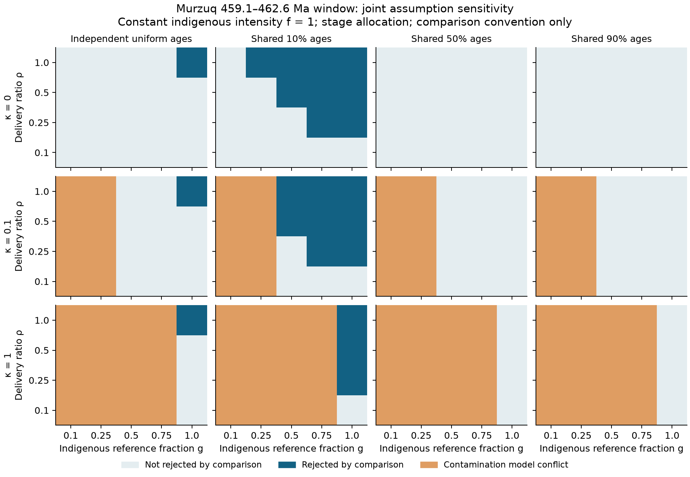
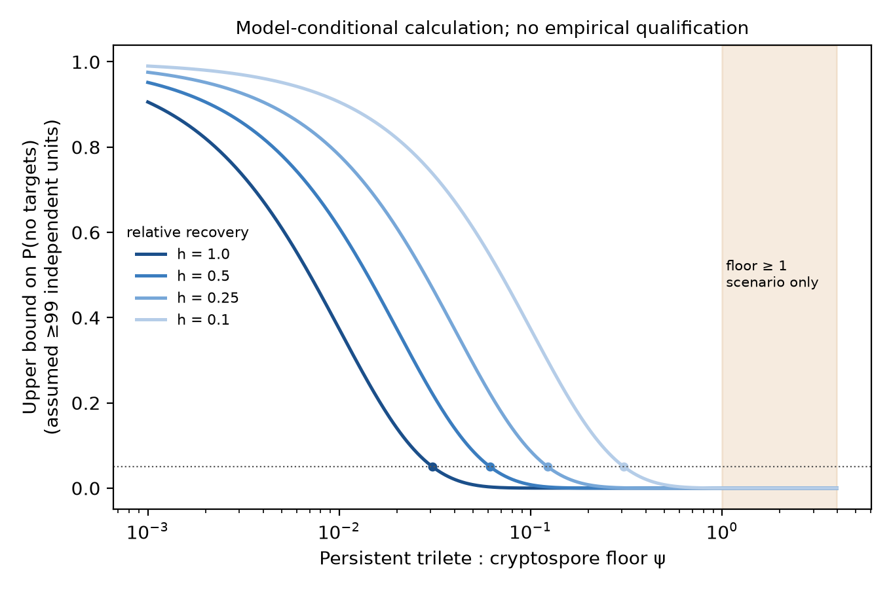
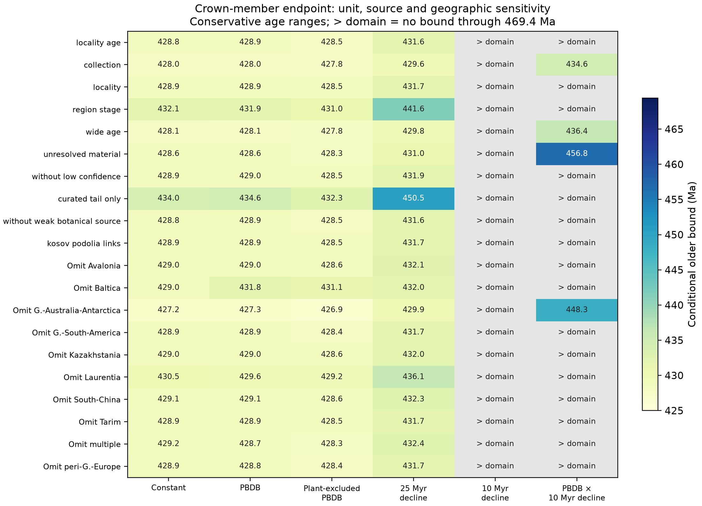
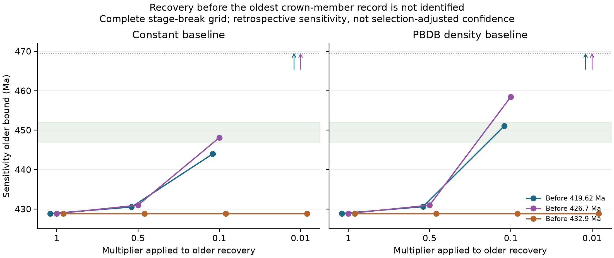

{#fig-joint-s1 width=100%}

![Spore records by well and age from the Murzuq Basin, Libya [@abuhmida2013PalynologicalAnalysisOrdovician]. (*a*) Age ranges of chart-coded samples of drill cuttings (rock chips) from five wells. Filled symbols: trilete spores reported; open symbols: no triletes reported, from explicit statements or complete reporting charts. Symbols sit at the middle of each age range for display; the model spreads each sample's age evenly over its range. Horizontal lines separate wells, with sample counts beside their names. No triletes are reported in any of the [28]{.C01} older samples; they are reported in [51 of 59]{.C02} Llandovery (earliest Silurian) samples, the reference. Of the older samples, [18]{.C45} are wholly younger than 459.1 Ma; only [10]{.C45} broadly dated Darriwilian samples, in two wells, have age ranges reaching older. Shading marks the Llandovery; the dashed line marks 459.1 Ma. (*b*) Upper 95% limits on older spore supply as a fraction of Llandovery supply, *f*, for steady supply and for supply varying between zero and the Llandovery level, starting at 459.1 Ma; the varying supply is averaged with each interval weighted by how much of the older samples' age ranges falls within it. The delivery ratio $\rho$ (older to Llandovery) covers transport, preservation and preparation; $\rho$ = 1 means spores reached both equally easily. Markers show the four delivery scenarios evaluated; dotted lines are visual guides. At a marked ratio, supply below its limit fits the shared-well model. With poorer delivery, supply near the Llandovery level fits.](../figures/figS_murzuq.png){#fig-murzuq-time-s2 width=100%}

{#fig-qsim-s3 width=100%}

{#fig-macro-recovery-s4 width=100%}

{#fig-macro-sensitivity-s5 width=100%}

{#fig-macro-suppression-s6 width=100%}

{#fig-mapping-s7 width=100%}
