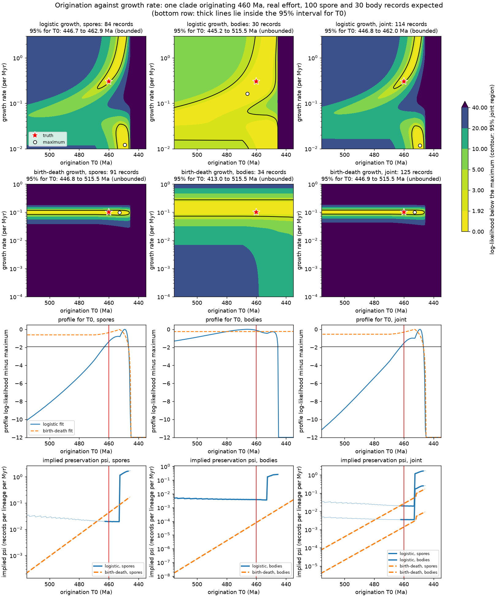

# F3: dating origination from an incomplete record

Loop 1, steps 2 and 3 of `docs/plan-f3.md`. A virtual palaeontology (a clade of growing abundance that leaves
stage-dated fossil occurrences), the classical estimators of the first appearance (step 2, the sketch), and the
ramp-aware likelihood estimators with the recovery study that tests all of them (step 3, below). Written by
Claude Sonnet 5.5 (`claude-sonnet-5-5`), 2026-10-28.

## Step 2: files

- `sim.py`: the simulator. `Constant`, `Logistic` and `BirthDeath` give the abundance N(t) behind one
  interface. `Channel(psi, effort)` records occurrences as a Poisson process with intensity
  psi * N(t) * E(t), E constant within each ICS stage (`data/timescale.csv`). `simulate` returns the true
  origination age `t0`, the abundance path and, for each channel, the true age of each record and the age
  range of its stage.
- `estimators.py`: `oldest` (naive baseline), `marshall_1990`, `strauss_sadler_1989`,
  `weighted_mcinerny` and `griwm` (Bradshaw et al. 2012, first appearance), and `stage_resampled`, the wrapper
  for stage-dated records. All return an `Interval(lo, point, hi)`.
- `test_sketch.py`: 31 checks (simulator invariants, hand-checkable tiny cases, the direction convention,
  the GRIWM cross-check against the authors' code, coverage under the classical assumptions, and the ramp
  degradation, which is printed and not asserted).
- `run_sketch.py`: the demonstration grid. About 40 s on mac-mini. Writes `out/sketch_grid.csv` and
  `out/sketch_grid.meta.json` (root seed, settings, `timescale.csv` hash, numpy version).

```bash
uv run models/f3/run_sketch.py
uv run --with pytest --with numpy --with scipy pytest models/f3 -p no:cacheprovider -s
```

## Conventions (steps 2 and 3)

- **Ages** are Ma, decreasing towards the present: older is larger. The first appearance is the oldest
  record, and every upper bound lies at an older age. There is no `first`/`last` switch and no forward-time
  axis anywhere, which avoids the `tbea` swap EPRP found. `test_classical_bounds_extend_towards_older_ages`
  checks the direction.
- **Effort and window.** E(t) is a per-stage dictionary (default 1; any non-negative value). The window ends
  at the base of the Eifelian (end of the Emsian) unless set otherwise. Records exist only between the window
  end and `t0`.
- **Birth-death.** Linear process from one lineage, simulated exactly (Gillespie) and conditioned on
  survival to the window end by rejection. N counts lineages; psi is per lineage per Myr.
  **Logistic.** N(s) = k / (1 + (k-1) e^{-r s}), s Myr after `t0`, so N(0) = 1; discretised in 0.01 Myr cells.
  **Constant.** N = k from `t0`: the control with no ramp.
- **Seeds.** Everything descends from one seed through `child_seed(seed, index)`, which never mutates its input.
  The abundance path, each channel's records and the dating draws have separate child streams, so a seed plus
  the arguments reproduces a run, and changing psi leaves the abundance path unchanged. The grid root seed is
  20261028; replicate `i` of growth form `g` is `SeedSequence(root, spawn_key=(g, i))`.
- **Stage-dated records.** Each record keeps the range [`young`, `old`] of its stage. `stage_resampled` draws every
  record's age uniformly within its range, applies the estimator to each draw, and pools: `lo` and `hi` are the
  2.5% quantile of the draws' `lo` and the 97.5% quantile of their `hi`, and `point` is the median of their
  points. Stage bases are taken as exact (the boundary uncertainty of primer section 1.2 still waits for the joint age model; see step 3).
- **`Interval`.** For the classical estimators `lo` is the oldest record and `hi` the one-sided upper bound on
  the origination. Coverage in the grid is `hi >= t0` (`coverage_upper`, the convention of Saltre et al. 2015:
  the truth lies between the first record and the upper bound) and, more strictly, `lo <= t0 <= hi`
  (`coverage_interval`, Bradshaw et al. 2012). Replicates with fewer than two records have no estimate; the
  share is `frac_undefined`, and coverage is over the rest.

## Sources read, by estimator

| Estimator | Read in this task | Not read |
|---|---|---|
| Marshall 1990 | Hammer's PAST manual page "Confidence intervals on stratigraphic ranges" (https://www.nhm.uio.no/english/research/resources/past/help/rangeconf.html): one endpoint, alpha = (1-C)^(-1/(H-1)) - 1 with H the number of horizons; two endpoints, C = 1 - 2(1+alpha)^-(H-1) + (1+2 alpha)^-(H-1); random (Poisson) horizons assumed. Also `tbea`'s `stratCI.R` (gaballench/tbea at 53a1e7ff, GPL-3), which labels the same one-endpoint formula Eq. 20 of Strauss & Sadler. | The paper, doi 10.1017/s0094837300009672 (paywalled; in `docs/closed-literature.csv`). |
| Strauss & Sadler 1989 | The same two sources. The point estimate follows Saltre et al. (2015), who took median estimates at alpha = 0.5: the 50% bound. | The paper, doi 10.1007/bf00897326. |
| GRIWM | Bradshaw et al. (2012), doi 10.1016/j.quascirev.2011.11.021, in full (the author's copy at conservationbytes.com); Saltre et al. (2015), doi 10.1016/j.quascirev.2015.01.022, the methods (same copy source); the authors' R code `Rextinct/R/griwm.R` in github.com/cjabradshaw/CRIWM at 8eb6f51 (MIT), in full. | McInerny et al. (2006), doi 10.1111/j.1523-1739.2006.00377.x, the estimator that GRIWM extends (paywalled); its form is taken from Bradshaw et al. and the code. |

**What the sources say, and what is implemented.**

- *Classical bounds.* Marshall's single-endpoint interval and Strauss & Sadler's one-parameter bound are the
  same formula in every source read, so `marshall_1990` and `strauss_sadler_1989` return the same `hi`. They
  differ only in `point`: the sources give Marshall an interval and no estimate, so `point` is the oldest record
  (the Signor-Lipps bias, in the grid's bias column for `oldest` and `marshall1990`). The two-endpoint
  (joint) case is not needed for a first appearance and is not implemented.
- *GRIWM.* For each series of the m oldest records (m = 2..n), the estimate lies beyond the oldest record by
  (span + unit) * (-ln alpha) / m, where span is the age range of the m records (the continuous form of
  McInerny's sighting-rate probability, as in the code). The series are weighted by 1/span, so series reaching
  further from the oldest record count less (Bradshaw et al. eq. 4; the code normalises the weights by the
  first, which cancels). Each date is first redrawn from a normal with its own sd, 10,000 times, and the 2.5%,
  50% and 97.5% quantiles of the weighted estimates are the interval and point. `weighted_mcinerny` is one
  such estimate; `griwm` adds the Gaussian resampling. With stage-dated records `stage_resampled` replaces the
  Gaussian by the uniform draw within the stage. `unit` (0.001 Myr) is the discrete time step of the sighting
  rate, the "+1 year" of the code; the code also rounds resampled dates to whole years, which is dropped here.
- *Reverse direction.* Applied to first appearances by mirroring the age axis. `test_sketch.py` checks four
  cases against the authors' inner loop run in R on negated ages (agreement to 1e-10).
- **Fault in the authors' arrival branch.** `griwm(signor_lipps = "arr")` in that code sets `t.n` to 1 for every
  series, so it returns an arrival estimate younger than the oldest record (99.53 for ages 100, 90, 60 at
  alpha = 1/e, where the mirrored extinction algorithm gives 107.13). Bradshaw et al. state only that the method
  "could also be applied reciprocally". The mirror implemented here is that reading; the `arr` option of
  `Rextinct` should not be used for first appearances until corrected.

## Step 2: what the sketch grid shows

`run_sketch.py`: three growth forms, three values of psi, two channels (spores at psi; bodies at psi/5),
2000 replicates per cell, origination drawn uniformly within the Telychian in each replicate, window to the
end of the Emsian. Constant: N = 50. Logistic: r = 0.35, k = 100 (half capacity about 13 Myr after the
origination). Birth-death: lambda = 0.25, mu = 0.15. Effort is constant. Monte Carlo error on a coverage
figure is at most 0.011 (0.005 near 0.95). The table shows the spore channel; `out/sketch_grid.csv` has both channels, the
`oldest` baseline, `strauss_sadler1989` coverage and the GRIWM alpha = 0.5 variant. "Exact" dates use the
true ages, "stage" the stage-resampling wrapper. Bias is median(point - t0) of the Strauss & Sadler point
estimate and of GRIWM (alpha = 0.05), in Myr; coverage is `coverage_upper`.

| growth, psi | median records | Marshall/S&S cover, exact | Marshall/S&S cover, stage | S&S bias, exact | S&S bias, stage | GRIWM cover / bias, exact | GRIWM cover / bias, stage |
|---|---|---|---|---|---|---|---|
| constant, 0.005 | 10 | 0.95 | 0.98 | +0.0 | +0.6 | 0.71 / +2.6 | 0.88 / +4.1 |
| constant, 0.02 | 42 | 0.94 | 0.98 | +0.0 | +1.4 | 0.77 / +1.0 | 0.97 / +3.1 |
| constant, 0.08 | 168 | 0.95 | 1.00 | +0.0 | +2.4 | 0.81 / +0.3 | 1.00 / +3.0 |
| logistic, 0.005 | 14 | 0.22 | 0.34 | -10.2 | -10.1 | 0.17 / -6.6 | 0.29 / -6.5 |
| logistic, 0.02 | 58 | 0.07 | 0.15 | -7.1 | -6.7 | 0.13 / -5.1 | 0.26 / -4.6 |
| logistic, 0.08 | 234 | 0.04 | 0.35 | -4.0 | -3.5 | 0.13 / -3.0 | 0.40 / -2.5 |
| birth-death, 0.005 | 6 (18% undefined) | 0.38 | 0.50 | -16.4 | -16.1 | 0.23 / -11.3 | 0.30 / -12.0 |
| birth-death, 0.02 | 23 | 0.28 | 0.37 | -9.0 | -8.9 | 0.29 / -5.0 | 0.39 / -5.3 |
| birth-death, 0.08 | 91 | 0.20 | 0.41 | -4.2 | -4.1 | 0.31 / -2.0 | 0.50 / -1.8 |

- **Under its own assumptions** (constant N and effort, exact dates) the classical 95% bound covers the true
  origination 0.94 to 0.95 of the time at every record count, and the Strauss & Sadler point estimate is
  unbiased in the median. `test_classical_interval_covers_at_its_nominal_rate_under_its_own_assumptions`
  asserts this over 2000 replicates at a fixed seed (0.95 +/- 0.02). In a scratch run of 12,000
  replicates (psi = 0.02, constant) the coverage was 0.950.
- **Under a ramp** the classical bound in the spore channel covers the truth 0.04 to 0.4 of the time, with
  median bias of -4 to -16 Myr. More records shrink the bias, but with exact dates coverage falls as they
  increase, because the bound narrows faster than the bias. Where records are scarce, coverage rises (bodies
  at psi = 0.001) only because the bound is then very wide (median 25 Myr beyond the truth for the logistic).
- **GRIWM** at its default alpha = 0.05 is not a calibrated bound even under uniform sampling: the estimate
  lies older than the truth in 0.64 to 0.81 of replicates across the grid, not 0.95. With exact dates its 95% interval has zero
  width, because the interval comes only from dating resampling. Under a ramp it is biased and under-covers
  like the classical bound, less severely in median bias.
- **Stage dating** adds an upward bias that grows with the record count: every record in the stage that holds
  the origination is dated to the whole stage, so the oldest drawn age tends to the stage base, older than the
  truth. Coverage by `hi` goes up for that reason (0.98 to 1.00), and the strict `coverage_interval` falls (to
  0.29 at psi = 0.08, constant).

## Step 3: the recovery study

Loop 1, step 3 of `docs/plan-f3.md`. Written by Claude Sonnet 5.5 (`claude-sonnet-5-5`), 2026-10-28. The step-2 amendment
established that classical estimators under-cover when abundance ramps up after origination. This step builds estimators
that model the ramp, and asks which estimators may be used on real data and whether the record can identify the
origination at all.

### What was added

- `ramp.py`: likelihood estimators of T0 from **stage-binned counts**.
  - Records in stage j and channel c are Poisson with mean psi_c * E_cj * integral of N(t) over the stage, with N(t) = 0 before
    T0 and N(T0) = 1. E is a known effort series.
  - Two growth forms with closed-form stage integrals. Logistic: N(s) = k / (1 + (k - 1) exp(-r s)), s = T0 - t, capacity k
    fixed (or profiled over several values) and rate r free. Expected birth-death curve: N(s) = exp(g s), g = lambda - mu >= 0
    free; g = 0 is constant abundance.
  - psi_c is profiled out exactly (its maximum-likelihood value is n_c / sum_j E_cj I_j), so the likelihood surface depends on
    T0 and the rate only. `RampModel` caches the stage integrals on a 0.5 Myr grid of T0 (up to 515.5 Ma, the oldest clock
    maximum named in the plan) and 80 logistic rates (0.01 to 3 per Myr) or 100 net rates (0 and 1e-4 to 1 per Myr). `fit` takes
    the grid maximum, polishes it with scipy (Nelder-Mead), and returns the 95% profile interval for T0 (a log-likelihood drop of
    1.92; the hull of the T0 values inside it). The profile over the rate is the grid maximum refined by a parabola in log rate. If
    the interval is narrower than 1.5 Myr, or the grid profile lies more than 0.2 below the polished maximum, the grid is too coarse
    for the likelihood and the interval is recomputed on a fine grid of T0 and rate. Capacity can be profiled by passing several
    models, one per capacity: the profile is their pointwise maximum. The profile is **unbounded** when it is still inside the
    interval at 515.5 Ma.
  - Channels share N(t) and T0 and have separate psi and E: the **joint fit** adds the channels' log-likelihoods. A channel
    without records adds nothing, so the joint fit with an empty second channel is the one-channel fit.
- `inputs.py`: per-stage effort series for the window Darriwilian to Emsian, read from `data/occurrences/effort.csv` and written
  to `out/effort_series.csv`. Spores: `n_docs` summed over palaeogeographic units. Bodies: `land + marginal` summed over units.
  **Stage boundaries are the fixed ICS v2024/12 ages of `data/timescale.csv`.** Propagating boundary-age uncertainty needs the
  joint, ordered age model of primer section 1.1 (the Harrigan et al. posterior), which is not yet in hand, so it is not
  approximated here by perturbing boundaries independently. The spore series stops at 2006 (the post-2006 literature is not yet
  counted).
- `recovery.py`: the recovery study; writes `out/recovery_grid.csv` and `out/recovery_grid.meta.json`.
- `report.py`: aggregates the grid into `out/recovery_summary.csv` and prints the tables below.
- `identifiability.py`: the profile-likelihood surfaces, `out/identifiability_surface_435.png` and `..._460.png`.
- `test_ramp.py`: 43 tests of the likelihood (against numerical quadrature, the simulator's abundance integral, and a dense-grid
  reference for the interval), parameter recovery in large samples, the joint fit, the age convention, the inputs, and the
  recovery machinery. `sim.py` gained `stage_exposure`, the integral of N over each stage, with `sample_records` refactored onto the
  same cell routine; the step-2 grid regenerates byte-identical.

### Design of the study

```bash
uv run models/f3/inputs.py          # out/effort_series.csv
uv run models/f3/recovery.py        # out/recovery_grid.csv and .meta.json (about 28 min under heavy load)
uv run models/f3/report.py          # out/recovery_summary.csv and the tables below
uv run models/f3/identifiability.py # out/identifiability_surface_*.png
```

A **scenario** is an origination
window x growth x effort x preservation level; each is replicated 1000 times (Monte Carlo error on a coverage figure at most 0.016,
0.010 near 0.90) from the root seed 20261029, replicate `i` of window `w` and growth `g` being
`SeedSequence(root, spawn_key=(w, g, i))`. In each replicate T0 is drawn uniformly within the window and the abundance path is
simulated once; every effort and preservation level is sampled from that path.

| Factor | Values |
|---|---|
| Origination window | Darriwilian to Sandbian (469.4 to 452.8 Ma, the spore case), Katian to Hirnantian (452.8 to 443.1), Telychian to Sheinwoodian (438.6 to 430.6, the body case) |
| Growth | constant; logistic with k = 100 and r = 0.15, 0.3, 0.6 per Myr; logistic with r = 0.3 and k = 30 or 300 (the capacity the fit assumes is wrong); birth-death with lambda - mu = 0.05 (0.20, 0.15) and 0.10 (0.25, 0.15) |
| Effort | the real series (`out/effort_series.csv`, scaled to mean 1) or constant |
| Preservation | expected records in the window, spores / bodies: low 30 / 10, mid 100 / 30, high 300 / 100, very high 1000 / 300 |

Preservation is set by the expected count: psi of each channel is its target divided by its effort-weighted abundance integral
in that replicate, so a clade that originates earlier has a lower psi, and the realised count is Poisson about the target. The
realised medians equal the targets (`median_n_spores`, `median_n_bodies` in the grid; the spore series is the
higher-count channel throughout, as in the real record). Pinning the count builds in the question the study asks: an earlier origination of the same record is one with poorer
preservation.

Estimators, each on spores alone, bodies alone, and both channels (`joint`):

| Estimator | What it is | Point | Interval |
|---|---|---|---|
| `classical` | Strauss and Sadler's bound (Marshall's one-endpoint interval) on records drawn uniformly within their stages | 50% bound | oldest record to 95% bound; stage draws pooled as in step 2 |
| `griwm` | mirrored GRIWM (alpha 0.05), stage-resampled | median of draws | calibrated by simulation, below |
| `ramp_logistic` | `ramp.fit`, logistic, capacity 100 fixed | maximum | 95% profile |
| `ramp_logistic_kfree` | the same with capacity profiled over 10, 30, 100, 300, 1000 | maximum | 95% profile |
| `ramp_bd` | `ramp.fit`, expected birth-death curve | maximum | 95% profile |

In the joint case the classical and GRIWM estimators use the pooled records of both channels.

**Acceptance.** The plan fixes the first criterion; how each estimator is judged under it was fixed in `recovery.py` before the first grid run.
- An interval estimator needs coverage of at least 0.90 and |median bias| under 2 Myr (the plan).
- Coverage is of the estimator's own nominal interval: the classical bound's one-sided 95% (hi >= T0), the ramp fits' two-sided 95% profile interval (lo <= T0 <= hi). The grid has both conventions for every estimator.
- GRIWM is a point estimator: |median bias| under 2 Myr and an interval calibrated by simulation. The interval is the 2.5% to 97.5% quantile range of (point - T0) from the same estimator in the constant-growth scenario with the same window, effort and preservation, shifted to the point. It is in-sample for the constant scenario itself. `calibrated_width_ma` gives the width of the interval calibrated in the scenario itself.
- An unbounded profile counts as covering, so `identified` records whether at most 10% of fits are unbounded, and `usable` requires both. The 10% limit was set before the run.

### Results

The final grid is 3 windows x 8 growth forms x 2 efforts x 4 preservation levels x 3 channel sets x 5 estimators = 2880 rows
(`out/recovery_grid.csv`, 1000 replicates each; seeds, constants and file hashes in `out/recovery_grid.meta.json`; aggregated in
`out/recovery_summary.csv`). It took 1704 s on mac-mini (10 workers) while other sessions held the load average at 70 to 140; an
earlier, smaller design (1728 rows, no capacity-profiled estimator) took 485 s under a load of about 20.

**Record counts.** The realised median counts equal the targets in every level.

| level | spores target | spores realised (median of cell medians) | bodies target | bodies realised |
|---|---|---|---|---|
| low | 30 | 30 | 10 | 10 |
| mid | 100 | 100 | 30 | 30 |
| high | 300 | 300 | 100 | 100 |
| very_high | 1000 | 1000 | 300 | 300 |

**Which estimators pass.** Scenarios meeting the plan's criteria (coverage of at least 0.90 and |median bias| under 2 Myr), out of the
scenarios in each growth family. A family has 24 scenarios per growth form (3 windows x 2 efforts x 4 preservation levels):

| channels | estimator | constant | logistic, capacity right | logistic, capacity wrong | birth-death |
|---|---|---|---|---|---|
| spores | classical | 12/24 | 1/72 | 1/48 | 6/48 |
| spores | griwm | 5/24 | 1/72 | 1/48 | 3/48 |
| spores | ramp_logistic | 4/24 | 37/72 | 4/48 | 1/48 |
| spores | ramp_logistic_kfree | 10/24 | 30/72 | 19/48 | 2/48 |
| spores | ramp_bd | 24/24 | 0/72 | 0/48 | 0/48 |
| bodies | classical | 12/24 | 0/72 | 0/48 | 0/48 |
| bodies | griwm | 4/24 | 2/72 | 0/48 | 0/48 |
| bodies | ramp_logistic | 10/24 | 11/72 | 4/48 | 0/48 |
| bodies | ramp_logistic_kfree | 14/24 | 4/72 | 4/48 | 2/48 |
| bodies | ramp_bd | 21/24 | 0/72 | 0/48 | 0/48 |
| joint | classical | 11/24 | 1/72 | 1/48 | 4/48 |
| joint | griwm | 5/24 | 1/72 | 1/48 | 4/48 |
| joint | ramp_logistic | 4/24 | 41/72 | 3/48 | 2/48 |
| joint | ramp_logistic_kfree | 7/24 | 29/72 | 21/48 | 3/48 |
| joint | ramp_bd | 24/24 | 0/72 | 0/48 | 0/48 |

Requiring also that at most 10% of profiles be unbounded (`usable`) changes only constant-growth rows of the ramp fits
(`ramp_bd` joint 24 to 16; `ramp_logistic` on bodies 10 to 4); the table is in `report.py`'s output.

The two criteria separately show why. Scenarios meeting the coverage criterion alone (the estimator's own interval, at least 0.90):

| channels | estimator | constant | logistic, capacity right | logistic, capacity wrong | birth-death |
|---|---|---|---|---|---|
| spores | classical | 24/24 | 1/72 | 2/48 | 7/48 |
| spores | griwm | 24/24 | 1/72 | 1/48 | 3/48 |
| spores | ramp_logistic | 6/24 | 52/72 | 9/48 | 4/48 |
| spores | ramp_logistic_kfree | 12/24 | 72/72 | 48/48 | 14/48 |
| spores | ramp_bd | 24/24 | 0/72 | 0/48 | 1/48 |
| bodies | classical | 18/24 | 1/72 | 0/48 | 0/48 |
| bodies | griwm | 24/24 | 8/72 | 5/48 | 0/48 |
| bodies | ramp_logistic | 13/24 | 53/72 | 28/48 | 13/48 |
| bodies | ramp_logistic_kfree | 18/24 | 72/72 | 48/48 | 31/48 |
| bodies | ramp_bd | 24/24 | 8/72 | 3/48 | 14/48 |
| joint | classical | 24/24 | 1/72 | 2/48 | 6/48 |
| joint | griwm | 24/24 | 1/72 | 1/48 | 4/48 |
| joint | ramp_logistic | 6/24 | 53/72 | 8/48 | 3/48 |
| joint | ramp_logistic_kfree | 10/24 | 71/72 | 48/48 | 12/48 |
| joint | ramp_bd | 24/24 | 0/72 | 0/48 | 2/48 |

Scenarios meeting the bias criterion alone (|median bias| under 2 Myr):

| channels | estimator | constant | logistic, capacity right | logistic, capacity wrong | birth-death |
|---|---|---|---|---|---|
| spores | classical | 12/24 | 32/72 | 16/48 | 26/48 |
| spores | griwm | 5/24 | 42/72 | 22/48 | 32/48 |
| spores | ramp_logistic | 16/24 | 43/72 | 7/48 | 22/48 |
| spores | ramp_logistic_kfree | 18/24 | 30/72 | 19/48 | 26/48 |
| spores | ramp_bd | 24/24 | 4/72 | 1/48 | 21/48 |
| bodies | classical | 16/24 | 5/72 | 4/48 | 7/48 |
| bodies | griwm | 4/24 | 14/72 | 10/48 | 15/48 |
| bodies | ramp_logistic | 17/24 | 13/72 | 6/48 | 7/48 |
| bodies | ramp_logistic_kfree | 18/24 | 4/72 | 4/48 | 7/48 |
| bodies | ramp_bd | 21/24 | 1/72 | 0/48 | 5/48 |
| joint | classical | 11/24 | 32/72 | 18/48 | 25/48 |
| joint | griwm | 5/24 | 43/72 | 25/48 | 34/48 |
| joint | ramp_logistic | 16/24 | 48/72 | 6/48 | 24/48 |
| joint | ramp_logistic_kfree | 16/24 | 30/72 | 21/48 | 27/48 |
| joint | ramp_bd | 24/24 | 5/72 | 1/48 | 22/48 |

**Findings.**

- **No estimator passes across the plausible scenarios.** Each passes where its assumptions hold and enough records exist, and
  nowhere else. At 30 spore and 10 body records, no estimator passes more than 3 of the 42 non-constant scenarios (per channel set);
  at 1000 and 300, `ramp_logistic` passes all 18 scenarios with the capacity right.
- **Classical bound and GRIWM fail every ramp**, as in the sketch. Under constant growth both are calibrated (the classical
  one-sided bound covers 24/24; the calibrated GRIWM interval is built from that scenario), and fail on bias alone: stage dating moves
  the classical point older by +2.3 to +4.0 Myr for an origination in the Darriwilian to Sandbian, +1.2 to +2.5 in the Katian to
  Hirnantian, +1.3 to +1.9 in the Telychian to Sheinwoodian (joint, real effort). They pass under constant growth only for late
  origination or few records.
- **`ramp_bd` is the constant-abundance likelihood with known effort when g = 0, and passes constant growth 24/24. It fails every
  ramp, its own birth-death scenarios included (0/48).** Its profile interval is too narrow: joint coverage at birth-death growth
  0.82 (low), 0.77 (mid), 0.66 (high) and 0.47 (very high). The Poisson likelihood ignores the variance of the realised path,
  and the simulated clade is conditioned on survival, so its mean rises faster in the first Myr than exp(g s). Under logistic
  growth its coverage is 0.01 to 0.53 at mid and high preservation.
- **`ramp_logistic` (capacity 100) is calibrated when form and capacity are right and the record is large enough**: joint passes
  41/72 capacity-right scenarios, by level 0/18 (low), 6/18 (mid), 17/18 (high; one fails on coverage),
  18/18 (very high). Coverage over those 72 scenarios has median 0.93 and minimum 0.84 (0.93 or more at very high). Median bias is
  -5.96 Myr at low, -1.69 at mid, -0.37 at high and -0.11 at very high preservation: the maximum sits young of the truth when records are few. It
  fails when the capacity is wrong by a factor of three (3/48; median bias +1.9 for k = 30 and -4.0 for k = 300 at mid and real effort; coverage 0.85 and 0.75) and
  under birth-death growth (2/48).
- **`ramp_logistic_kfree` (capacity profiled over 10 to 1000) has near-nominal intervals for every logistic ramp, whatever the capacity**:
  joint coverage meets 0.90 in 71/72 capacity-right and 48/48 capacity-wrong scenarios (minimum 0.89, median 0.95). It fails the
  plan only on bias: its maximum is young of the truth by a median 0.2 Myr at very high preservation, 1.5 at high, 3.8 at mid and
  7.5 at low (those logistic scenarios, joint), so it passes 29/72 and 21/48. Intervals are two to three times as wide as the fixed-capacity ones: median width 24 Myr at mid, 16.5 at high and
  10.8 at very high preservation. Under birth-death growth coverage is 0.85 and 0.87 at mid and 0.77 and 0.79 at high preservation, and
  under constant growth 0.90 at mid and 0.75 at high, where the lower end of the interval misses (hi >= T0 is met).
- **The joint fit is the spore fit in practice.** `ramp_logistic` passes 57% of capacity-right scenarios jointly and 51% on spores alone;
  bodies alone pass 15%, because they have a third of the records and, in the real effort series, a threefold step in
  land-plus-marginal collections at the Lochkovian. The joint profile is less unbounded than both single channels by more than 0.05 in
  34 of 576 ramp-estimator cells (at most 0.12; 24 of the 34 at low counts) and never more than 0.003 more unbounded than spores alone.

**Joint fit, real effort, mid preservation** (100 spore and 30 body records expected; median over the three origination windows).
Cells are own-interval coverage / median bias in Myr / median interval width in Myr / fraction of unbounded profiles (ramp fits only):

| growth | classical | griwm | ramp_logistic | ramp_logistic_kfree | ramp_bd |
|---|---|---|---|---|---|
| constant | 1.00 / +2.1 / 3.2 | 0.95 / +2.8 / 7.1 | 0.80 / +1.5 / 11.1 / 0.00 | 0.90 / +1.2 / 16.6 / 0.00 | 0.95 / +0.1 / 3.9 / 0.00 |
| logistic_r0.15 | 0.36 / -4.1 / 4.2 | 0.33 / -2.1 / 7.1 | 0.91 / -1.5 / 10.9 / 0.00 | 0.93 / -3.0 / 26.1 / 0.00 | 0.53 / -4.5 / 6.6 / 0.03 |
| logistic_r0.3 | 0.36 / -5.2 / 3.6 | 0.23 / -3.5 / 7.1 | 0.91 / -1.3 / 12.0 / 0.00 | 0.95 / -5.1 / 21.9 / 0.00 | 0.08 / -6.7 / 2.8 / 0.00 |
| logistic_r0.6 | 0.50 / -2.0 / 3.4 | 0.32 / -1.0 / 7.1 | 0.90 / -1.4 / 11.0 / 0.00 | 0.97 / -3.3 / 17.8 / 0.00 | 0.05 / -5.2 / 2.3 / 0.00 |
| logistic_r0.3_k30 | 0.64 / -1.7 / 3.8 | 0.50 / +0.2 / 7.1 | 0.85 / +1.9 / 13.5 / 0.00 | 0.97 / -1.8 / 23.5 / 0.00 | 0.17 / -4.5 / 2.8 / 0.00 |
| logistic_r0.3_k300 | 0.18 / -7.6 / 3.9 | 0.10 / -6.2 / 7.1 | 0.75 / -4.0 / 10.7 / 0.00 | 0.95 / -7.1 / 21.1 / 0.00 | 0.08 / -9.5 / 3.3 / 0.00 |
| bd_g0.05 | 0.68 / -0.6 / 3.6 | 0.62 / +1.1 / 7.1 | 0.78 / -0.8 / 9.5 / 0.00 | 0.87 / -1.0 / 14.1 / 0.00 | 0.72 / -1.9 / 5.7 / 0.03 |
| bd_g0.10 | 0.38 / -3.6 / 3.6 | 0.38 / -1.6 / 7.1 | 0.39 / -4.6 / 5.0 / 0.00 | 0.85 / -3.1 / 14.0 / 0.00 | 0.82 / -3.3 / 22.5 / 0.47 |

**The upper limit**, which is what a test against a clock maximum needs. Coverage of hi >= T0 / median (hi - T0) in Myr, joint fit, real
effort, mid preservation. Every estimator's one-sided coverage is in `out/recovery_grid.csv` (`coverage_upper`,
`median_upper_excess_ma`); the high-preservation version is in `report.py`'s output.

| growth | classical | ramp_logistic | ramp_logistic_kfree | ramp_bd |
|---|---|---|---|---|
| constant | 1.00 / +3.6 | 1.00 / +10.3 | 1.00 / +15.4 | 0.97 / +2.0 |
| logistic_r0.15 | 0.36 / -2.2 | 0.92 / +5.3 | 0.93 / +20.0 | 0.53 / +0.5 |
| logistic_r0.3 | 0.36 / -2.0 | 0.92 / +6.4 | 0.95 / +14.9 | 0.08 / -4.7 |
| logistic_r0.6 | 0.50 / +0.0 | 0.91 / +6.2 | 0.97 / +12.4 | 0.05 / -3.6 |
| logistic_r0.3_k30 | 0.64 / +1.3 | 0.96 / +10.3 | 0.97 / +19.1 | 0.17 / -2.4 |
| logistic_r0.3_k300 | 0.18 / -5.5 | 0.75 / +2.5 | 0.95 / +11.8 | 0.08 / -7.5 |
| bd_g0.05 | 0.68 / +2.0 | 0.85 / +5.9 | 0.88 / +10.9 | 0.73 / +2.1 |
| bd_g0.10 | 0.38 / -1.8 | 0.40 / -1.1 | 0.85 / +6.1 | 0.83 / +16.4 |

### Identifiability

Can T0 and the ramp be told apart? **Only through the shape of the rise, and only if its form is right or profiled.** The first record
does not do it.



`out/identifiability_surface_435.png` and `..._460.png` show one realisation each (real effort, 100 spore and 30 body records expected).
Rows: the log-likelihood over (T0, rate) with psi profiled out; the profile for T0; and the psi implied at each T0 by the best rate.

- **Exponential growth leaves an exact ridge.** Expected counts depend on psi * exp(g T0): an origination Delta Myr older with
  preservation lower by exp(-g Delta) predicts the same count in every stage the younger clade occupied. The bottom row of
  the figures shows the implied psi falling log-linearly with T0 along the ridge (the dashed lines). What breaks it is the older stages in which no
  record was found: an older origination predicts records there. A fast-growing clade predicts few, so in the unbounded cases the profile stays within 1.92
  of its maximum back to 515.5 Ma. For birth-death clades with g = 0.10 fitted by `ramp_bd`, the fraction of unbounded joint
  profiles is 0.66 at 30/10 expected records, 0.46 at 100/30, 0.28 at 300/100 and 0.15 at 1000/300; at g = 0.05, 0.32, 0.13, 0.06 and 0.04.
- **A logistic ramp with a known capacity ties psi to the plateau**, so psi and T0 separate and T0 is bounded: for spores and the joint
  fit at 100 expected records or more, at most 0.02 of `ramp_logistic` profiles are unbounded in the logistic scenarios (0.00 to 0.04 for the
  capacity-profiled fit). The price is the capacity: a wrong capacity shifts T0 along the ridge (bias +1.9 and -4.0 Myr for k = 30 and 300 at mid
  preservation, coverage 0.85 and 0.75). Profiling the capacity puts the ridge back into the interval: coverage returns to 0.95 and the interval widens to about 24 Myr at mid.
- **The window edge limits what can be known about an early origin.** The data stop at the Darriwilian, so an origination older than 469.4 Ma
  cannot be told from one at the edge. Joint profiles are unbounded in 0.074 (`ramp_logistic`), 0.131 (capacity profiled) and 0.191 (`ramp_bd`)
  of fits for origination in the Darriwilian to Sandbian, against at most 0.005 (0.076 for `ramp_bd`) from the Katian onwards.
- **Two channels add little unless each is thin.** In a noise-free test (`test_joint_fit_bounds_the_origination_when_neither_channel_does`),
  15 expected records per channel leave a logistic origination at 460 Ma unbounded for spores alone and for bodies alone, and
  bounded jointly (458.2 to 499.6 Ma). At the real count ratio the spore channel carries almost everything.
- **Old origin with poor preservation against young origin with good preservation** is therefore answered by the rise, not by the
  first record: under a logistic ramp with its capacity profiled the interval covers the truth 95% of the time but is 16 Myr wide (median, at 300/100
  records; 24 Myr at 100/30). Under birth-death growth it is not answered (above), and the finding is a demonstrated limit: what would resolve it is an
  independent measure of psi or of the abundance at origination, such as a denser record of the earliest stages or a count of
  the clade's later plateau.

### What step 4 should use

- **Do not use the classical bound, GRIWM or `ramp_bd` alone on a clade whose abundance rises.** They fail on coverage in nearly every ramp
  scenario (of the 168 joint ramp scenarios, classical meets the coverage criterion in 9, GRIWM in 6, `ramp_bd` in 2). Report the classical bound as the lower-limit view (its range-extension logic holds
  only for constant abundance and exact dating).
- **Primary: `ramp_logistic_kfree`, on spores and on both channels, as a conditional interval.** State it as "if abundance followed a logistic rise
  with a capacity between 10 and 1000, T0 lies in [lo, hi]". Use the interval, and in particular the **upper limit hi** for the tests against
  clock maxima (E1 to E3): its one-sided coverage is 0.93 to 0.98 for logistic ramps at mid and high preservation (0.81 to 0.88 under
  birth-death growth), with a median excess over T0 of 6 to 20 Myr at mid, so a clock maximum younger than hi cannot be excluded.
  Do not use its maximum as a point estimate: it is young of the truth by 1.5 to 7.5 Myr at 300/100 or fewer records.
- **Sensitivity: `ramp_logistic` with capacity 100 and `ramp_bd`.** Report them beside the primary fit and say which they agree with.
  A verdict that holds for the profiled-capacity interval but not for them is a statement about assumptions.
- **An unbounded profile is the result**: the record does not bound the origination, down to the 515.5 Ma search limit.
- **Check each event's record count against the levels above** before reading its interval. If E1 and E2 (spore documents)
  reach the 100 to 300 range and E3 to E5 (megafossil records) fall at or below 30 to 100 (an assumption to check against the occurrence data), the
  latter lie where no estimator in this study passes a ramp scenario and only the interval is defensible.
- **Inputs.** Build counts per stage and channel under the main reading, then under each alternative reading (`inputs.effort_series()` gives the
  effort; `ramp.RampModel(edges, family)` and `ramp.fit(models, n, effort)` do the rest). `ramp.fit` accepts non-integer counts, so a record
  dated to a range of stages can be apportioned among them; that is an approximation, not a mixture likelihood.
- **Propagate boundary-age uncertainty** (primer section 1.1) once the joint age model is in hand; it is fixed here.

### Limits of this study

- **Effort is known exactly and sampling is proportional to it.** The real effort series are proxies (all-taxa PBDB collections from land and marginal
  settings; Palynodata documents to 2006), so the coverage here is optimistic. Testing the fit against a mismeasured effort series is the first thing to do next.
- **Boundaries are fixed** at ICS v2024/12 (see above); origination is drawn uniformly within three windows; preservation counts are pinned by design.
- **One clade, one preservation process.** No extinction before the window end, no reworking, no facies or gap structure beyond the effort series, no
  producer-link uncertainty between spores and bodies (they share N(t) and T0 by assumption).
- **The birth-death scenarios are conditioned on survival**, so `ramp_bd` is approximately, not exactly, the generating mean (in a scratch check of 600 simulated paths with lambda = 0.25, mu = 0.15 and T0 = 437 Ma, the mean stage integral is 1.5 times
  that of exp(g s) in the origination stage and 2.0 to 2.4 times in the later ones). The logistic path is deterministic and exact.
- **The lower end of an interval can be conservative by up to 0.5 Myr** when the profile meets the top of the oldest occupied stage (the grid sets it to that edge).
  This cannot affect coverage, since T0 lies above that edge, and it widens intervals slightly.
- **Not done:** the PyRate, `tbea` and StratPal cross-checks, Marshall (1994, 1997) and Strauss and Sadler's two-endpoint cases, lineage-level birth-death with preservation,
  and the `deep-server` run (the grid ran on mac-mini).
- **Review.** An independent Claude subagent (run with the `sonnet` model alias) reviewed `ramp.py` and `recovery.py` against dense-grid references. It found no error in the likelihood (it matches
  `scipy.stats.poisson` to 1e-13), the age orientation, the seeding or the verdict logic, and four interval-construction defects: a gap in the birth-death rate grid, a rate box in the
  fine interval that excluded the best rate at the interval ends, the fine interval ignoring all but the best capacity, and the fine path not triggering when the grid profile was far below the polished
  maximum. All four were fixed before the final grid, with a dense-reference test (`test_interval_agrees_with_a_dense_reference_and_contains_the_maximum`).

### Carried over from step 2

- Effort that varies by stage: used (the real series). Preservation that depends on facies and gaps: through effort only.
- Joint stage-boundary age uncertainty: not done (fixed boundaries; see above).
- Lineage-level birth-death with a trait, extinction before the window end, dating by biozone or radiometric ages: not done.
- Estimators that model N(t) and preservation: done (`ramp.py`). Cross-checks against PyRate, `tbea` and StratPal: not done.
- Identifiability and the acceptance criteria: done above. Ensembles on `deep-server`: not done.

## Step 4: the compatibility estimator (F3 reshape v3)

Implements the estimator and validation harness of `docs/f3-shape.md` (v3, "What F3 reports" and "Validation before any real-data
result"). First built by Claude Sonnet 5.5 (`claude-sonnet-5-5`), 2026-10-28, to the construction designed by Claude Opus 5.5, and
repaired on 2026-10-29 by the same Sonnet to Opus's design after Codex's implementation review (`docs/audits/2026-10-29-f3-implementation-review.md`,
I1 to I4). Nothing here has been run on real data: there is no real unit table yet. The development grid (21 cells × 1,000 replicates on the
synthetic design, 2026-10-29) is below; it binds nothing, because the binding validation runs on the real design. The as-built smoke run (equal-duty H0, delay-grid H0m, logistic class, boundary draws, χ²
comparison) is in `c7729ad`, its count-matched re-run in `69f2ef4` and the 60-against-400 boundary-draw check in `b2c6443`.

### Files

- `envelope.py`: the estimator. `Units` (eligible binary units: stage range, class, cluster, outcome), `AgeModel` (stage bases from `data/timescale.csv`
  under a scenario: `chart`, `older` = base + printed uncertainty, `younger` = base − uncertainty), `Spec` (the inference fields of a specification;
  `Spec.from_toml`), and `Problem`, which takes one unit table and finds its own first appearance, reference window and calibrated classes. Methods:
  `fstar(cls, T)` (the bound, its state and its fit record), `lr(cls, T, f)` (LR_K at a target), `origin_set`, `origin_stat` and `lr_origin` (test
  inversion), `edges`, `window` (the pieces of (τ, T]), `const_max`, `bound_sup` (the optimiser), `abar_truth`, `grid`, `crit`. Also
  `no_detection_probability` (a cluster's no-detection probability, which the tests use to check the quadrature) and `count_crit`.
- `units_sim.py`: unit tables on the real design: units per stage `round(scale * n_docs)` with `n_docs` the spore effort of `data/occurrences/effort.csv`
  summed over palaeogeographic units; a fraction have ranges widened by up to three stages; true ages uniform within the range under the
  truth scenario's bases; clusters are runs of consecutive true age with Gamma(k, k) effects; two classes. `Truth` histories: `H0c`, `step`
  (delay), `ramp`, `logistic`, `hide` and `hide_h1` (the least favourable H0 and H1 members: a 0/1 or 0/3 path lit on the stages with the fewest expected units per Myr
  until the time-average is f). `Design` options, all off by default: `class_trend`, `misassign`, `older_report`, `confine`, `truth_scenario`
  (docstring). The estimator sees only ranges, recorded classes, clusters and outcomes and must find tau itself.
- `validate.py`: the harness (21 cells) and the two-stage acceptance rule (`stage1`, `stage2`, `pass_probability`). Writes
  `out/validation_<tag>.csv` (one row per cell), `_reps.csv` (one row per replicate) and `.meta.json` (root seed 20261030, spawn keys, settings, file hashes).
  `out/validation_dev*` hold the development grid; the replicate table is committed gzipped (`validation_dev_reps.csv.gz`, 10.7 MB uncompressed).
- `test_envelope.py`: 68 tests; the whole of `models/f3` is 142 tests, all passing (about 25 s).

```bash
uv run --with pytest --with numpy --with scipy python -m pytest -q models/f3
uv run models/f3/validate.py [--reps N] [--start J] [--cells NAME ...] [--workers W] [--tag TAG]
```

### The construction, as implemented

- **Detection.** Unit i detects with probability 1 - exp(-r_c u_k a(t_i)); r_c = -log(1 - p_c); u_k ~ Gamma(k, rate k) is shared by the units of cluster k
  (k = inf: none). A cluster has no detection with probability (1 + Lambda_k / k)^-k, Lambda_k = sum r_i a(t_i).
- **Boundaries and ages.** Stage bases are fixed. The chart is the default; `older` and `younger` shift every base by its printed uncertainty
  (a blank uncertainty is 0), and `AgeModel` asserts that the bases stay strictly increasing. No uncertainty is propagated: the boundary draws, the shared-draw
  machinery and the `--age-draws` option are removed (Codex I4). A unit's age is uniform within its range and is integrated exactly. `Problem` refuses an age
  model whose scenario differs from `Spec.age_scenario`.
- **Pieces.** For an origin T > tau and an optional lag D, (tau, T] is cut at the stage bases strictly between tau and T and at T - D when that lies inside.
  Stage ranges align with the bases, so an older unit i overlaps piece p in a fraction w_ip of its range (zero or the piece's share), has Qref_i of its range at or
  younger than tau (a = 1) and the rest older than T (a = 0). Pieces no older unit overlaps are dropped. A path enters the likelihood through its piece means x_p.
- **Likelihood.** Units are independent given u, and a cluster's likelihood is the integral of Gamma(k, k)(u) times its units' outcome probabilities
  (trapezoid in log u, 48 nodes; 64 for k < 1; log-sum-exp per cluster). Reference and older units share the integral, so clusters that span the first appearance
  are treated jointly. Per unit, with rate r:
  - **exact** (piecewise-constant path x; H0c): D_i(u) = Qref (1 - e^-ru) + sum_p w_ip (1 - e^(-r u x_p)), P0_i = 1 - D_i.
  - **bound** (H0m, H0, H1; pointwise values in [L_p, U_p], piece means x_p). Non-detected unit: P0_i(u) = Qref e^-ru + sum_p w_ip chi_p(u) + (1 - Qref - sum_p w_ip),
    with the chord chi_p(u) = [(U_p - x_p) e^(-ru L_p) + (x_p - L_p) e^(-ru U_p)] / (U_p - L_p) (e^(-ru L_p) when U_p = L_p), which by convexity bounds E e^(-ru a)
    over every a in [L_p, U_p] with mean x_p. Detected unit: the exact D_i at x (Jensen). The product over units is an upper bound on the likelihood of every
    path in the class with those piece means; with no detected older unit it is attained, by a path at L_p or U_p within each piece.
  - The log-likelihood has an analytic gradient in log r and x. Everything is one vectorised routine over the nonzero (unit, piece) weights, so a
    fit costs milliseconds.
- **First appearance and windows.** tau is the base of the oldest stage holding a certain detection (a detected unit whose whole range lies in that stage;
  broad-range detections do not count). That stage and the `reference_stages - 1` stages younger than it are the reference window; units wholly inside it are
  reference units; units with any part older than tau are older units; units wholly younger than tau but outside the window are dropped. A class with fewer than
  `min_units_per_class` reference units is uncalibrated and loses its units (`n_dropped_uncalibrated`). No certain detection raises `NoFirstAppearance`.
  The reference rates `r_ref` that weight the target are fitted to the reference units alone and stay fixed there; the profile likelihoods re-fit the rates.
- **Histories and target.** Target abar = sum_p c_p x_p with c_p = sum_i r_ref(c(i)) w_ip / sum_i r_ref(c(i)) Qmid_i over the older units (Qmid_i = sum_p w_ip;
  the c_p sum to 1): the reference-rate-weighted mean intensity over (tau, T].
  - **H0c**: constant x in [0, 1], exact. **H0**: x in [0, 1]^P, bound. **H0m**: as H0 with x non-decreasing towards tau; the bound is conservative for the monotone
    class (it admits non-monotone paths inside a piece). **H1**: x in [0, C]^P, C = `h1_ceiling`. **H1-no-ceiling**: no finite bound.
  - Removed: the equal-duty H0, the delay-grid H0m, the logistic class, their grids and `p0_bound` (Codex I1).
- **f* and LR.** f*_K(T) is the largest f in [0, C_K] with LR_K(f) <= crit, where LR_K(f) = max(0, 2 (alt - sup{l_K(r, x) : abar(x) >= f})), the supremum taken jointly over
  the reference rates and x, and alt the best constant history (exact) on [0, C_K], with C_K = 1 for H0c, H0m and H0 and C for H1. H0c, H0m and H0 therefore share
  one alternative and nest: f*(H0c) <= f*(H0m) <= f*(H0); H1 need not nest with them when the best constant exceeds 1. LR_K is non-decreasing in f; f > C_K gives LR = inf.
  States: `finite`, `ceiling-limited` (LR_K(C_K) <= crit), `unbounded` (H1-no-ceiling), `zero-exposure`. `Bound` carries `converged` and `spread`.
- **Optimiser.** SLSQP over (log r, x) with the analytic jacobian, the target as a linear constraint, monotone rows for H0m, x in [L, U] and log r in [log 1e-5, log 8].
  Variables with L = U are eliminated and rows with one free variable become bounds. Starts: the constant history at max(f, best constant) with its own rates (f*) or an
  even allocation at `r_ref` (origin read-outs); a hiding allocation that fills the target on the pieces with least exposure c_p per Myr first (from the youngest piece for H0m, which keeps
  it monotone); the previous solution for the same window; and, when a target is active, the best single-piece vertex (a step from the youngest piece for H0m) by likelihood, because with finite k the supremum has local
  optima at vertices. The best feasible start is kept. A fit is flagged when no start succeeded or the successful starts differ by more than 0.05
  in log-likelihood (`Fit.flagged`; `Problem.n_fits`, `n_flagged`). With no detected older unit and no active target every non-detection bound falls in each x_p, so the
  supremum is at x = L and only log r is profiled (L-BFGS-B); the same when every piece is fixed.
- **Critical value.** `count_crit(n)` is a declared rule matched to the one-sided Poisson (Garwood) limit for the n older detections with part of their range in (tau, T]:
  5.99 at n = 0 falling towards 2.71. It is exact only for fixed rates and independent Poisson counts (Codex I2: the profile LR is not that deviance, and the first appearance
  and window are selected from the same outcomes), so it is a rule whose coverage the simulation establishes. `Spec.crit_shift` (default 0) moves it, and
  `Problem.crit(T) = count_crit(n) + crit_shift`. The harness stores the statistic, so any shift delta can be applied afterwards.
- **Origin read-outs.** T is excluded at level alpha when "a >= f_min on (tau, T]" is rejected against the best constant history on [0, 1] at T. **H0c**: constant in [f_min, 1], exact.
  **H0**: pieces with L = f_min, U = 1, bound (equal to H0c when no older unit detects). **H0m**: pieces in (tau, T - D] have L = f_min, pieces in (T - D, T] have L = 0, U = 1, monotone,
  D = `h0m_lag_ma` = 10 Myr (the delayed step when no older unit detects; it replaces the delay grid). The grid runs from tau every `step` Myr to the oldest unit age plus a step plus D, then
  the domain edge; the statistic is constant beyond the first grid point with T - D at or past the oldest unit, so it is copied. A detected older unit wholly older than T makes T
  inadmissible (LR = inf). `OriginSet.runs` are the runs from tau; `complete_runs` start at base[s* - 1], the top of the first-appearance stage, because every origin from there to tau is
  in the set by construction; `contains` keeps its semantics. Each f_min read-out is a marginal statement.
- **Acceptance rule.** `stage1(944) = pass`, `stage1(915) = fail`, 916 to 943 `borderline`; `stage2` passes at 1,886 of 2,000 (`STAGE2_PASS`, Codex I3: 1,880 passes a cell at the 0.93 floor with probability 0.069
  once the interim look is allowed for). P(pass) is 0.95039, 0.42713, 0.04837 and 0.00212 at true coverage 0.95, 0.94, 0.93 and 0.92 (`test_acceptance_operating_characteristics`).

### What was checked (`test_envelope.py`)

- **Engine** against an independent per-unit formula with scipy quadrature over the cluster effect (k = inf, 2, 0.8; exact and bound; detected and straddling units; clusters spanning tau) and against explicit
  enumeration (exact, and the bound with no detected older unit); the quadrature against the closed gamma-cluster result and 2e6 Monte Carlo draws; **analytic gradients** against finite differences (exact and bound).
- **Chord and Jensen validity**: over 25 random designs, k = inf and 2, the exact likelihood of random fine-grained paths inside [L_p, U_p] never exceeds the bound at their piece means. **Attainment**: with no detected older
  unit, a path at L_p or U_p within each piece has exactly the bound's likelihood (15 designs, k = inf and 2).
- **Optimiser against brute force** on a tiny design (three pieces, with and without a detected older unit, H0 and H0m, target 0, 0.35 and 0.8): grid search with the target met exactly, refinement and an independent
  numerical-gradient SLSQP polish; the fit is never below it and within 2e-4. LR_K(f) is non-decreasing in f and zero up to the best constant.
- **Nesting** f*(H0c) <= f*(H0m) <= f*(H0) <= f*(H1) on a toy table with and without older detections, and on simulated tables (stationary, step, long-lived and hide truths, at t0 and 459.1). A scratch scan behind it (135 evaluations over seven cells, 25 replicates each, many with older
  detections) found no violation and no flagged fit.
- **Origins**: with no older detection the H0 origin set equals H0c's, and H0m's statistic equals the delayed step's; complete runs start at base[s* - 1]; a detected unit older than T makes T inadmissible.
- **Calibration in a regular case** (`test_profile_lr_is_calibrated_in_a_regular_case`): the profile LR at the true f is within chi-square(1) at 0.95 +/- 0.03. Four states on constructed cases, including Codex's counterexample; a finite f* equals
  an independent scipy solution of the zero-count problem to 0.2%. First appearance (tau, window, outside units, uncalibrated classes, `NoFirstAppearance`) and the pieces (edges, lag, dropped pieces). Age scenarios ordered; crossing
  bases refused.
- Not done: an independent review of the repaired `envelope.py`; a cross-check of the profile against a different implementation of the same likelihood.

### The validation harness

Base: t0 = 476, tau0 = 452.8, p = (0.12, 0.04), class weights (0.6, 0.4), k = 2, scale 0.05 (about 505 units), 48 nodes, a 2 Myr origin grid, read-outs 1, 0.1 and 0.01. Acceptance cells are correctly specified; diagnostic cells
are not, and are reported, not accepted against.

| Cell | Kind | Truth and design |
|---|---|---|
| A1 | acceptance | H0c, f = 1 |
| A2 | acceptance | H0c, f = 0.3 |
| A3 | acceptance | H0c, f = 0.1 |
| A4 | acceptance | A2, k = inf |
| A5 | acceptance | A2, k = 0.8 (64 nodes) |
| A6 | acceptance | step, f = 0.3, delay 4.3 |
| A7 | acceptance | ramp (0 at t0 to 1 at tau0) |
| A8 | acceptance | logistic, g = 0.3, h = 7.7 |
| A9 | acceptance | hide, f = 0.3 |
| A10 | acceptance | hide_h1, f = 0.3 (height 3) |
| A11 | acceptance | A2 with class_trend 0.8 |
| A12 | acceptance | A9 with class_trend 0.8 |
| A13 | acceptance | A2 at scale 0.2 |
| A14 | acceptance | A1 with t0 = 466 |
| A15 | acceptance | A2 with t0 = 500 |
| D1 | diagnostic | A2 with misassign 0.1 |
| D2 | diagnostic | A2 with older_report 0.7 |
| D3 | diagnostic | A2 with confine 0.5 |
| D4 | diagnostic | A2 with true k = 0.8 analysed at k = 2 |
| D5 | diagnostic | A2 with truth_scenario `older` |
| D6 | diagnostic | A2 with truth_scenario `younger` |

- **Per replicate**, for each history class that contains the truth (`Truth.members`) and always H0: f* and its state at t0 and at T = 459.1 (Hooper's M2 maximum) when that lies above the estimated tau; LR_K(abar_rel), the
  statistic at the true target (the window-relative expected intensity: the path times `older_report` and (1 - `confine`) beyond tau0; `lr_nominal_*` is the statistic at the nominal path where those differ), the count-matched critical value and
  n. f* >= abar_rel is the same event as LR_K(abar_rel) <= crit, so the summary applies any shift delta to the stored statistic. At 459.1 the origin is below t0, so f* there is informative, not a coverage claim.
  Origin sets for H0c, H0m and H0 at each read-out: `cover_set` (the grid set contains t0), `lr0` (the exact statistic at t0), `applicable` (the largest read-out true of the truth on (tau, t0], or on (tau, t0 - D] for H0m).
  The window-relative truth (`abar_rel`, `a_ref`) is as before.
- **Per cell**: coverage over all replicates at delta = 0 (trivial replicates, with t0 at or below tau, count as covered), the non-trivial coverage as a diagnostic, `delta95` (the smallest shift not below 0 that brings a primary coverage
  to 0.95), `outside_*` (the share of non-trivial replicates whose window-relative target exceeds the class ceiling, which makes the truth lie outside the class), informativeness (unbounded share, endpoints, the four states), `flagged_share`
  (fits flagged), and `seconds_per_rep`. The chi-square comparison columns are gone.
- **Seeds.** Replicate j of cell c descends from `SeedSequence(20261030, spawn_key=(c, j))`; child 0 simulates. A stage-2 batch uses `--start 1000`.

### Development grid (2026-10-29; binds nothing)

21 cells × 1,000 replicates in 4,710 s on mac-mini (8 workers; 1.8 s per replicate on average, from 0.4 s in A4 to 5.6 s in A13). No fit was flagged except 0.2% in A5. Results are in `out/validation_dev.csv`, and the code hashes in the meta file match commit `6f9342c`.

How to read the table:
- **Coverage** is over all replicates, at the count-matched critical value (δ = 0).
- **The f\* columns** are per history class, given only where the class contains the truth.
- **Origin** is the reported grid set at the applicable read-out (H0c / H0m / H0).
- **f\* medians** are window-relative.
- **The last column** is the share of f_min = 1 origin sets that are unbounded, with their median older endpoint and the median τ̂.

| Cell | Truth | H0c | H0m | H0 | H1 | H0, non-trivial | Origin | f\* median H0c / H0 / H1 | f_min = 1: unbounded; endpoint (τ̂) |
|---|---|---|---|---|---|---|---|---|---|
| A1 | H0c, f = 1 | 0.978 | 0.978 | 0.978 | 0.987 | 0.927 | 0.982 / 1.000 / 0.982 | 0.73 / 0.76 / 2.13 | 0.05; 493 (477.1) |
| A2 | H0c, f = 0.3 | 0.973 | 0.985 | 0.986 | 0.990 | 0.980 | 1.000 / 1.000 / 1.000 | 0.56 / 0.59 / 1.12 | 0.29; 489 (471.3) |
| A3 | H0c, f = 0.1 | 0.967 | 0.971 | 0.971 | 0.981 | 0.967 | 0.999 / 1.000 / 0.999 | 0.44 / 0.47 / 0.60 | 0.19; 471 (452.8) |
| A4 | A2, k = ∞ | 0.964 | 0.978 | 0.980 | 0.991 | 0.970 | 1.000 / 1.000 / 1.000 | 0.54 / 0.57 / 1.06 | 0.24; 489 (471.3) |
| A5 | A2, k = 0.8 | 0.968 | 0.977 | 0.979 | 0.992 | 0.970 | 1.000 / 1.000 / 1.000 | 0.53 / 0.59 / 1.24 | 0.30; 489 (471.3) |
| A6 | step, 4.3 Myr | – | 0.981 | 0.981 | 0.995 | 0.980 | 1.000 / 1.000 / 1.000 | – / 0.56 / 1.15 | 0.14; 485 (469.4) |
| A7 | ramp | – | 0.981 | 0.981 | 0.986 | 0.979 | 1.000 / 1.000 / 1.000 | – / 0.69 / 1.30 | 0.11; 483 (469.4) |
| A8 | logistic | – | 0.973 | 0.973 | 0.980 | 0.966 | 1.000 / 1.000 / 1.000 | – / 0.72 / 1.38 | 0.08; 487 (471.3) |
| A9 | hide | – | – | 0.976 | 0.985 | 0.976 | – / 1.000 / – | – / 0.57 / 1.23 | 0.05; 477 (469.4) |
| A10 | hide_h1 | – | – | – | 0.971 | – | – / 1.000 / – | – / 0.59 / 1.18 | 0.04; 477 (469.4) |
| A11 | A2, class trend | 0.961 | 0.973 | 0.973 | 0.983 | 0.959 | 1.000 / 1.000 / 1.000 | 0.56 / 0.61 / 1.08 | 0.22; 491 (471.3) |
| A12 | A9, class trend | – | – | 0.982 | 0.987 | 0.982 | – / 1.000 / – | – / 0.64 / 1.17 | 0.04; 477 (469.4) |
| A13 | A2, scale 0.2 | 0.975 | 0.976 | 0.976 | 0.980 | 0.897 | 1.000 / 1.000 / 1.000 | 0.76 / 0.77 / 1.02 | 0.00; 487 (477.1) |
| A14 | A1, t0 = 466 | 0.961 | 0.961 | 0.961 | 0.978 | 0.821 | 0.972 / 0.997 / 0.972 | 0.77 / 0.80 / 1.72 | 0.02; 475 (469.4) |
| A15 | A2, t0 = 500 | 0.946 | 0.956 | 0.957 | 0.971 | 0.950 | 1.000 / 1.000 / 1.000 | 0.51 / 0.56 / 1.29 | 0.77; 495 (491.0) |
| D1 | misassignment 0.1 | 0.968 | 0.981 | 0.982 | 0.990 | 0.974 | 1.000 / 1.000 / 1.000 | 0.55 / 0.59 / 1.10 | 0.28; 489 (471.3) |
| D2 | older reporting 0.7 | 0.965 | 0.978 | 0.979 | 0.985 | 0.972 | 1.000 / 1.000 / 1.000 | 0.46 / 0.49 / 0.93 | 0.28; 481 (469.4) |
| D3 | confinement 0.5 | 0.978 | 0.984 | 0.984 | 0.986 | 0.980 | 1.000 / 1.000 / 1.000 | 0.44 / 0.48 / 0.68 | 0.24; 473 (469.4) |
| D4 | k 0.8, fitted at 2 | 0.956 | 0.970 | 0.971 | 0.981 | 0.957 | 1.000 / 1.000 / 1.000 | 0.51 / 0.57 / 1.10 | 0.29; 491 (471.3) |
| D5 | boundaries older | 0.945 | 0.966 | 0.968 | 0.984 | 0.958 | 1.000 / 1.000 / 1.000 | 0.52 / 0.57 / 1.08 | 0.24; 487 (471.3) |
| D6 | boundaries younger | 0.959 | 0.978 | 0.979 | 0.986 | 0.965 | 1.000 / 1.000 / 1.000 | 0.57 / 0.59 / 1.06 | 0.30; 493 (471.3) |

- **Calibration.**
  - **Every acceptance cell would pass stage 1** (at least 944 of 1,000) for every class that contains its truth. That includes the hiding truths (A9, A10, A12), class composition confounded with age (A11, A12), and the off-grid H0m members (A6–A8).
  - **The lowest is A15 under H0c,** at 946. A shift δ = 0.11 would bring it to 0.95. All other `delta95` values are 0.
  - **Origin sets cover at 0.96–1.00** at the applicable read-out. They are conservative where the truth lies above the read-out (f = 0.3 against f_min = 0.1).
- **Non-uniformity** (diagnostic). Non-trivial coverage is lowest in the cells with a = 1 up to t0, where a gap below t0 is itself an anomaly: 0.82 in A14, 0.90 in A13 and 0.93 in A1. Elsewhere it is 0.95–0.98.
- **Diagnostics against the effective target.** The effective target is the path times older reporting, averaged over regions. Coverage stays at or above 0.945. The lowest is D5 under H0c, truth boundaries older than the chart (δ = 0.07).
- **Diagnostics against the nominal path.** Coverage falls when f\* is read as the encounter intensity where the lineage lived:
  - D2 (older reporting 0.7): 0.934 under H0c and 0.950 under H0;
  - D3 (confinement to half the regions): 0.907 under H0c and 0.936 under H0.

  f\* bounds reported, range-averaged intensity. The biological translation must say so (`lr_nominal_*` in the replicate table).
- **What the all-path class costs.** H0's f\* exceeds H0c's by only 0.01–0.06, and H0m's is within 0.01 of H0's. In the Poisson limit, the zero-count likelihood depends on a path only through its exposure-weighted mean, which is the target. Moving intensity between pieces therefore changes little; the chord bound's curvature and the clusters account for the rest. The primary class is affordable. H1's f\* median is 0.6–2.1, and it is rarely informative.
- **Informativeness at this design** (about 505 units, about 110 older, a median of zero older detections):
  - f_min = 1 origin sets are bounded in 70–96% of replicates (23% in A15), and end about 4–22 Myr beyond τ̂.
  - f_min = 0.1 sets are unbounded in 95–100%, and f_min = 0.01 sets in all.
  - H0m sets end 10 Myr (the lag) beyond H0c's, and H0's equal H0c's.
  - f\* at 459.1 is finite under H0 in 3–33% of replicates.

  The real table's size will set the power.

### Open choices

- **Scale 0.05 of the Palynodata document counts** (505 units); the scale of the real table is unknown. It sets the power, not the construction. A13 repeats A2 at 0.2.
- **Grids**: origin step 2 Myr (the full run may use 1); read-outs 1, 0.1, 0.01; H0m lag 10 Myr; 48 nodes (64 for k < 1).
- **Design**: classes p = (0.12, 0.04), weights 0.6 / 0.4; 12% broad-range units; clusters of mean size 3; t0 = 476 and tau0 = 452.8 chosen so that the first appearance falls below the origin often enough (A14 and A1 show how often it
  does not). `class_trend` 0.8 makes P(class 0) run from about 0.2 at the young end of the design span to 0.95 at the old end.
- **Tolerances**: L-BFGS-B `ftol` 1e-12, SLSQP `ftol` 1e-10, f searched to 1e-3, spread flag 0.05, constraint violation 1e-6.

### Limits

- Cells are correctly specified except the six diagnostics. The H0 and H0m bounds are conservative: with a detected older unit the chord and the Jensen bound are not attained together; H0m's chord admits non-monotone paths within a
  piece. Their f* is therefore an upper limit that may exceed the supremum over the exact class.
- Window-relative targets: a = 1 is the reference window's own intensity, wherever the first appearance puts it, so f* is relative to a window that may itself be low; a truth whose relative path exceeds a class ceiling is outside the class
  (`outside_*`).
- The supremum is found by local search from three starts; a missed optimum makes the statistic too large (f* too small, anti-conservative). The flags and the nesting checks are the guard; no proof of global optimality.
- Reference rates enter the target weights fixed at the reference-unit fit; the likelihoods re-profile them.
- `Spec.from_toml` requires every inference field; the draft specification declares the `Spec` defaults (`test_draft_specification_sets_every_inference_field`).
