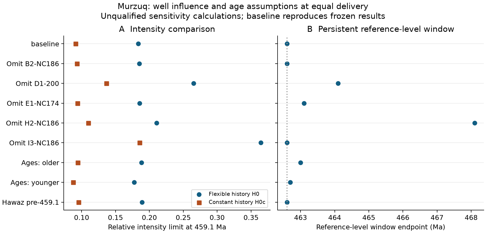
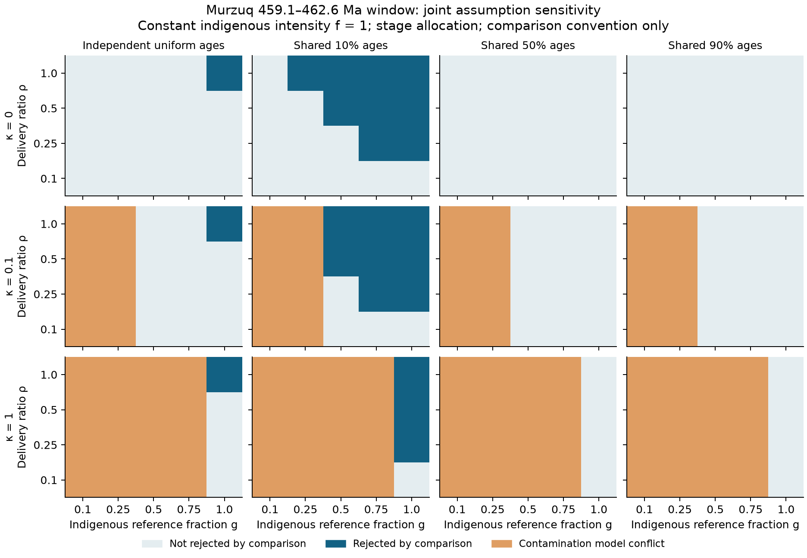

# Loop 2 sprint 1: what the observation process permits

Codex, 1 November 2026. Implemented under `sprints-loop2.md` v2.1. This is the completed
sprint-1 handoff for Claude's review, not the close of Loop 2 or a new qualified empirical result.

## Result

The count gate changes the feasible analysis. Neither Murzuq nor QSIM-801 supplies separate
trilete and cryptospore counts tied to the effort that produced the reported trilete non-detection.
The new count-share method therefore remains a tested protocol handoff. Murzuq receives the
required count-free analysis: observational equivalence, numerical break-even surfaces and
well/chronology sensitivity. Frozen Loop 1 results and qualification evidence are retained.

The substantive new result is that the short reference-level window is sensitive to both the
indigenous fraction of the reference and the allocation of age uncertainty. Under the declared
constant-intensity comparison, equal delivery and independent uniform stage ages, the
459.1–462.6 Ma window changes comparison status when the indigenous reference fraction crosses
**0.9559**, if reference contamination contributes nothing to the older cuts. Under shared
midpoint ages, this interval has **zero sampled exposure**. The data then cannot test it under
that chronology. These are explicit assumption thresholds, not confidence limits or estimates
of contamination. They do not replace the frozen conditional window endpoint.

## Observation evidence

`studies/f3/data/units/loop2/observation/` accounts for all **164 appendix entries**, joined to 158 chart rows:
153 exact matches, 11 unmatched appendix rows and five unmatched chart rows. It retains literal
reports, material identity, barren/caving caveats and the separate counting bases. It neither
recodes E1 nor copies interval percentages to samples. Source pages, hashes and independent
decisive checks are in `audits/2026-11-01-loop2-count-gate.md`.

The 200-particle palynofacies denominator belongs to a different preparation and pooled group
from the E1 slide count plus additional rare-form search. QSIM has 18 exact depth matches between
the two papers, but depth agreement does not establish matched preparation or search effort.
The disputed 10.4% at 695.7 ft is *Micrhystridium*, not cryptospores (Q5).

The reference inventory also prevents a misleading contamination correction: the cuttings
frame has **51 detections among 59 reference units**, whereas the admitted core frame has one
prose-supported detection among five reference units, all in E1-NC174 at different depths.
They are not matched core/cutting observations. Their difference is not an estimate of caving.

## Estimands and identification

Let `r` be total observed reference encounter intensity, `g` its indigenous fraction, `rho`
the older/reference delivery ratio for indigenous spores, `f` constant older indigenous
intensity relative to indigenous reference intensity, and `kappa` the older/reference transfer
ratio for the contaminant component. Each well has one shared `u ~ Gamma(2,2)` effect.
For older unit `i`, `q_i` is the probability of lying in the target interval, or a deterministic
indicator under a shared-age scenario. The probability of its zero, conditional on `u`, is

```
exp[-r u kappa (1-g)] { (1-q_i) + q_i exp[-r u rho g f] }.
```

Reference reports have detection probability `1-exp(-r u)`. The joint likelihood integrates
reference and older observations over each well's shared effect and profiles their common `r`.
This preserves dependence between the two intervals. Both components are assumed to share
the same well effect; this is a scenario model, not an independently established property.

The likelihood depends on the biological/transport parameters only through
`a = rho*g*f` and `b = kappa*(1-g)`. Every admissible tuple preserving `(a,b)` is observationally
equivalent. For example, `(rho,g,f,kappa)=(0.5,0.4,0.2,0.25)` and
`(0.25,0.8,0.2,0.75)` both give `(a,b)=(0.04,0.15)`. If all `q_i=1`, only `a+b` matters;
otherwise equal sums alone generally do not imply equal likelihoods. These are structural
identification statements, distinct from uncertainty around a finite-sample likelihood fit.

Allowing `rho` or `g` to approach zero while `kappa=0` allows any permitted `f`, including
reference-level `f=1`, to approach the no-indigenous-signal likelihood. Thus these binary data
alone cannot identify a nontrivial upper bound on indigenous production over that unrestricted
parameter set. Reference contamination is not automatically harmless: a positive transfer
assumption can instead make the absence of older reports conflict with the contamination model.
Direction of caving supplies no quantitative lower bound on that transfer.

The new `f` is a constant indigenous-intensity ratio. At `g=1,kappa=0`, its origin comparison
matches the frozen **H0c** statistic; it does not reproduce the more permissive H0
exposure-weighted-mean estimand. For windows, `f` is the persistent minimum within the declared
interval, zero outside. Bounds for these different quantities must not be described as an
improvement over each other.

## Quantitative challenges

The numerical grid was committed before computation (`2fe6bef`): 5,760 joint rows across four
delivery ratios, five indigenous fractions, three contaminant transfer ratios, two Hawaz
allocations, four chronology scenarios, four targets and three intensity levels. Another 384
rows record break-even roots and explicit no-root cases. Shared 10%, 50% and 90% ages are fixed,
nondecreasing depth-age scenarios within source ranges, not measured age distributions or a
fitted age-depth model. Coincident ages within a stage are intentional coarse stress cases.

All comparisons use `-2 log(0.05)` as an **uncalibrated convention**. Before interpreting a
candidate, the code flags a contamination model whose `f=0` fit conflicts with the older zeros:
either its conditional all-zero probability at the reference-only fitted rate is below 0.05,
or its profiled deviance against the reference-only fit exceeds the convention. Neither flag
is a calibrated goodness-of-fit test. A weak additional contrast inside a conflicted model
is never reported as support for an old origin.

Selected break-even values for `rho=f=1,kappa=0` are:

| Target | Independent uniform stages: critical g | Shared midpoint ages |
|---|---:|---|
| Constant intensity from 443.1 to 459.1 Ma | 0.0910 | 0.0955 |
| Window 459.1–462.6 Ma | 0.9559 | No exposure; no root |
| Window 459.1–467.1 Ma | 0.2363 | 0.1572 |
| Window 459.1–469.4 Ma | 0.1735 | 0.1572 |

Above a finite critical `g`, the candidate is rejected by this comparison; below it, it is not.
The no-transfer surface is `rho*g*f = a_critical`; the positive-transfer grid additionally
depends on `b`. With all Hawaz ages constrained older than 459.1 Ma, the independent-uniform
short-window threshold is 0.7688. This changes exposure rather than supplying better dating.

The separate 36-case frozen-engine exercise reproduces the four baseline delivery scenarios
and changes one well, boundary-age scenario or allocation at a time. All cases pass the
potential screen and converge. At `rho=1`, H0 intensity limits range from **0.1775 to 0.3646**;
omitting I3 gives the largest limit. Reference-level window endpoints range from **462.6 to
468.1 Ma**; omitting H2 gives the latter. At `rho=1`, every tested case retains unbounded
windows at `f=0.1` and `f=0.01`. These one-at-a-time checks do not establish joint robustness.





The joint grid has 2,304 model-conflict rows, 561 rejected comparisons and 2,895 not rejected.
These are counts of declared scenarios, many observationally equivalent, not probabilities
or proportions of plausible geology. No new primary estimate or biological claim is released.
The full claim/status ledger is `studies/f3/models/loop2/claims.csv`.

## Count-share method and missing evidence

For independent matched-rate Poisson counts, conditioning on each stratum's total gives
`p_i=h_i*theta/(1+h_i*theta)`, where `h_i` is known relative effective effort. The common-effort
implementation transforms an exact one-sided binomial bound. For zero targets in independent
strata, it solves `prod_i(1+h_i*theta)^(-C_i)=alpha`, explicitly conditional on stratum totals
and a common rate ratio. Unknown effective effort with no positive lower bound gives a
vacuous output. The recovered-rate share becomes producer share only through the declared
differential delivery/recovery assumptions.

Exact enumeration over 77 binomial cells gives minimum coverage 0.9504055. Deterministic
misspecification examples show why the assumptions matter: wrong effort can reduce coverage
to approximately zero, and beta-binomial clustering gives 0.3732 versus 0.9763 under the paired
independent example. These examples validate a method and diagnose failure; they do not
qualify a fossil design. Independent review and numerical checks are recorded in
`audits/2026-11-01-loop2-methods-review.md`.

The combined focused suite passes 37 tests. All 5,760 joint reference/null/candidate profiles
converged, and every break-even scan was monotone with valid profiles. An independent adaptive
integration reproduced the effective-intensity root within `3.94e-11`. All 28 frozen
qualification receipts still match their 18 unique bound files; no frozen model, data or output
file changed from the plan baseline. `studies/f3/models/loop2/out/handoff_verification.json` records
these checks. This verifies provenance and computation, not a new coverage claim.

The decisive new observations are specific:

- matched target/control counts with preparation, searched-slide effort and a defensible
  effective-effort ratio; a similarly counted reference is needed for normalisation;
- contamination diagnostics on matched materials, or an independently supported depth-transfer
  relation, to constrain `g` or `kappa` rather than absorb them into `rho`;
- tighter, correlated age control placing actual older units within the short window;
- an independent older/reference frame meeting the same observation contract.

## Handoff

Run commands and the protocol example are in `studies/f3/models/loop2/README.md`. Source/output hashes
and runtime versions accompany each analysis; figures are generated from the CSVs. The new
code and outputs are isolated from the frozen Loop 1 inputs, implementation and qualification
receipts. There is no new binding qualification because no new primary design is admitted.

Claude's next tranche is review of these source mappings, likelihood distinctions and numerical
thresholds, then sprint 2: external-frame admission/replication attempt, the selected M1 affinity
question, M3 ledger requests and the private paper package. An admission failure is not a
failed biological replication. Sprint 1 does not decide any of those pending evidence readings.
